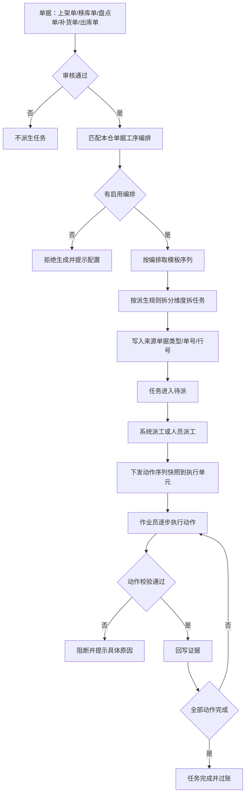
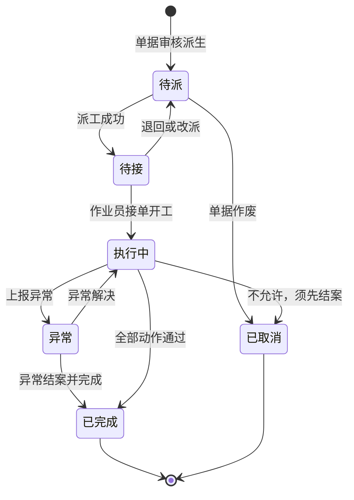
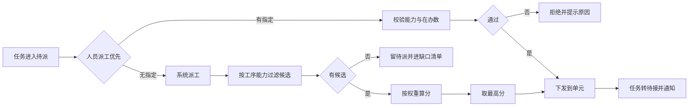
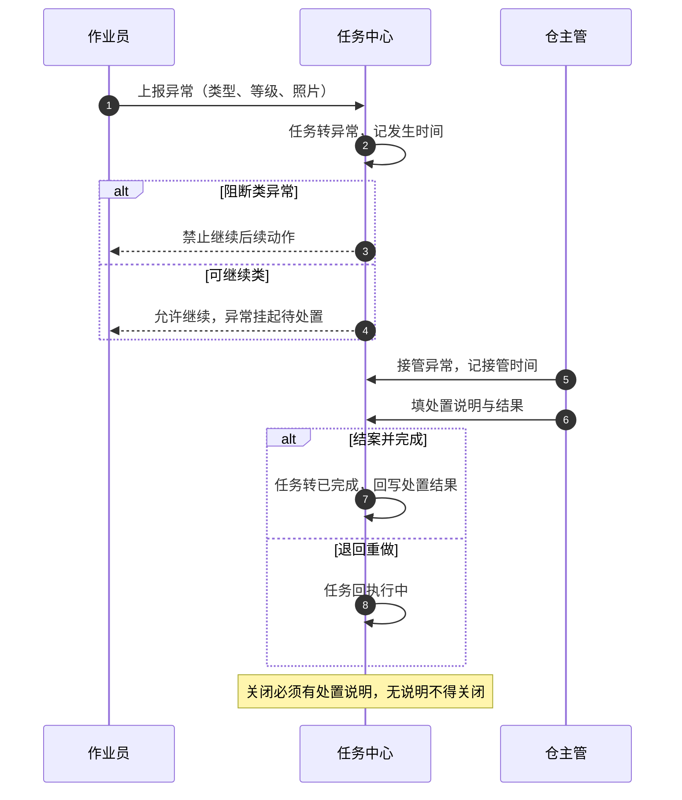

# 任务中心需求文档

| 项 | 内容 |
| --- | --- |
| 编号 | DOC-SPC-006 |
| 状态 | 草稿，待评审 |
| 依赖于 | DOC-BND-001、DOC-MOD-001、DOC-SPC-001、DOC-SPC-002 |
| 被引于 | 无 |

本文只定义**任务从哪来、怎么拆、派给谁、怎么执行、怎么统计**五件事。单据本身的字段与审核规则由仓库单据模块负责，执行单元的资源与契约由 `DOC-SPC-002` 负责，本文不重复。

## 一、背景与目标

### 1.1 业务背景

仓库的一切作业都落在任务上。人做的不是单据，是单据拆出来的一张张任务：把一托货从上架区搬到储位，是移库任务；把一箱货摆到指定库位，是上架任务；把一个库位数一遍，是盘点任务。

任务有三种来源，缺一不可。**其一是单据**。上架单、移库单、盘点单、补货单、出库单审核通过后，按工序链路拆成任务。**其二是工序编排**。一张单据该走哪几道工序、每道工序按什么维度拆分、拆成几张，由单仓的工序编排决定，不写死在代码里。**其三是执行动作**。任务派到人手上之后，作业员每一步做什么、扫什么、验什么、留什么证据，由工序模板里的动作序列决定。

三者是串行依赖：单据不审核，不出任务；工序编排缺失，不知道该拆几道；动作序列缺失，任务派下去人也不知道怎么干。当前原型只有最下游的任务数据，上游三层全缺，所以任务只能手工编，编出来的数据与业务时间对不上。

### 1.2 业务痛点

| 编号 | 问题 | 业务影响 |
| --- | --- | --- |
| P1 | 任务没有来源单据 | 任务表引用 27 个上架单号，其中 20 个查无主档。追溯不到是哪张单、哪个货主、哪批货。 |
| P2 | 拆分规则写在代码里 | 换个仓、换个单据类型就要改代码。客户自建仓无法自定义工序。 |
| P3 | 执行动作没有定义 | 作业员在手持端看到的是硬编码的四个步骤名，没有校验、没有证据，等于纸质单据换了个屏幕。 |
| P4 | 派工凭感觉 | 谁能接什么活、该派给谁、派错了怎么改，没有统一规则。 |
| P5 | 看板无口径 | 任务状态取值三类不统一、超期判定与截止时间互相矛盾，任何统计都要先人工对齐。 |

### 1.3 为什么现在做

- 执行单元已定义清楚「谁能干活」，但「活从哪来」没有定义，两者接不上。
- 原型里的任务数据是手工编的，已经出现时间轴断裂、单据悬空、状态互驳三类问题，继续在上层做看板只会放大缺陷。
- 客户自建仓要求自己配工序，拆分规则必须是数据，不能是代码。

### 1.4 业务目标

| 指标 | 口径 | 目标值 | 优先级 |
| --- | --- | --- | --- |
| 单据到任务的可追溯率 | 能反查到有效来源单据的任务数除以任务总数 | 100% | P0 |
| 派工匹配率 | 派工后无需改派的任务数除以派工总数 | ≥90% | P0 |
| 动作校验覆盖率 | 有校验规则与证据要求的动作数除以动作总数 | ≥95% | P1 |
| 状态口径一致率 | 状态与派工状态、时限判定三者自洽的任务数除以任务总数 | 100% | P0 |

目标值为建议值，评审确认。

### 1.5 非目标

- 单据本身的字段、审核、作废规则（归仓库单据模块）。
- 执行单元的定义、登录、资源池（归 `DOC-SPC-002`）。
- 硬件档案与探活（归 `DOC-SPC-001`、`DOC-SPC-005`）。
- 人员技能档案与排班。
- 绩效与计件工资。
- 跨仓调度与调拨决策。
- 波次合单算法（本期只留接口）。

## 二、读者与使用场景

| 读者 | 关心什么 | 用哪几章 |
| --- | --- | --- |
| 产品与评审 | 任务中心的边界与五件事 | 1、3 |
| 单据模块研发 | 单据如何派生成任务 | 5.1、5.2、11 |
| 配置与实施 | 动作库、工序模板、编排怎么配 | 5.3、5.4、9 |
| 派工员与仓主管 | 任务怎么派、派错了怎么办 | 5.5、5.6、8 |
| 任务中心研发 | 状态机、数据表、契约 | 7、8、11 |
| 看板与报表 | 指标从哪取、口径怎么定 | 7、8、12 |

## 三、范围

### 3.1 五层结构

任务中心的完整链路是五层，上层不成立则下层无意义。

| 层 | 内容 | 当前原型 |
| --- | --- | --- |
| 一、单据层 | 入库单、上架单、移库单、盘点单、补货单、出库单、库存调整单 | 缺。9 份数据文件未迁入 |
| 二、配置层 | 操作动作库、工序模板、单据工序编排、任务派生规则、任务生成与分配 | 缺。归档有 56 条动作、12 个工序节点、4 个模板、29 条编排 |
| 三、任务层 | 按工序拆出的作业任务，带来源单据外键 | 有数据，无来源 |
| 四、动作层 | 任务执行时逐步的动作、校验、证据 | 缺。手持端为硬编码步骤 |
| 五、统计层 | 执行看板、单仓视图、全网视图 | 缺。口径未定 |

### 3.2 本期做

- 单据层到任务层的派生规则与字段契约。
- 配置层五个对象的数据结构与页面。
- 任务层状态机与派工规则。
- 动作层的动作定义、校验、证据回写。
- 统计层的指标口径。

### 3.3 本期不做

见 1.5。

## 四、用户画像与场景

### 4.1 画像

| 角色 | 关心什么 | 系统权限 |
| --- | --- | --- |
| 仓主管 | 今天的活派完了没有，谁闲着，卡在哪 | 派工、改派、查看本仓全部任务 |
| 派工员 | 手上这批任务该给谁，谁的能力够 | 派工、改派、查看本仓资源池 |
| 作业员 | 我接下来做哪张，第一步扫什么 | 接单、执行、上报异常，只看自己的 |
| 实施与配置 | 这个仓的工序怎么配，动作怎么改 | 配置动作库、模板、编排、派生规则 |
| 运营与总部 | 三个仓谁在恶化，缺口在哪 | 跨仓只读、全网视图 |

画像不是系统角色。权限由权限点与数据范围决定，见第十章。

### 4.2 用户操作场景

| 编号 | 场景 | 操作人 | 触发 | 操作与结果 | 对应功能 |
| --- | --- | --- | --- | --- | --- |
| S-TC-01 | 单据审核生成任务 | 仓主管 | 上架单审核通过 | 按本仓编排匹配模板，按拆分维度拆成搬运子任务与上架子任务，写来源单据外键 | FR-TC-01、FR-TC-05、FR-TC-09 |
| S-TC-02 | 编排未配置 | 仓主管 | 本仓该单据类型无启用编排 | 审核拒绝生成，提示先配置编排。不允许用默认规则兜底 | FR-TC-06 |
| S-TC-03 | 配置动作库 | 实施 | 新仓上线 | 从动作库选动作，配输入、校验、证据 | FR-TC-12 |
| S-TC-04 | 配置工序模板 | 实施 | 该工序动作序列不同 | 按执行单元类型配动作序列，同工序可有多套 | FR-TC-13、FR-TC-14 |
| S-TC-05 | 配置单据工序编排 | 实施 | 该仓工序链路不同 | 选模板、排链路、设版本。改动需重新审核 | FR-TC-15、FR-TC-16 |
| S-TC-06 | 配置任务派生规则 | 实施 | 拆分维度不同 | 按工序设拆分维度与尾差策略 | FR-TC-17、FR-TC-18 |
| S-TC-07 | 系统派工 | 系统 | 任务进入待派 | 按能力过滤候选，按规则算分，派给最高分。同分按任务号升序 | FR-TC-20、FR-TC-21 |
| S-TC-08 | 人员派工 | 派工员 | 系统派错或任务紧急 | 手工指定作业员。留痕并记原因 | FR-TC-22 |
| S-TC-09 | 派工无候选 | 系统 | 本仓无可用单元 | 任务留在待派，进缺口清单。不派给不匹配的单元 | FR-TC-24 |
| S-TC-10 | 作业员接单 | 作业员 | 收到推送 | 任务转已接。开始执行时转执行中 | FR-TC-26、FR-TC-27 |
| S-TC-11 | 按动作序列执行 | 作业员 | 执行中 | 逐步扫描、输入、确认。每步校验不通过即阻断并提示 | FR-TC-30、FR-TC-31 |
| S-TC-12 | 上报异常 | 作业员 | 遇到破损、条码不可读 | 选中异常类型，拍照留证，任务转异常。阻断类不得继续 | FR-TC-33、FR-TC-34 |
| S-TC-13 | 异常处置 | 仓主管 | 任务处于异常 | 接管、说明处置方式、结案或退回。留痕 | FR-TC-35、FR-TC-36 |
| S-TC-14 | 改派 | 派工员 | 作业员请假或能力不足 | 任务退回待派或直接改派他人。原作业员收到通知 | FR-TC-22、FR-TC-23 |
| S-TC-15 | 换机续做 | 作业员 | 终端故障 | 新终端登录后任务跟人走，不退回任务池 | FR-TC-28 |
| S-TC-16 | 下班退回 | 作业员 | 交接班 | 未开工任务退回待派，执行中任务不得退回 | FR-TC-29 |
| S-TC-17 | 超期与临期判定 | 系统 | 任务进入未终态 | 按统一口径判定，判定结果随任务行下发，页面不重算 | FR-TC-40、FR-TC-41 |
| S-TC-18 | 查看执行看板 | 仓主管、总部 | 交接班或巡检 | 单仓看动作，全网看差异。跨仓只比改善幅度 | FR-TC-45 |
| S-TC-19 | 无权限操作 | 任意账号 | 越权 | 按钮不可见或接口拒绝 | 10 权限 |
| S-TC-20 | 单据取消 | 仓主管 | 单据作废 | 未开工任务随之取消，执行中任务不得取消，须先结案 | FR-TC-10 |
| S-TC-21 | 单据未审核 | 仓主管 | 查看草稿单 | 草稿与审核中不派生任务。任务页查不到该单的子任务 | FR-TC-03、FR-TC-05 |
| S-TC-22 | 拆分数量不整除 | 实施 | 单据行 100 件按 3 份拆 | 按尾差策略分配，三份之和等于 100，不出现小数 | FR-TC-07、FR-TC-12、FR-TC-14 |
| S-TC-23 | 拆分任务数过多 | 实施 | 单据行数多导致拆出 300 张 | 超过阈值二次确认，可取消 | FR-TC-15 |
| S-TC-24 | 动作停用受阻 | 实施 | 停用一个被模板引用的动作 | 提示引用位置，拒绝停用或要求先解引用 | FR-TC-20 |
| S-TC-25 | 动作缺校验 | 实施 | 新建动作未填校验与证据 | 拒绝保存，提示两者不得同时为空 | FR-TC-18 |
| S-TC-26 | 模板引用了不存在的节点 | 实施 | 保存工序模板 | 保存时校验引用完整性，指出悬空节点 | FR-TC-28 |
| S-TC-27 | 编排改版 | 实施 | 本仓该单据类型改链路 | 存为草稿，重新审核后生效。已生成任务按旧版本执行 | FR-TC-25、FR-TC-26、FR-TC-27 |
| S-TC-28 | 编排回滚 | 实施 | 新版本出问题 | 回滚到历史版本，记操作人与原因 | FR-TC-27 |
| S-TC-29 | 派工评分与兜底 | 系统 | 多个候选单元 | 按权重算分取最高。资源稀缺时加惩罚分。同分按任务号升序 | FR-TC-31、FR-TC-32、FR-TC-35 |
| S-TC-30 | 退回待派 | 派工员 | 派错人或作业员请假 | 未接单任务退回待派，留痕 | FR-TC-38 |
| S-TC-31 | 离线执行 | 作业员 | 库区信号弱 | 动作队列本地缓存，恢复后按序回传。冲突须人工处置 | FR-TC-50 |
| S-TC-32 | 动作快照隔离 | 作业员 | 执行中动作库被改 | 已下发任务按快照执行，不受改动影响 | FR-TC-46 |
| S-TC-33 | 跳步执行 | 作业员 | 未扫源库位直接扫目标位 | 拒绝，提示先完成上一步 | FR-TC-47、FR-TC-48 |
| S-TC-34 | 改客户端时间 | 作业员 | 试图规避超期判定 | 判定取服务端时间，改客户端无效 | FR-TC-52、FR-TC-55 |
| S-TC-35 | 时限口径查询 | 仓主管 | 质疑某任务为何标超期 | 按配置的基准时间与临期阈值复现判定，取到期时间与异常时限中先到者 | FR-TC-53、FR-TC-54、FR-TC-56 |
| S-TC-36 | 看板跨仓对比 | 总部 | 月度复盘 | 只比改善幅度与组内位置。聚合标覆盖仓数，小样本不排名 | FR-TC-57、FR-TC-58、FR-TC-59 |
| S-TC-37 | 单据删除受阻 | 仓主管 | 删除有任务的上架单 | 拒绝，提示先删除子任务 | FR-TC-09 |
| S-TC-38 | 一人多任务 | 派工员 | 试图给已在办的人再派一张 | 拒绝，提示该人已有在办任务 | FR-TC-37 |
| S-TC-39 | 单据与任务互相反查 | 仓主管 | 从任务查单据，或从单据看子任务 | 双向可跳转，子任务计数与实际一致 | FR-TC-08、FR-TC-02 |
| S-TC-40 | 任务取消 | 仓主管 | 入库计划变更 | 填原因取消，取消件不计入完成率分母 | FR-TC-10、FR-TC-40 |
| S-TC-41 | 单据作废有在办任务 | 仓主管 | 单据需作废但仍有任务执行中 | 拒绝作废，提示先结案或取消。已开工任务不随单据作废 | FR-TC-04 |
| S-TC-42 | 拆分维度按工序分别设定 | 实施 | 同一单据不同工序拆分口径不同 | 拣货按容器、移库按托盘、上架按托盘，各工序独立 | FR-TC-11 |
| S-TC-43 | 动作依赖设备能力 | 作业员 | 本机无拍照能力 | 该动作不可执行，提示缺能力。有兜底方式时走兜底 | FR-TC-19 |
| S-TC-44 | 状态非法迁移 | 系统 | 试图从已完成退回执行中 | 拒绝，状态机只允许正向迁移 | FR-TC-39 |
| S-TC-45 | 状态变更留痕 | 仓主管 | 追溯某任务全过程 | 每条状态变更可取到时间、操作人、前后状态与原因 | FR-TC-42 |
| S-TC-46 | 换机后的任务归属 | 作业员 | 终端坏了换新机 | 任务跟人走，不退回任务池。新单元接续执行 | FR-TC-43 |
| S-TC-47 | 交接班退回 | 作业员、仓主管 | 下班交接 | 未开工任务退回待派。执行中任务不得退回，须先完成或结案 | FR-TC-44 |
| S-TC-48 | 证据缺失提交 | 作业员 | 走了流程但未留证 | 缺证据不得提交，提示缺哪一项 | FR-TC-49 |
| S-TC-49 | 阻断类异常 | 作业员 | 上报商品破损且标阻断 | 任务转异常，禁止继续后续动作，待主管处置 | FR-TC-51 |

## 五、功能需求

### 5.1 任务来源与单据契约

| 编号 | 需求 | 优先级 | 验收口径 |
| --- | --- | --- | --- |
| FR-TC-01 | 任务只能由单据派生，不得手工新建 | P0 | 无创建入口；绕过接口创建被拒 |
| FR-TC-02 | 任务必须带来源单据类型、单据号、行号三字段，且三者可反查 | P0 | 按任务可反查到单据行 |
| FR-TC-03 | 单据审核通过才派生任务。草稿与审核中不派生 | P0 | 草稿单据无任务 |
| FR-TC-04 | 单据作废取消未开工任务，执行中任务须先结案 | P0 | 执行中任务不随单据作废 |
| FR-TC-05 | 一张单据可派生多类工序任务，各类独立编号前缀 | P0 | 上架单可同时出搬运子任务与上架子任务 |
| FR-TC-06 | 本仓无启用编排时拒绝生成任务并提示原因 | P0 | 不静默使用默认规则 |
| FR-TC-07 | 单据行与任务行须数量守恒：拆分后各行计划量之和等于单据行数量 | P0 | 拆分前后计划量相等 |
| FR-TC-08 | 单据状态与任务进度双向可见：单据看子任务计数，任务看来源单据 | P1 | 计数与实际子任务数一致 |
| FR-TC-09 | 单据删除须先删除其全部任务 | P1 | 有任务时删除被拒 |
| FR-TC-10 | 任务取消须填原因，取消后不计入完成率分母 | P0 | 原因必填 |

### 5.2 任务拆分

| 编号 | 需求 | 优先级 | 验收口径 |
| --- | --- | --- | --- |
| FR-TC-11 | 拆分维度三值：容器、托盘、到货批次加 SKU。每道工序独立设定 | P0 | 同一单据不同工序可用不同维度 |
| FR-TC-12 | 尾差策略三值：均摊余数、尾差进最后一份、尾差进第一份 | P1 | 三策略结果可测且总量相等 |
| FR-TC-13 | 拆分结果为子任务，子任务带父单据与父行引用 | P0 | 可上卷 |
| FR-TC-14 | 拆分数量为整数，除不尽按尾差策略处理，不得出现小数 | P0 | 无小数 |
| FR-TC-15 | 拆分后任务数超过阈值（建议 200）须二次确认 | P2 | 提示可取消 |

### 5.3 操作动作库

| 编号 | 需求 | 优先级 | 验收口径 |
| --- | --- | --- | --- |
| FR-TC-16 | 动作是独立对象，字段含编码、名称、类型、执行单元、终端、输入、校验、证据、依赖设备能力 | P0 | 字段齐备 |
| FR-TC-17 | 动作类型八值：扫描、输入、选择、确认、采集、搬运、交接、系统 | P0 | 八类可辨（含系统类） |
| FR-TC-18 | 每个动作须声明校验规则与证据要求，两者不得同时为空 | P0 | 空校验空证据被拒 |
| FR-TC-19 | 动作可声明依赖的设备能力（扫描、打印、称重、拍照） | P1 | 缺能力时该动作不可执行 |
| FR-TC-20 | 动作停用前须检查引用它的工序模板 | P1 | 有引用时停用被拒或告警 |
| FR-TC-21 | 动作库按主体共享，不按仓隔离 | P1 | 动作编码主体内唯一 |

### 5.4 工序模板与单据工序编排

| 编号 | 需求 | 优先级 | 验收口径 |
| --- | --- | --- | --- |
| FR-TC-22 | 工序模板等于工序节点加执行单元类型加动作序列 | P0 | 同一模板可被多单据类型复用 |
| FR-TC-23 | 同一工序可有多套模板，按执行单元类型区分 | P0 | 移库在人工与 AGV 下动作序列不同 |
| FR-TC-24 | 单据工序编排等于仓加单据类型加单据子类型加模板序列加版本 | P0 | 一仓一单据类型一条启用编排 |
| FR-TC-25 | 编排有草稿、审核中、启用、停用四态 | P0 | 只有启用态参与派生 |
| FR-TC-26 | 编排改动须重新审核，已生成任务不受影响 | P0 | 改版后旧任务按旧版本 |
| FR-TC-27 | 编排版本可回滚，回滚须留痕 | P1 | 可查历史版本 |
| FR-TC-28 | 模板与编排的引用完整性在保存时校验，不得存在悬空工序节点 | P0 | 悬空引用被拒 |

### 5.5 派工

| 编号 | 需求 | 优先级 | 验收口径 |
| --- | --- | --- | --- |
| FR-TC-29 | 派工两模式：系统派工与人员派工。两者可并存，人员派工优先 | P0 | 两模式各自可测 |
| FR-TC-30 | 系统派工先按工序要求的能力过滤候选单元，再按规则算分 | P0 | 能力不符的单元不进候选 |
| FR-TC-31 | 评分按权重：人工单元考量负荷、区域、连续性、排队、班次；设备单元考量负荷、区域、排队 | P0 | 权重可配 |
| FR-TC-32 | 资源稀缺时加惩罚分，避免把唯一可用单元占满 | P1 | 惩罚可配 |
| FR-TC-33 | 候选上限默认三，超出不展示，防止候选人过多导致选择困难 | P2 | 可配 |
| FR-TC-34 | 无候选时任务留待派并进缺口清单，不得降级派给能力不符的单元 | P0 | 不产生错误派工 |
| FR-TC-35 | 同分按任务号升序派，保证可复现 | P1 | 重复执行结果一致 |
| FR-TC-36 | 人员派工须填原因，改派须通知原作业员 | P0 | 无原因不可提交 |
| FR-TC-37 | 一人同一时刻最多一个在办任务 | P0 | 违反时拒绝派工 |
| FR-TC-38 | 派工可回退：未接单的任务可退回待派 | P1 | 退回留痕 |

### 5.6 任务状态机

| 编号 | 需求 | 优先级 | 验收口径 |
| --- | --- | --- | --- |
| FR-TC-39 | 任务状态六值：待派、待接、执行中、异常、已完成、已取消 | P0 | 六态可测 |
| FR-TC-40 | 状态迁移只允许正向：待派→待接→执行中→已完成；执行中↔异常；未终态→已取消 | P0 | 非法迁移被拒 |
| FR-TC-41 | 派工状态与任务状态须自洽：未终态不得标已完成，已接单不得无人 | P0 | 不自洽行构建期报错 |
| FR-TC-42 | 状态变更须留痕：时间、操作人、前后状态、原因 | P0 | 历史可查 |
| FR-TC-43 | 换机时任务跟人不退回任务池 | P0 | 换机后任务归属不变 |
| FR-TC-44 | 交接班未开工任务退回待派，执行中不得退回 | P0 | 执行中退回被拒 |
| FR-TC-45 | 执行中任务不得被单据作废或强制作废 | P0 | 须先结案 |

### 5.7 执行与动作

| 编号 | 需求 | 优先级 | 验收口径 |
| --- | --- | --- | --- |
| FR-TC-46 | 任务下发时带动作序列快照，动作库后续改动不影响已下发任务 | P0 | 快照只读 |
| FR-TC-47 | 动作须逐步执行，前一步未通过不得进入下一步 | P0 | 跳步被拒 |
| FR-TC-48 | 动作校验不通过时阻断并给具体原因，不得静默放行 | P0 | 提示到具体字段 |
| FR-TC-49 | 动作证据按定义回写：扫描流水、数量记录、照片、交接单 | P0 | 缺证据时不得提交 |
| FR-TC-50 | 离线执行时动作队列本地缓存，恢复后按序回传，冲突须人工处置 | P1 | 断网可继续 |
| FR-TC-51 | 异常动作（上报异常）触发任务转异常，阻断类异常不得继续后续动作 | P0 | 阻断类强制停 |

### 5.8 时限与看板口径

| 编号 | 需求 | 优先级 | 验收口径 |
| --- | --- | --- | --- |
| FR-TC-52 | 时限判定基准取服务端当前时间，不取客户端时间 | P0 | 改客户端时间无效 |
| FR-TC-53 | 判定基准时间、临期阈值须写入配置并可查，不得分散在多处 | P0 | 口径单点可查 |
| FR-TC-54 | 判定截止时间取任务到期时间与异常处理时限中先到者 | P0 | 两者取小 |
| FR-TC-55 | 判定结果由服务端计算后作为字段下发，页面只展示不重算 | P0 | 页面无判定逻辑 |
| FR-TC-56 | 终态任务不出临期状态，只出正常或已超期 | P1 | 已完成行无临期 |
| FR-TC-57 | 看板单仓视图与全网视图同源同式，汇总层只加权不重算 | P0 | 两视图同指标数值可对上 |
| FR-TC-58 | 看板任何聚合须标覆盖仓数，缺数据不得按零参与平均 | P0 | 覆盖数可见 |
| FR-TC-59 | 跨仓对比只比改善幅度与组内位置，不比绝对值；样本量小于五不进排名 | P0 | 小样本不排名 |

## 六、非功能需求

| 编号 | 要求 | 口径 |
| --- | --- | --- |
| NFR-01 | 单据审核到任务可见不超过五秒 | 建议值，待确认 |
| NFR-02 | 一次派生任务数上限按单据行数与拆分维度估算，超出转异步 | 建议 500 条 |
| NFR-03 | 状态变更、派工、改派、异常处置全留痕 | 审计覆盖率 100% |
| NFR-04 | 动作序列快照保留期与任务证据一致 | 建议九十天 |
| NFR-05 | 手持端动作页在弱网下可继续执行，恢复后补传 | 断网三十秒不中断 |
| NFR-06 | 看板查询响应时间单仓三秒内，全网五秒内 | 单仓百天数据量 |

## 七、数据与字段定义

### 7.1 配置层四对象

| 实体 | 主键 | 关键字段 | 唯一性 |
| --- | --- | --- | --- |
| 操作动作 | 动作编码 | 名称、类型、执行单元、终端、输入、校验、证据、依赖能力、启用状态 | 编码主体内唯一 |
| 工序节点 | 节点编码 | 名称、所属链路、类型、节拍、换算系数 | 编码主体内唯一 |
| 工序模板 | 模板编号 | 节点、执行单元类型、动作序列、状态 | 节点加执行单元类型唯一 |
| 单据工序编排 | 编排编号 | 仓、单据类型、单据子类型、模板序列、版本、状态 | 一仓一单据类型一子类型一条启用编排 |
| 任务派生规则 | 规则编号 | 单据类型、仓、编排号与版本、各工序的拆分维度与尾差策略、缓冲位、派工权重 | 单据类型加仓唯一 |

### 7.2 任务层主表

| 实体 | 主键 | 关键字段 | 唯一性 |
| --- | --- | --- | --- |
| 作业任务 | 任务编号 | 工序、来源单据类型与单号与行号、仓、货主、计划量、单位、状态、派工状态、作业员、执行单元、计划时间、到期时间、开始时间、完成时间、异常标记 | 任务编号唯一 |
| 动作执行记录 | 自增 | 任务、动作编码、序号、输入值、校验结果、证据、操作人、时间 | 只追加 |
| 任务状态历史 | 自增 | 任务、前后状态、原因、操作人、时间 | 只追加 |
| 异常记录 | 异常编号 | 任务、异常类型、等级、是否阻断、发生时间、接管时间、接管人、处置说明、结果、关闭标记 | 关闭须有处置说明 |

### 7.3 字段规则

- 任务只存来源单据的**类型、单号、行号**三个引用，不复制单据字段。需要单据字段时按引用反查。
- 作业员字段只放人。设备走执行单元字段，不得混填。当前数据里 32 行作业员填的是设备名，属缺陷。
- 计划量单位必须与单位字段配套。同一字段不得混装两种单位。
- 时间字段一律精确到秒，同一任务内开始时间早于完成时间。
- 判定类字段（超期、临期）由服务端计算后写入，页面不重算，也不得由页面回写。

### 7.4 与既有数据的差异

当前原型三份任务表与本文契约的差距，供迁移参考。

| 差距 | 现状 | 目标 |
| --- | --- | --- |
| 来源单据悬空 | 27 个上架单号中 20 个无主档 | 全部可反查 |
| 工序混装 | 移库任务表同时装搬运子任务、移库子任务、调整子任务三类 | 按工序分表或加工序字段区分 |
| 派工词表不统一 | 三类任务并集 13 种取值 | 收敛为六态 |
| 作业员填设备名 | 32 行 | 只放人，设备进执行单元字段 |
| 完成时间与开始时间跨三周 | 74 行已完成任务全部晚于截止时间 | 开始与完成在同一时间窗 |
| 时限判定与截止时间矛盾 | 89 行未终态中 38 行判定不一致 | 单一口径 |

## 八、流程与状态机

### 8.0 五层派生总览

### 8.1 任务状态机

状态与派工状态的对应关系，两者必须自洽。

| 任务状态 | 允许的派工状态 | 作业员 |
| --- | --- | --- |
| 待派 | 待派、已退回 | 空 |
| 待接 | 已下发待接收、已推送待领取 | 必填 |
| 执行中 | 已接受、执行中 | 必填 |
| 异常 | 异常挂起 | 必填 |
| 已完成 | 已完成、回报完成 | 必填 |
| 已取消 | 任意 | 可空 |

### 8.2 派工流程图

### 8.3 异常处置流程

## 九、界面与交互

### 9.1 页面清单

| 页面 | 层 | 本期 |
| --- | --- | --- |
| 操作动作库 | 配置 | 列动作、编码、类型、执行单元、校验、证据；新增与停用 |
| 工序模板 | 配置 | 按链路分组列工序节点；右栏配各执行单元的动作序列 |
| 单据工序编排 | 配置 | 按仓与单据类型列编排；版本、状态、模板序列；改动重新审核 |
| 任务派生规则 | 配置 | 按单据类型与仓列规则；各工序拆分维度与尾差策略 |
| 任务生成与分配 | 配置 | 选单据预览拆分结果；显示各工序子任务数与派工候选 |
| 上架作业任务 | 任务 | 列表加状态页签；行可按来源单据反查 |
| 移库作业任务 | 任务 | 同上。搬运子任务与移库子任务分视图或加工序列 |
| 盘点作业任务 | 任务 | 同上 |
| 执行看板 | 统计 | 单仓视图与全网视图两态 |

### 9.2 交互约定

- 配置页保存前校验引用完整性，悬空引用直接拒绝并指出具体行。
- 编排改动以草稿方式提示「链实例需重新审核才生效」，不静默生效。
- 任务页每行提供来源单据链接，点击可反查单据详情。
- 手持端动作页逐步推进，当前步高亮，已完成步显示证据摘要，失败步显示具体原因。
- 看板跨仓对比默认展示改善幅度与组内位置，样本不足时显示原始值与样本数，不给排名。

## 十、权限与安全

### 10.1 权限点

| 权限点 | 动作 | 数据范围要求 |
| --- | --- | --- |
| `task.action.view/edit` | 动作库查看与维护 | 主体 |
| `task.template.view/edit` | 工序模板查看与维护 | 主体 |
| `task.flow.view/edit/audit` | 单据工序编排查看、维护、审核 | 主体 |
| `task.rule.view/edit` | 任务派生规则查看与维护 | 本仓 |
| `task.dispatch` | 派工与改派 | 本仓 |
| `task.view` | 任务查看 | 本仓 |
| `task.execute` | 接单与执行 | 本人 |
| `task.exception.handle` | 异常接管与结案 | 本仓 |
| `task.cancel` | 取消任务 | 本仓 |
| `task.board.view` | 看板查看 | 本仓 |
| `task.board.network` | 全网视图查看 | 主体 |

### 10.2 数据范围

沿用 `DOC-SPC-001` 的三值模型：主体全部、指定仓、本人。范围独立于角色，多角色取并集。

看板的全网视图必须由「主体全部」范围显式授权。单仓数据范围是安全边界，不得靠前端隐藏按钮实现。

### 10.3 职责分离

- 派工与执行不得为同一人（可配开关，默认关闭）。
- 编排审核人与编排维护人不得为同一人（可配开关，默认关闭）。
- 例外须填原因并留痕。

## 十一、约束与依赖

### 11.1 与执行单元的契约

| 字段 | 含义 | 谁提供 |
| --- | --- | --- |
| `unitId` | 单元编号 | `DOC-SPC-002` |
| `operatorId` | 登录人工号 | `DOC-SPC-002` |
| `type` | 单元类型 | `DOC-SPC-002` |
| `warehouse` | 单元所属仓 | `DOC-SPC-002` |
| `zone` | 区域 | `DOC-SPC-002` |
| `shift` | 班次 | `DOC-SPC-002` |
| `status` | 可派、在办、不可派、已释放 | `DOC-SPC-002` |
| `capabilities` | 设备能力与工序能力 | `DOC-SPC-002` |
| `currentTaskIds` | 在办任务 | 本文回写 |

本文按 `operatorId` 派任务，按 `type` 找单元，按 `capabilities` 过滤候选。

### 11.2 与单据模块的契约

| 字段 | 含义 | 谁提供 |
| --- | --- | --- |
| `docType` | 单据类型 | 单据模块 |
| `docNo` | 单据号 | 单据模块 |
| `lineNo` | 单据行号 | 单据模块 |
| `status` | 单据状态，须含审核通过与已作废 | 单据模块 |
| `warehouse` | 单据所属仓 | 单据模块 |
| `qty` | 行计划量 | 单据模块 |

单据审核通过事件触发本文派生。本文回写子任务计数与进度供单据展示。

### 11.3 外部依赖

| 依赖 | 用途 | 状态 |
| --- | --- | --- |
| `DOC-SPC-002` | 资源池与能力 | 第一稿已落 |
| 仓库单据模块 | 单据主档与审核事件 | 待建 |
| 用户中心 | 人员、在岗、技能 | 接口口径待确认 |
| 设备能力 | 扫描、打印、称重、拍照可用性 | 见 `DOC-SPC-001`、`DOC-SPC-005` |
| 统一通知服务 | 任务推送与告警 | 平台承担 |

## 十二、验收标准

P0 骨架十条。

1. 单据审核通过后按编排派生任务，来源单据三字段可反查。
2. 本仓无启用编排时拒绝生成，提示具体原因。
3. 拆分后各行计划量之和等于单据行数量。
4. 系统派工按能力过滤候选，能力不符的单元不出现。
5. 无候选时任务留待派并进缺口清单，不产生错误派工。
6. 一人同时最多一个在办任务，违反时派工被拒。
7. 任务状态六态迁移全部可测，非法迁移被拒。
8. 派工状态与任务状态不自洽的数据在构建期报错。
9. 动作逐步执行，校验不通过阻断并提示到具体字段。
10. 看板单仓与全网视图同指标数值可对上，聚合结果标覆盖仓数。

## 十三、里程碑与待评审确认

### 13.1 里程碑

| 阶段 | 内容 | 出口 |
| --- | --- | --- |
| M0 | 模型评审 | 本稿通过 |
| M1 | 配置层：动作库、工序模板、编排、派生规则 | 配置四页可用，引用完整性校验通过 |
| M2 | 任务层：派生、派工、状态机 | 验收一至八条过 |
| M3 | 动作层：动作快照、逐步执行、证据回写 | 验收第九条过 |
| M4 | 统计层：单仓与全网看板 | 验收第十条过 |

顺序不可颠倒。配置层不成立时，任务层只能编数据。

### 13.2 待评审确认

| 编号 | 待确认事项 | 建议 |
| --- | --- | --- |
| Q-01 | 单据工序编排是主体共享还是按仓独立 | 建议按仓独立。同一主体下不同仓的作业方式不同，共享会导致改一仓影响全主体 |
| Q-02 | 搬运子任务与移库子任务是否分表 | 建议分表。两者业务语义与生命周期不同，同表已造成口径混乱 |
| Q-03 | 超期判定基准取实时时间还是快照时间 | 建议实时。快照仅用于离线演示包，生产环境须实时 |
| Q-04 | 一个作业员是否允许同时持两张任务 | 建议不允许。物理上一手一设备，同时持两张会造成负荷统计失真 |
| Q-05 | 异常关闭是否强制填处置说明 | 建议强制。无说明的关闭无法复盘 |
| Q-06 | 动作序列快照保留期 | 建议九十天，与任务证据一致 |
| Q-07 | 系统派工的权重是否可按仓配置 | 建议可配。不同仓的作业瓶颈不同 |
| Q-08 | 波次合单是否纳入本期 | 建议不纳入，只留接口。合单算法独立性强，先保证单链正确 |
