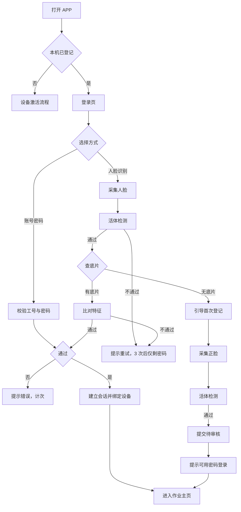

# 作业登录需求文档

| 项 | 内容 |
| --- | --- |
| 编号 | DOC-SPC-004 |
| 状态 | 草稿 |
| 依赖于 | DOC-BND-001、DOC-SPC-001、DOC-SPC-002 |
| 被引于 | 待补 |

## 一、背景与目标

### 1.1 业务背景

作业员在仓内使用 APP 端（安卓手机或 PDA）完成上架、移库、盘点等作业。作业前必须先登录，系统据此确认「谁在用哪台设备作业」。

登录解决两件事。其一是**身份**：确认操作人是谁，任务归属、绩效统计、越权拦截都以此为前提。其二是**设备绑定**：确认用的是哪台设备，派工能查到该终端的在线状态与能力。

仓内劳动密集、人员流动快、换班频繁。登录如果慢或难用，作业员会绕过流程，常见做法是共用账号、代刷、账号长期不退出。这类行为一旦发生，任务归属与作业留痕全部失真，事后追责没有依据。所以登录必须**足够快**，才能让人愿意用。

手机摄像头已经普及，人脸识别在仓内是可行的强认证手段，且比输密码快。但人脸数据有前置条件：后端必须先有该员工的底片。新员工、首次使用的员工没有底片，这是必须处理的主流程，不是异常分支。

### 1.2 业务痛点

| 编号 | 问题 | 业务影响 |
| --- | --- | --- |
| P1 | 账号共用 | 多人共用一个账号。任务归属失真，绩效无法核算 |
| P2 | 密码易泄露 | 密码写在纸上或口头相传。越权操作无法追责 |
| P3 | 登录慢，作业员不愿用 | 频繁登录影响节拍。作业员倾向让账号常驻不退出 |
| P4 | 首次登录无人脸底片 | 若直接报错，新员工无法进入系统，现场卡住 |
| P5 | 换机无记录 | 设备坏了临时换机，谁在何时换了哪台设备查不到 |
| P6 | 代刷与冒用 | 打卡式代登录。实际作业人与系统记录不一致 |

### 1.3 为什么现在做

- APP 端已具备摄像头与人脸采集能力，登录方式可以不止密码。
- 任务是按人归属的。登录不准确，任务归属、负荷统计、绩效全部失真。
- 新员工与临时工占比高，首次登录无底片是高频情况，必须设计清楚。
- 设备与账号的绑定关系是派工的前提。登录时建立绑定，比事后补录可靠。

### 1.4 业务目标

| 编号 | 业务目标 | 衡量指标 | 目标值 | 优先级 |
| --- | --- | --- | --- | --- |
| G1 | 登录快 | 单次登录耗时 | ≤5 秒，人脸 ≤3 秒 | P0 |
| G2 | 归属准 | 任务归属与实际上机人一致率 | 100% | P0 |
| G3 | 首次可用 | 新人首次登录成功率 | ≥98% | P0 |
| G4 | 可追溯 | 登录与换机记录完整率 | 100% | P1 |

目标值为建议值，评审确认。

### 1.5 非目标

- 账号的开户、销户与权限分配（用户中心承担）。
- 短信验证码登录（本期不做，见 13.2 Q-01）。
- 指纹、声纹、虹膜等其他生物识别。
- 单点登录与第三方账号登录。
- 员工考勤与排班打卡。
- 人脸底片的采集设备与活体算法选型。

## 二、读者与使用场景

| 读者 | 关心什么 | 用哪几章 |
| --- | --- | --- |
| 产品与评审 | 范围、目标、登录方式取舍 | 1、3、5、13 |
| 研发 | 登录流程、状态、接口、异常 | 5、7、8、11 |
| 测试 | 验收口径 | 5、12 |
| 实施与仓管 | 首次登记、审核、重置密码 | 4、5、9 |
| 安全与合规 | 生物特征存储、隐私告知 | 5.6、10、11 |

## 三、范围

| 能力块 | 本期做 | 本期不做 |
| --- | --- | --- |
| 账号密码登录 | 工号加密码，错误次数限制与锁定 | 手机号登录、邮箱登录 |
| 人脸识别登录 | 已有底片的比对登录，含活体检测 | 指纹、声纹、虹膜 |
| 人脸首次登记 | 采集、活体、提交、审核、启用 | 自助重采的无限次尝试 |
| 设备绑定 | 登录即绑定当前设备，一账号一活跃设备 | 一账号多设备并行 |
| 会话管理 | 会话有效期、心跳续期、强制下线 | 单点登录（SSO） |
| 换机 | 登出旧机、新机登录、任务跟人 | 多设备同时在线 |
| 安全 | 错误锁定、异地登录提醒、登录留痕 | 风控模型与设备指纹风控 |
| 隐私 | 采集告知、特征值存储、不存原图 | 员工自助删除人脸底片 |

## 四、用户画像与场景

### 4.1 画像

画像不是系统角色。系统权限由权限点与数据范围决定。

| 画像 | 关心什么 | 典型动作 |
| --- | --- | --- |
| 作业员 | 能不能快点开始干活 | 登录、刷脸、换机 |
| 新入职作业员 | 第一次怎么进系统 | 首次登录、人脸登记 |
| 仓主管 | 谁在岗、谁在用哪台设备 | 查看在线人员、强制下线、审核人脸 |
| IT 运维 | 登录故障处理 | 重置密码、解锁账号、处理人脸审核 |
| 安全合规 | 生物特征是否合规 | 审核采集告知与存储方案 |

### 4.2 用户操作场景

下表枚举用户操作。异常与越权也列出。场景编号供验收与评审引用。

| 编号 | 场景 | 操作人 | 触发 | 操作与结果 | 对应功能 |
| --- | --- | --- | --- | --- | --- |
| S-LG-01 | 密码登录 | 作业员 | 上班开机 | 输入工号与密码。校验通过后建立会话，绑定当前设备，进入作业主页 | FR-LG-01、02、10 |
| S-LG-02 | 密码错误 | 作业员 | 输错密码 | 提示剩余次数。连续 5 次错误锁定 15 分钟 | FR-LG-03 |
| S-LG-03 | 人脸登录成功 | 已登记员工 | 上班刷脸 | 采集人脸 → 活体检测 → 比对底片。通过后建立会话并绑定设备 | FR-LG-05、06 |
| S-LG-04 | 首次刷脸无底片 | 新员工 | 首次选择人脸登录 | 系统查不到底片。提示未登记并说明后续步骤，引导进入采集流程。不报错退出 | FR-LG-07 |
| S-LG-05 | 人脸首次登记 | 新员工 | 无底片，点击开始采集 | 采集正脸 → 活体检测 → 提交后端 → 状态待审核。告知审核期间可用密码登录 | FR-LG-08、09、12 |
| S-LG-06 | 人脸审核通过 | 仓主管 | 审核人脸申请 | 查看申请人、采集时间、活体结果。通过后底片生效，可刷脸登录 | FR-LG-11 |
| S-LG-07 | 人脸审核驳回 | 仓主管 | 照片不清或非本人 | 驳回并填原因。员工收到通知后可重新采集 | FR-LG-11、13 |
| S-LG-08 | 活体检测失败 | 作业员 | 用了照片或视频 | 提示活体未通过，要求重新检测。连续 3 次失败转密码登录 | FR-LG-06 |
| S-LG-09 | 换机登录 | 作业员 | 设备坏了或换班 | 旧设备登出或强制下线，新设备登录。任务仍归本人，不退回任务池 | FR-LG-14、15 |
| S-LG-10 | 会话过期 | 作业员 | 长时间未操作 | 超过有效期自动登出，回登录页。有在办任务时先提示再登出 | FR-LG-16 |
| S-LG-11 | 强制下线 | 仓主管 | 员工离岗或设备丢失 | 后台强制下线该账号。该设备立即失效 | FR-LG-17 |
| S-LG-12 | 忘记密码 | 作业员 | 忘记密码 | 提交重置申请。由仓管或 IT 重置，本人不可自助改密码 | FR-LG-18 |
| S-LG-13 | 设备未登记 | 作业员 | 用未登记设备登录 | 提示该设备未登记，需先激活。引导走设备激活流程 | FR-LG-19 |
| S-LG-14 | 越权登录 | 非授权人员 | 尝试登录他人账号 | 密码错误即拒。人脸不比中即拒。连续失败锁定并记告警 | FR-LG-03、06、20 |
| S-LG-15 | 激活码无效 | 作业员 | 输入过期、已用或他机的码 | 分别提示已过期、已被使用、不属于本机。**不计入尝试次数** | FR-LG-23、24 |
| S-LG-16 | 激活时断网 | 作业员 | 仓内信号差 | 提示网络异常并保留输入，可重试。**不得放行进入作业** | FR-LG-26 |
| S-LG-17 | 连续猜错激活码 | 作业员 | 反复输错 | 提示剩余次数，5 次后锁定本机 15 分钟 | FR-LG-25 |

## 五、功能需求

### 5.1 登录方式与入口

本期登录方式两选一，由主体配置默认方式，作业员可在登录页切换。

| 编号 | 需求 | 优先级 | 验收口径 |
| --- | --- | --- | --- |
| FR-LG-01 | 登录方式两值：账号密码、人脸识别。不做短信验证码、邮箱登录 | P0 | 登录页只有两个入口 |
| FR-LG-02 | 作业员可在登录页自由切换两种方式，切换不丢失已输入的工号 | P1 | 切换后工号保留，密码清空 |

### 5.2 账号密码登录

| 编号 | 需求 | 优先级 | 验收口径 |
| --- | --- | --- | --- |
| FR-LG-03 | 工号加密码登录。工号必填且须存在。密码错误提示剩余次数，连续 5 次锁定 15 分钟 | P0 | 5 次错误后锁定。锁定期内正确密码亦拒绝 |
| FR-LG-04 | 密码由用户中心管理，本模块只做校验与错误计数，不存密码明文 | P0 | 库中无明文密码。重置入口跳用户中心 |

### 5.3 人脸识别登录

| 编号 | 需求 | 优先级 | 验收口径 |
| --- | --- | --- | --- |
| FR-LG-05 | 人脸比对前须通过活体检测。检测项含眨眼、转头。未通过不得进入比对 | P0 | 照片与视频无法通过 |
| FR-LG-06 | 活体或比对失败可重试。连续 3 次失败本机转密码登录，当日累计 10 次失败锁定账号 | P0 | 3 次后仅剩密码入口。10 次后锁定 |
| FR-LG-07 | 查无底片时不报错退出。提示未登记，说明后续步骤，引导进入采集流程 | P0 | 无底片可进入采集，不中断 |

### 5.4 人脸首次登记

首次登记是主流程，不是异常。新员工与老员工首次使用均走此路径。

| 编号 | 需求 | 优先级 | 验收口径 |
| --- | --- | --- | --- |
| FR-LG-08 | 采集须正脸、光照充足、面部完整入框。采集失败给出具体原因：光线暗、遮挡、多人入镜 | P0 | 每类失败有独立提示 |
| FR-LG-09 | 采集后做活体检测，通过才允许提交。采集与活体在同一页面内分步完成 | P0 | 未过活体不可提交 |
| FR-LG-10 | 提交后底片状态为待审核。审核期间该员工可用密码登录，不阻塞作业 | P0 | 待审核期间密码登录正常可用 |
| FR-LG-11 | 审核由仓主管或 IT 运维执行。通过则底片生效；驳回须填原因，员工可重新采集 | P0 | 驳回无原因不可提交 |
| FR-LG-12 | 采集页须展示隐私告知：仅采集特征值用于身份核验，不保存原始照片 | P0 | 告知文案常驻可见 |
| FR-LG-13 | 每人同时只允许一条待审核记录。重复提交先作废前一条 | P1 | 重复提交后仅一条有效 |

### 5.5 设备绑定与会话

| 编号 | 需求 | 优先级 | 验收口径 |
| --- | --- | --- | --- |
| FR-LG-14 | 登录成功即绑定当前设备。一个账号同一时刻只有一台活跃设备 | P0 | 第二台设备登录时提示是否顶掉前一台 |
| FR-LG-15 | 换机时旧设备会话结束、旧单元结束，新设备生成新单元。任务跟人走，不退回任务池 | P0 | 换机后在办任务仍归本人 |
| FR-LG-16 | 会话有效期按主体配置，默认 12 小时。心跳续期。有在办任务时过期先提示再登出 | P1 | 过期前给出提示。无任务时直接登出 |
| FR-LG-17 | 后台可强制下线指定账号，该设备立即失效，下次请求即拒绝 | P0 | 强制下线后旧设备无法继续操作 |

### 5.6 安全与留痕

| 编号 | 需求 | 优先级 | 验收口径 |
| --- | --- | --- | --- |
| FR-LG-18 | 密码重置由仓管或 IT 运维执行，员工不可自助修改。重置须留痕 | P0 | 自助改密入口不存在 |
| FR-LG-19 | 未登记设备不允许登录。提示需先激活，并引导至设备激活流程 | P0 | 未登记设备登录被拒 |
| FR-LG-23 | 激活码校验六态：格式不符、码不存在、码已过期、码已被使用、码不属于本机、通过。每态给独立文案，不合并为「操作失败」 | P0 | 六态各自可复现，文案可区分 |
| FR-LG-24 | 尝试次数只统计「码不存在」这一类猜错。码已过期、已使用、不属于本机属码本身无效，不计入次数，避免员工因拿到废码反复重试而被锁 | P0 | 三类无效码连续提交后次数不变 |
| FR-LG-25 | 激活码连续 5 次猜错锁定本机 15 分钟，锁定期内正确码亦拒绝 | P0 | 第 5 次即锁定，第 6 次仍锁定 |
| FR-LG-26 | 激活需联网。离线或请求超时时提示网络异常并可重试，**不得在失败时放行**，也不得本地伪造成功 | P0 | 断网提交被拒且停留在激活页 |
| FR-LG-27 | 激活接口须幂等。同一码重复提交只成功一次；超时重试沿用同一幂等键，避免重复绑定 | P0 | 重试不产生第二条绑定记录 |
| FR-LG-20 | 登录行为全量留痕：账号、设备、方式、时间、IP、结果与失败原因。保留三年 | P0 | 每类结果均可查 |
| FR-LG-21 | 人脸特征值加密存储，与账号解耦。原始照片不落库，仅保留特征向量 | P0 | 库中无原始照片 |
| FR-LG-22 | 同一账号短时间多地登录触发提醒，通知仓主管 | P2 | 触发后生成提醒记录 |

## 六、非功能需求

| 编号 | 要求 | 口径 |
| --- | --- | --- |
| NFR-01 | 密码登录响应 ≤2 秒，人脸比对 ≤3 秒 | 建议值，待确认 |
| NFR-02 | 人脸比对准确率：误识率 ≤1%，拒真率 ≤3% | 由算法供应商保障 |
| NFR-03 | 活体检测防照片、屏幕翻拍、面具 | 按供应商测试报告验收 |
| NFR-04 | 登录接口在弱网（3G）下 5 秒内给出明确结果，不无限转圈 | 断网给超时提示 |
| NFR-05 | 并发登录按在岗人数峰值设计 | 容量公式见 DOC-SPC-002 |
| NFR-06 | 人脸特征值传输全程加密，落库加密 | 传输 TLS，存储国密或同等强度 |

## 七、数据与字段定义

| 实体 | 主键 | 关键字段 | 唯一性 |
| --- | --- | --- | --- |
| 登录账号 | 账号编号 | 工号、姓名、手机号、状态、密码错误次数、锁定至 | 工号唯一 |
| 人脸底片 | 底片编号 | 账号编号、特征向量、采集时间、审核状态、审核人、驳回原因 | 每账号仅一条生效底片 |
| 人脸采集申请 | 申请编号 | 账号编号、特征向量、采集设备、采集时间、状态、审核人、审核时间、驳回原因 | 同账号同时只一条待审核 |
| 登录会话 | 会话编号 | 账号编号、设备编号、登录方式、登录时间、最后心跳、过期时间、状态 | 同账号同时只一条有效会话 |
| 登录记录 | 自增 | 账号、设备、方式、时间、IP、结果、失败原因 | 只追加 |

字段规则五条。

- 密码不入本模块库，只存错误次数与锁定时间。
- 人脸只存特征向量，不存原始照片。
- 特征向量与账号解耦存储，通过底片编号关联。
- 会话与设备一一对应。换机即旧会话结束。
- 登录记录只追加，不改写。

## 八、流程与状态机

### 8.0 登录总流程

### 8.1 人脸登记状态机

| 状态 | 进入条件 | 可做什么 | 退出 |
| --- | --- | --- | --- |
| 未登记 | 账号新建或底片被删 | 发起采集 | 提交后转待审核 |
| 待审核 | 员工提交采集 | 仓主管审核 | 通过转已生效，驳回转已驳回 |
| 已生效 | 审核通过 | 用于人脸登录 | 底片重采时转待审核 |
| 已驳回 | 审核不通过 | 员工重新采集 | 重采后转待审核 |

同一账号同时只允许一条待审核记录。重新提交时前一条自动作废。

### 8.2 会话状态机

| 状态 | 进入条件 | 可做什么 | 退出 |
| --- | --- | --- | --- |
| 已登录 | 认证通过 | 接任务、作业、心跳续期 | 登出、过期、强制下线 |
| 已过期 | 超过有效期未续期 | 只读查看 | 重新登录 |
| 已登出 | 主动登出或换机 | 无 | 重新登录 |
| 已强制下线 | 后台操作 | 无 | 重新登录 |

### 8.3 登录失败处理

- 密码连续 5 次错误，锁定 15 分钟。锁定期内正确密码亦拒绝。
- 人脸连续 3 次失败，本机当次只保留密码入口。
- 同一账号当日人脸累计 10 次失败，锁定账号并告警。
- 所有失败均记录时间、设备、方式与原因。

## 九、界面与交互

| 页面 | 内容 | 动作 |
| --- | --- | --- |
| 登录页 | 两个页签：账号密码、人脸识别。品牌区、工号与密码输入、记住工号、忘记密码 | 登录、切换方式 |
| 人脸识别页 | 人脸框、识别中动效、失败原因 | 重试、改用密码 |
| 未登记提示 | 账号、姓名、人脸状态、后续步骤说明 | 开始采集、改用密码 |
| 采集页 | 人脸框、三步进度：采集正脸、活体检测、提交登记。隐私告知常驻 | 完成采集、取消 |
| 提交结果页 | 提交时间、审核状态、预计时长、审核期间如何作业 | 用密码登录继续 |
| 待审核提示 | 状态与预计时长 | 刷新状态 |

交互四条。

- 登录页默认展示主体配置的默认方式，另一方式一键切换。
- 采集页在活体未通过前，提交按钮不可用。
- 失败提示须给具体原因，不用「操作失败」这类笼统文案。
- 有在办任务时，任何登出动作先二次确认。

## 十、权限与安全

| 权限点 | 动作 | 数据范围 |
| --- | --- | --- |
| `auth.login` | 登录 | 本人 |
| `auth.session.revoke` | 强制下线 | 本仓 |
| `auth.face.review` | 人脸审核 | 本仓 |
| `auth.face.reset` | 删除人脸底片 | 本仓或主体 |
| `auth.password.reset` | 重置密码 | 本仓 |
| `auth.log.view` | 查登录记录 | 本仓或主体 |
| `auth.log.export` | 导出登录记录 | 同查看 |

三条安全规则。

- 生物特征属于敏感个人信息。采集前必须告知并取得同意，告知内容不得省略。
- 特征值加密存储，不与身份信息同表明文关联。
- 权限点与数据范围独立于角色。账号多角色取功能并集，多范围取数据并集。

## 十一、约束与依赖

| 编号 | 约束 |
| --- | --- |
| C-01 | 一账号同一时刻只有一台活跃设备。第二台登录须顶掉前一台 |
| C-02 | 人脸只存特征值，不存原图。原图不落库、可缓存在设备本地并在提交后清除 |
| C-03 | 登录方式只有账号密码与人脸识别两种，不扩短信 |
| C-04 | 会话与设备强绑定，换机必须走登出或强制下线 |
| C-05 | 未登记设备不得登录 |

| 依赖 | 用途 | 状态 |
| --- | --- | --- |
| 用户中心 | 账号来源、密码校验、人员信息 | 接口口径待确认 |
| 人脸算法供应商 | 比对、活体检测、特征提取 | 选型待定 |
| 设备管理（DOC-SPC-001） | 设备登记状态、设备编号 | 已定义 |
| 执行单元（DOC-SPC-002） | 登录后生成单元、一人一单元 | 已定义 |

## 十二、验收标准

1. 登录页只有账号密码与人脸识别两个入口。切换方式不丢失已输入工号。
2. 密码连续 5 次错误锁定 15 分钟，锁定期内正确密码亦拒绝。
3. 密码重置只能由仓管或 IT 运维执行，员工无自助改密入口。
4. 人脸比对前必过活体检测。照片与视频无法通过。
5. 人脸连续 3 次失败后，本机当次只保留密码入口。
6. 无底片时不报错退出，可进入采集流程。
7. 采集须过活体才能提交。提交后状态为待审核。
8. 待审核期间密码登录可用，不阻塞作业。
9. 审核驳回须填原因。员工可重新采集。同账号同时只一条待审核。
10. 登录成功即绑定当前设备。第二台设备登录提示顶掉前一台。
11. 换机后在办任务仍归本人，不退回任务池。
12. 未登记设备登录被拒，并引导至设备激活。
13. 登录记录含账号、设备、方式、时间、IP、结果与原因，保留三年。
14. 库中无人脸原始照片，只有特征向量。
15. 激活码六态文案各自可区分，不出现笼统的「操作失败」。
16. 过期、已用、不属本机的码连续提交不消耗尝试次数；不存在码消耗次数，5 次锁定。
17. 断网时激活被拒并提示网络异常，不进入作业页。
18. 同一激活码重复提交只绑定一次。

## 十三、里程碑与待评审确认

### 13.1 里程碑

| 阶段 | 内容 | 出口 |
| --- | --- | --- |
| M0 | 登录方式与流程评审 | 本稿通过 |
| M1 | P0：密码登录、会话、设备绑定、留痕 | 验收 1 至 5、10 至 14 通过 |
| M2 | P1：人脸登录、首次登记、审核、换机 | 验收 6 至 9 通过 |
| M3 | P2：异地登录提醒、登录统计 | 按需 |

### 13.2 待评审确认

| 编号 | 待确认事项 | 建议 |
| --- | --- | --- |
| Q-01 | 是否做短信验证码登录 | 本期不做。作业场景有工号与密码，人脸作为强认证补充，短信成本高且仓内信号不稳 |
| Q-02 | 人脸登记是否必须审核 | 建议必须。首次采集无历史可比，审核是防代刷的关键。若现场只有一人值守，可配置为「采集即生效 + 事后抽查」 |
| Q-03 | 会话有效期取值 | 默认 12 小时，按班次覆盖。跨班次需重新登录 |
| Q-04 | 一账号能否多设备并行 | 建议不允许。多设备并行会让人被拆成多个资源，派工与负荷统计失真 |
| Q-05 | 人脸算法与活体供应商 | 待选型。需提供误识率、拒真率与防翻拍测试报告 |
| Q-06 | 密码重置的审批层级 | 建议仓管直接重置并留痕，不设审批。现场需要快速恢复 |
| Q-07 | 员工离职后人脸底片如何处理 | 建议随账号停用同步删除，保留删除记录 |
