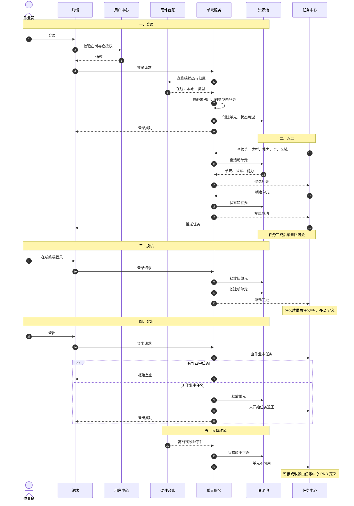

# 执行单元需求文档

| 项 | 内容 |
| --- | --- |
| 编号 | DOC-SPC-002 |
| 状态 | 草稿 |
| 依赖于 | DOC-BND-001、DOC-MOD-001、DOC-SPC-001 |
| 被引于 | 无 |

## 一、背景与目标

### 1.1 业务背景

作业员到岗后领 PDA，或到工位开 PC。任务派给人。人登录终端后，才具备接单与作业的条件。派工员需要知道当前谁在岗、用什么终端、能接什么任务。

执行单元是新模块的一部分。本期从零建设。原型里的静态设备列表只作参考，不作为现状基线。一个作业员可能同时使用 PDA 与 PC。PDA 用于拣货、移库、上架与盘点。PC 用于复核、打印、称重与发货交接。两类终端的作业形态不同，不能混成一个资源。

### 1.2 业务痛点

| 编号 | 问题 | 业务影响 |
| --- | --- | --- |
| P1 | 资源不可见 | 派工前看不到谁已登录、用什么终端、能不能接单。 |
| P2 | 终端与人对不上 | 一人多机、换机、交接班时，业务上没有实时对应关系。 |
| P3 | 能力不清 | 不知道 PC 的外设是否在线。派了打印任务，打印机却离线。 |
| P4 | 状态滞后 | 终端离线或故障后，派工仍按可用处理。 |

### 1.3 为什么现在做

- 一人两终端的作业形态已经出现。单一设备台账表达不了。
- 派工依赖实时资源视图。视图不准，派工就要改派。
- PC 外设参与作业。能力必须按外设在线状态算。

### 1.4 业务目标

承接 `DOC-SPC-001` 的 G4 资源可见。

| 指标 | 口径 | 目标值 | 优先级 |
| --- | --- | --- | --- |
| 资源池准确率 | 抽查单元状态与现场一致数除以抽查数 | ≥95% | P0 |
| 派工匹配率 | 派工后无需改派的任务数除以派工总数 | ≥90% | P0 |

目标值为建议值，评审确认。

### 1.5 非目标

- 系统派工与人员派工。
- 任务池与交接班退回。
- 任务状态机。
- 排班与人员编制。
- AGV 单元。

## 二、读者与使用场景

| 读者 | 关心什么 | 用哪几章 |
| --- | --- | --- |
| 产品与评审 | 单元定义与范围 | 1、3 |
| 研发 | 登录、状态、能力 | 5、7、8 |
| 测试 | 验收口径 | 5、12 |
| 派工与仓管 | 资源池怎么看 | 5、9 |
| 任务中心研发 | 契约字段 | 11 |

## 三、范围

| 能力块 | 本期做 | 本期不做 |
| --- | --- | --- |
| 单元定义 | 人、终端、区域、班次 | 任务归属 |
| 单元类型 | PDA、PC | AGV |
| 登录与登出 | 校验、生成、释放 | 排班 |
| 资源池 | 活动单元、状态、能力 | 系统派工与人员派工 |
| 能力 | 终端加外设加人 | 派工算法 |
| 状态 | 可派、在办、不可派、已释放 | 任务状态 |
| 页面 | 资源池、登录记录、详情 | 任务中心页面 |

页面归属一条：单仓配置 › 执行单元。

本文件只定义资源与契约。派工分系统派工与人员派工两种模式。两种模式的规则、任务池、按类型路由、换机续做、下班退回、改派，全部由任务中心 PRD 承接。

## 四、用户画像与场景

### 4.1 画像

画像不是系统角色。系统权限由权限点与数据范围决定。

| 画像 | 关心什么 | 典型动作 |
| --- | --- | --- |
| 作业员 | 登录哪台终端、能不能接单 | 登录、登出、换机 |
| 派工员或仓主管 | 现在谁能干活 | 看资源池、看能力缺口、强制登出 |
| 设备管理员 | 终端与外设是否可用 | 处理离线与故障 |
| IT 运维 | 登录态与接入 | 排查登录失败、强制登出 |

### 4.2 用户操作场景

下表枚举用户操作。异常与越权也列出。场景编号供验收与评审引用。

| 编号 | 场景 | 操作人 | 触发 | 操作与结果 | 对应功能 |
| --- | --- | --- | --- | --- | --- |
| S-EU-01 | 登录 PDA | 作业员 | 到岗领机 | 输入工号。校验证在岗、终端在线、同仓、未占用、同类型未登录。生成 PDA 单元 | FR-EU-05、06、22 |
| S-EU-02 | 登录 PC | 作业员 | 到工位开机 | 同上。生成 PC 单元，能力含在线外设 | FR-EU-05、06、15 |
| S-EU-03 | 一人两单元 | 作业员 | 上午拣货，下午复核 | 同时登 PDA 与 PC。两单元并存，类型不同 | FR-EU-02、12 |
| S-EU-04 | 同类型第二台 | 作业员 | 已登 PDA-01，再登 PDA-02 | 拒绝，提示先登出旧终端 | FR-EU-07 |
| S-EU-05 | 登录失败 | 作业员 | 终端离线、跨仓、未授权或终端被占用 | 拒绝，给具体原因 | FR-EU-05 |
| S-EU-06 | 换机 | 作业员 | 原终端故障 | 在新终端登录。旧单元释放，新单元生成。任务由任务中心续做 | FR-EU-09 |
| S-EU-07 | 正常登出 | 作业员 | 下班或离岗 | 无作业中任务，释放单元，写登录记录 | FR-EU-08、11 |
| S-EU-08 | 带任务登出 | 作业员 | 有作业中任务时下班 | 拒绝登出，提示先完成 | FR-EU-08 |
| S-EU-09 | 强制登出 | 仓主管、IT 运维 | 终端损坏或人员离岗 | 填原因，释放单元，写审计 | FR-EU-10 |
| S-EU-10 | 查资源池 | 派工员、仓主管 | 派工前 | 按类型、区域、班次、状态、能力、缺口筛选。看可派单元 | FR-EU-11、13、22 |
| S-EU-11 | 看能力缺口 | 派工员 | PC 打印机离线 | 单元缺打印能力。任务被过滤或走兜底 | FR-EU-15、17 |
| S-EU-12 | 查登录记录 | 仓主管、IT 运维 | 追溯登录或排查 | 按人员、终端、时间查会话与登出原因 | FR-EU-14 |
| S-EU-13 | 跨仓查看 | 主体范围账号 | 多仓巡检 | 切换仓，看各仓资源池。数据范围决定可见 | 10 权限 |
| S-EU-14 | 设备故障 | 系统 | 终端离线或故障 | 单元转不可派。任务中心暂停或改派 | FR-EU-19、20 |
| S-EU-15 | 权限不足 | 任意账号 | 越权操作 | 按钮不可见或接口拒绝 | FR-EU-24 |

## 五、功能需求

### 5.1 单元定义

| 编号 | 需求 | 优先级 | 验收口径 |
| --- | --- | --- | --- |
| FR-EU-01 | 单元等于人加已登录终端加区域加班次 | P0 | 四要素齐全才生成 |
| FR-EU-02 | 一人最多一个 PDA 单元加一个 PC 单元 | P0 | 同类型第二台被拒，PDA 与 PC 可并存 |
| FR-EU-03 | 单元是运行时资源。登录生成，登出释放 | P0 | 登出后资源池不再出现 |
| FR-EU-04 | 单元编号按 `EU-工号-类型-序号` 生成 | P1 | 同人同类型编号不重 |

### 5.2 登录与登出

| 编号 | 需求 | 优先级 | 验收口径 |
| --- | --- | --- | --- |
| FR-EU-05 | 登录校验在岗、终端在线、同仓、终端未被占用、同类型未登录 | P0 | 五项任一不过即拒绝 |
| FR-EU-06 | 登录生成单元，记登录时间与区域、班次 | P0 | 资源池可见 |
| FR-EU-07 | 同类型第二台登录拒绝，提示先登出 | P0 | 第二次登录被拒 |
| FR-EU-08 | 登出时该单元有作业中任务必须拒绝 | P0 | 有任务时登出被拒 |
| FR-EU-09 | 换机释放旧单元，生成新单元。任务归属由任务中心处理 | P0 | 旧单元消失，新单元出现 |
| FR-EU-10 | 强制登出需要权限、原因与审计 | P1 | 无权限不可操作 |

### 5.3 资源池

| 编号 | 需求 | 优先级 | 验收口径 |
| --- | --- | --- | --- |
| FR-EU-11 | 资源池只列活动单元，不列已释放 | P0 | 登出后不出现 |
| FR-EU-12 | 按人聚合，同一人两个单元并列显示 | P1 | 一人两行可辨 |
| FR-EU-13 | 按类型、区域、班次、状态、能力、缺口筛选 | P1 | 组合筛选生效 |
| FR-EU-14 | 登录记录按时间查历史会话 | P1 | 可查登录与登出时间 |

### 5.4 能力

| 编号 | 需求 | 优先级 | 验收口径 |
| --- | --- | --- | --- |
| FR-EU-15 | 设备能力等于终端能力加在线外设能力 | P0 | 打印机离线则无打印 |
| FR-EU-16 | 工序能力等于登录人技能 | P0 | 未登录时为空 |
| FR-EU-17 | 缺能力分三态：齐、走兜底、缺 | P1 | 三态可辨 |
| FR-EU-18 | 能力快照随任务证据保存 | P1 | 快照只读 |

### 5.5 状态

| 编号 | 需求 | 优先级 | 验收口径 |
| --- | --- | --- | --- |
| FR-EU-19 | 四态：可派、在办、不可派、已释放 | P0 | 迁移可测 |
| FR-EU-20 | 不可派原因含终端离线、故障、维修、外设缺失、人离岗 | P0 | 原因可见 |
| FR-EU-21 | 状态变更留痕 | P1 | 历史可查 |

### 5.6 页面

| 编号 | 需求 | 优先级 | 验收口径 |
| --- | --- | --- | --- |
| FR-EU-22 | 资源池页展示活动单元 | P1 | 列与筛选齐全 |
| FR-EU-23 | 单元详情展示基本、能力、在办任务、状态历史 | P1 | 段齐全 |
| FR-EU-24 | 按钮按权限点显示，不按角色名判断 | P1 | 无权限按钮不可见 |

## 六、非功能需求

| 编号 | 要求 | 口径 |
| --- | --- | --- |
| NFR-01 | 同一账号同类型只允许一个活动会话 | 登录接口保证 |
| NFR-02 | 资源池刷新五秒内 | 建议值，待确认 |
| NFR-03 | 登录、登出、换机、强制登出全留痕 | 审计覆盖率 100% |
| NFR-04 | PC 端支持 Chrome、Edge 最近两个大版本 | 不作 PDA 页面 |
| NFR-05 | 活动单元峰值按在岗人数算，不按设备总数算 | 容量公式见 `DOC-SPC-001` |

## 七、数据与字段定义

| 实体 | 主键 | 关键字段 | 唯一性 |
| --- | --- | --- | --- |
| 执行单元 | 单元编号 | 人员、类型、终端、仓库、区域、班次、登录时间、登出时间、状态、负荷、在办任务 | 同人同类型同时只有一个活动单元 |
| 登录会话 | 会话编号 | 单元、人员、终端、登录时间、登出时间、登出原因 | 只追加 |
| 能力快照 | 单元加时间 | 设备能力、工序能力、缺口 | 随任务证据存 |
| 单元历史 | 自增 | 单元、状态、时间、操作人 | 只追加 |

字段规则三条。

- 单元只存终端编号引用，不存硬件档案字段。
- 任务字段不归本文件。契约见第 11 章。
- 能力快照只读，不随能力变化回改。

## 八、流程与状态机

### 8.0 时序总览

### 8.1 登录

1. 人登录终端。
2. 校验五项：在岗、终端在线、同仓、终端未被占用、同类型未登录。
3. 生成单元，进资源池。
4. 同类型已有活动单元时拒绝。

### 8.2 登出

1. 检查该单元是否有作业中任务。
2. 有任务，拒绝登出。
3. 无任务，释放单元，写历史。
4. 未开始任务的处理由任务中心 PRD 定义。

### 8.3 换机

1. 人在同类型新终端登录。
2. 旧单元释放，新单元生成。
3. 任务归属由任务中心处理。
4. 能力按新终端与外设重算。

### 8.4 设备故障

1. 终端离线、故障或维修。
2. 单元转不可派。
3. 有作业中任务时，任务状态由任务中心处理。
4. 恢复后单元回可派。

### 8.5 单元状态

| 状态 | 进入 | 可做什么 | 退出 |
| --- | --- | --- | --- |
| 可派 | 登录成功，无在办任务 | 可接单 | 接单转在办 |
| 在办 | 有作业中任务 | 不可再接单 | 完成转可派 |
| 不可派 | 终端异常、外设缺失、人离岗 | 不可接单 | 恢复转可派 |
| 已释放 | 登出或强制登出 | 只读 | 终态 |

## 九、界面与交互

本章在四屏切片评审后回填。当前只登记页面与列，不作最终设计。

| 页面 | 内容 | 动作 |
| --- | --- | --- |
| 资源池 | 单元编号、人员、终端、类型、区域、班次、登录时间、状态、负荷、在办任务、能力、缺口 | 查看、强制登出 |
| 登录记录 | 人员、终端、登录时间、登出时间、原因 | 查看 |
| 单元详情 | 基本、能力、在办任务、状态历史 | 按权限点显示 |

按钮按权限点显示。页面与接口不得按角色名判断。

## 十、权限与安全

| 权限点 | 动作 | 数据范围要求 |
| --- | --- | --- |
| `unit.view` | 查看资源池与详情 | 本仓或主体 |
| `unit.record.view` | 查看登录记录 | 本仓 |
| `unit.login` | 本人在终端登录 | 本人 |
| `unit.logout` | 本人登出 | 本人 |
| `unit.force_logout` | 强制登出 | 本仓 |
| `unit.config` | 单元规则配置 | 主体 |

数据范围独立于角色。角色只装权限点。审计记账号、时间、单元、动作与原因。

## 十一、约束与依赖

### 11.1 与任务中心的契约

| 字段 | 含义 | 谁提供 |
| --- | --- | --- |
| `unitId` | 单元编号 | 本文件 |
| `operatorId` | 登录人工号 | 本文件 |
| `type` | `EXEC-PDA` 或 `EXEC-PC` | 本文件 |
| `warehouse` | 单元所属仓 | 本文件 |
| `zone` | 区域 | 本文件 |
| `shift` | 班次 | 本文件 |
| `status` | 可派、在办、不可派、已释放 | 本文件 |
| `capabilities` | 设备能力与工序能力 | 本文件 |
| `currentTaskIds` | 在办任务 | 任务中心回写 |

任务中心按 `operatorId` 派任务，按 `type` 找单元，按 `capabilities` 过滤候选。派工分系统派工与人员派工两种模式。两种模式的触发条件、分配算法、任务池、交接班退回与改派不在本文件。

### 11.2 业务约束

- 一人最多一个 PDA 单元加一个 PC 单元。
- 同类型同时只有一个活动单元。
- 单元不存硬件档案字段，只引用终端编号。
- 有作业中任务不得登出。
- 登录必须同仓且在岗。

### 11.3 外部依赖

| 依赖 | 用途 | 状态 |
| --- | --- | --- |
| `DOC-SPC-001` | 硬件状态、外设能力 | 第一稿已落 |
| 用户中心 | 人员与在岗状态 | 接口口径待确认 |
| 任务中心 PRD（DOC-SPC-006） | 派工规则与任务状态 | 第一稿已落 |
| PC 代理与 PDA App | 登录态与终端状态 | 原型已模拟 |

## 十二、验收标准

P0 骨架八条。P1 在切片后补。

1. 人登录 PDA 生成单元，资源池可见。
2. 同一人再登 PDA 被拒，登 PC 允许，两单元并存。
3. 同类型第二台登录被拒。
4. 终端离线，单元转不可派，原因可见。
5. 有作业中任务登出被拒。
6. 换机后旧单元释放，新单元生成，能力重算。
7. 资源池按权限与数据范围过滤。
8. 登录、登出、换机、强制登出全留痕。

## 十三、里程碑与待评审确认

### 13.1 里程碑

| 阶段 | 内容 | 出口 |
| --- | --- | --- |
| M0 | 模型评审 | 本稿通过 |
| M1 | P0：登录、登出、资源池、状态 | 验收八条过 |
| M2 | P1：能力、登录记录、权限态 | 切片评审通过 |

### 13.2 待评审确认

| 编号 | 待确认事项 | 建议 |
| --- | --- | --- |
| Q-01 | 换机时任务如何续做 | 任务中心 PRD 定义，本文件只留契约 |
| Q-02 | 强制登出的权限边界 | 仓主管与 IT 运维可强制登出，填原因 |
| Q-03 | 资源池刷新频率 | 五秒 |
| Q-04 | 能力快照保留期 | 随任务证据保留九十天 |
