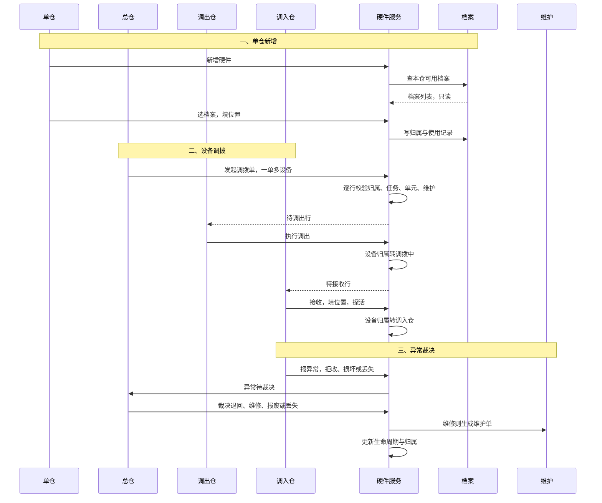
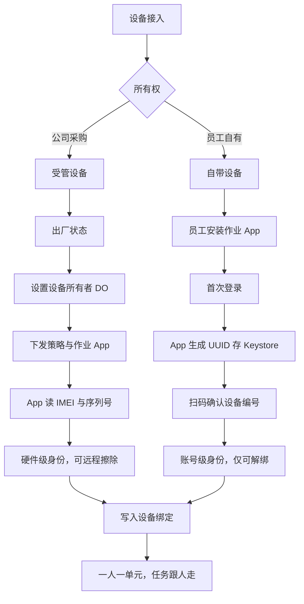
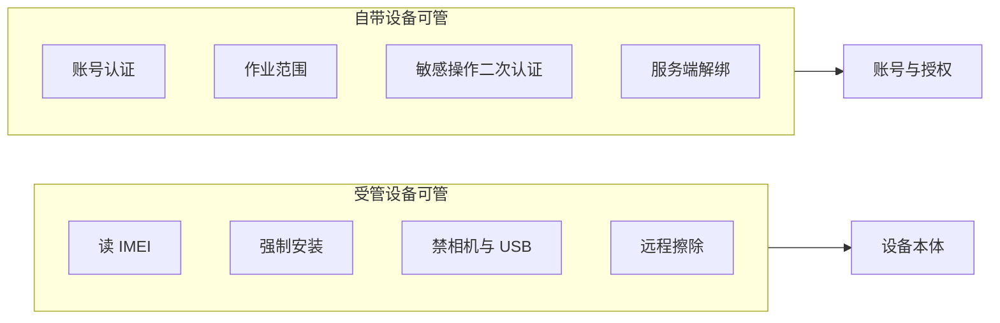
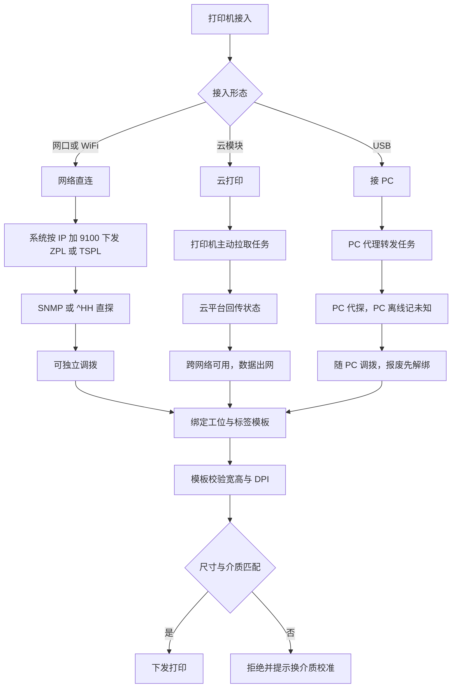
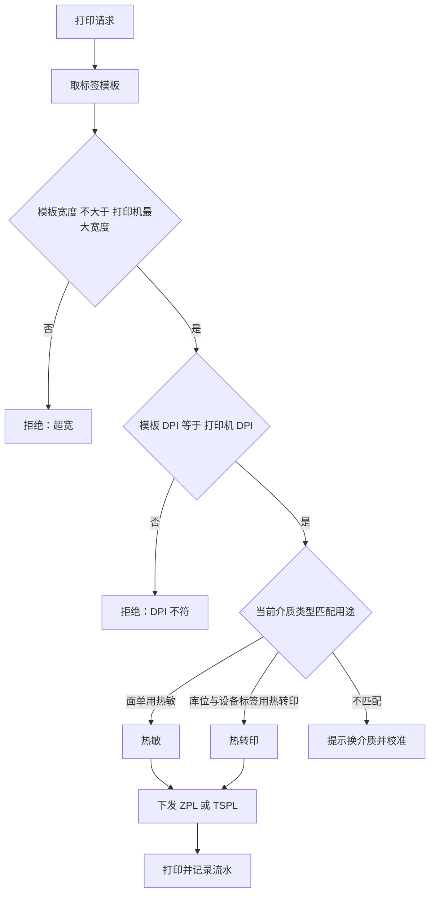

# 硬件管理需求文档

| 项 | 内容 |
| --- | --- |
| 编号 | DOC-SPC-001 |
| 状态 | 草稿 |
| 依赖于 | DOC-BND-001、DOC-MOD-001 |
| 被引于 | DOC-SPC-002 |

## 一、背景与目标

### 1.1 业务背景

本产品服务多主体、多子仓的仓储业务。一个主体下有多个子仓。硬件是仓内作业的入口。作业员用 PDA 扫描与移动作业。复核与打包工位用 PC 连接标签打印机、固定扫码枪、称重机与摄像头。

仓储库存模块是新开发模块。硬件管理是其中一部分。本模块从零建设，不承接旧系统迁移。硬件档案分两层：型号档案记 DT40 这类型号，单台设备记每一台实物。档案按主体统一管。总仓是管理节点，不是实体仓。实物收货与存放发生在实体仓。实物同一时刻只在一个子仓使用。子仓数量与设备规模增长后，各仓自记、Excel、微信群与口头交接撑不住跨仓调拨、资产核对与审计。

### 1.2 业务痛点

| 编号 | 问题 | 业务影响 |
| --- | --- | --- |
| P1 | 档案分散，口径不一 | 同一台设备在多个子仓重复建档。序列号与资产编号对不上。资产账实不符。 |
| P2 | 调拨无单据 | 借调靠电话与群聊。没有调出人、接收人与时间线。丢失或损坏时责任不清。 |
| P3 | 可用性不可见 | 派工前不知道哪台 PDA 或 PC 可用。到岗才发现故障。作业停摆。 |
| P4 | 维修与保修失控 | 故障靠口头报修。维修历史不留。保修与校准到期无人提醒。 |
| P5 | 告警靠人 | 离线、故障、耗材低没有主动通知。发现滞后。 |
| P6 | 资产决策缺数据 | 数量、利用率、故障率、维修成本说不清。采购与报废凭经验。 |

### 1.3 为什么现在做

- 子仓增加，设备进入三百台级。手工台账撑不住跨仓共用。
- 资产核算与审计要求每台设备有档案、归属、调拨与维修记录。
- 作业节拍依赖终端可用性。设备不可用直接造成停线与改派。
- 多仓共用一套档案后，调拨与维修记录必须能跨仓追溯。

### 1.4 业务目标

| 编号 | 业务目标 | 衡量指标 | 目标值 | 优先级 |
| --- | --- | --- | --- | --- |
| G1 | 账实一致 | 账实差异率等于盘点差异数除以应盘数 | ≤1% | P0 |
| G2 | 设备可用 | 设备可用率、平均修复时长 | 可用率 ≥98%，平均修复 ≤4 小时 | P1 |
| G3 | 调拨可追溯 | 调拨闭环率、在途超期数 | 闭环率 100%，超期数 0 | P0 |
| G4 | 资源可见 | 资源池准确率、派工匹配率 | 资源池准确率 ≥95%，派工匹配率 ≥90% | P0 |

目标值为建议值，评审确认。

### 1.5 非目标

- 备件与耗材。
- AGV 与自动化设备。
- 视频监控平台。
- SKU 库存。
- 采购审批与财务折旧。
- 系统派工与人员派工。
- 通知渠道配置（平台统一通知服务承担）。

## 二、读者与使用场景

| 读者 | 关心什么 | 用哪几章 |
| --- | --- | --- |
| 产品与评审 | 范围、目标、优先级 | 1、3、13 |
| 研发 | 实体、状态、权限 | 5、7、8、10 |
| 测试 | 验收口径 | 5、12 |
| 实施与仓管 | 归属、设备使用、调拨 | 5、8、9 |
| 集成商 | 统一通知服务、适配器、用户中心 | 11 |

## 三、范围

| 能力块 | 本期做 | 本期不做 |
| --- | --- | --- |
| 型号档案 | 设备类、型号名、厂商、操作系统、默认能力、默认适配器 | AGV、自动化设备 |
| 单台设备 | 每台实物的序列号、IMEI、MAC、资产编号、保修与生命周期。单仓不维护档案，新增硬件时按档案选择，选择器内只读 | 同时多仓共用 |
| 资产编号 | 本模块生成与维护 | ERP 资产编号、折旧 |
| 设备归属 | 主体共享档案。建档后为未到货。到货接收后写当前仓，转待分配。分配只改状态，不改当前仓。跨仓走调拨 | 同时多仓共用 |
| 设备调拨 | 一单多设备，行级状态 | 库存跨仓调拨 |
| 外设 | 打印、扫码、称重、摄像头四类。外设型号、单台外设、归属、调拨、维护、报废与设备同流程 | 键鼠、显示器、UPS |
| 打印机接入 | 三形态：USB 接 PC、网络直连、云打印。后两者不依赖 PC。标签模板多尺寸与介质校验 | 自建云打印平台、标签设计器 |
| 设备身份 | 设备编号主键加二维码标签。受管设备读 IMEI；自带设备用应用 UUID 加账号绑定 | 应用商店上架与审核 |
| 生命周期 | 待接入、在用、维修中、停用、报废 | 采购审批 |
| 维护 | 故障、保养、校准、耗材更换 | 备件库存、外部 EAM |
| 监控 | 探活、在线、离线、故障 | 视频监控、网络拓扑 |
| 告警 | 七类告警与事件发布 | 通知渠道配置、短信、邮件、电话 |
| 权限 | 权限点、数据范围、审计 | 账号体系、单点登录 |

本模块为新开发。上表本期做的能力从零建设。`proto/admin_warehousedemo.html` 只作交互参考，不是现状基线。原型里的五类设备、设备行带仓库、只读单元页，不作为本模块的约束。

页面归属四条。总仓是管理节点，不是实体仓。到货接收与实物存放只发生在实体仓。

- 总仓管理 › 设备档案：主体级基础数据。管型号、厂商、默认能力、固件版本、设备数。建型号、看版本明细。只管"这个型号长什么样"，不管"这台设备在哪"。
- 总仓管理 › 设备调拨：跨仓调拨单。跨仓是管理动作，故在总仓。
- 单仓配置 › 设备：本仓设备台账、状态、归属、外设、维护、告警。不显示档案字段。到货接收、新增设备时按已分配到本仓的档案选择，选择器内档案只读。
- 单仓配置 › 设备（工位设备视图、设备绑定视图）：工位设备视图看本仓设备摆在哪个工位、挂了哪些外设，工位是实体仓的空间概念；设备绑定视图管本仓员工手机与账号的绑定关系，绑定发生在实体仓的作业人员身上。两视图与设备台账并列，不各占一个页面。

共享范围是主体。一个主体下所有子仓共用一套硬件档案。一台设备同一时刻只属一个仓。未到货、在途与已核销当前仓为空。

## 四、用户画像与场景

### 4.1 画像

画像不是系统角色。系统权限由权限点与数据范围决定。

| 画像 | 关心什么 | 典型动作 |
| --- | --- | --- |
| 作业员 | 手里的终端能不能用 | 登录、报修、摄像头取证 |
| 仓设备管理员 | 本仓设备够不够、在哪 | 到货接收、新增本仓设备、改位置、绑定外设、报修、执行调出、接收 |
| 主体设备管理员 | 全主体档案与调拨 | 建型号、批量新增设备、改档案、分配到仓、发起调拨、异常裁决、报废审批 |
| 资产人员 | 资产编号、保修、报废 | 核对、审批、导出 |
| IT 运维 | 接入、探活、告警 | 配适配器、处理告警、强制登出 |

### 4.2 用户操作场景

下表以设备为主。外设与设备走同一套场景。外设的建档、到货接收、分配、绑定、调拨、维护、报废与审计同样适用。差异见 5.4。外设专有动作单列在 S-HW-34 至 39。

下表枚举用户操作。异常与越权也列出。场景编号供验收与评审引用。

| 编号 | 场景 | 操作人 | 触发 | 操作与结果 | 对应功能 |
| --- | --- | --- | --- | --- | --- |
| S-HW-01 | 总仓新增单台设备 | 总仓设备管理员 | 采购单确认 | 选型号 DT40 这类型号，扫序列号与 IMEI，填资产编号、供应商、采购日期、保修到期。不填仓，状态未到货。生成设备编号与资产编号，打印标签 | FR-HW-01、04、05、34 |
| S-HW-02 | 总仓改档案 | 总仓设备管理员 | 型号、保修或供应商变更 | 改可改字段。设备编号与序列号不可改 | FR-HW-02 |
| S-HW-03 | 查档案与详情 | 总仓设备管理员、资产人员、仓设备管理员 | 查设备、盘点、审计 | 按类型、仓、生命周期、关键词筛选。详情看八段 | FR-HW-03、06 |
| S-HW-04 | 打印设备标签 | 总仓设备管理员、仓设备管理员 | 新设备贴标 | 打印二维码与资产编号。二维码编码设备编号，扫码打开详情 | FR-HW-05 |
| S-HW-05 | 批量导入 | 总仓设备管理员 | 批量到货 | 下载模板，导入，逐行校验。失败行给行号与原因 | FR-HW-04 |
| S-HW-06 | 配置接入与探活 | IT 运维、总仓设备管理员 | 新设备接入或地址变更 | 填适配器、地址、凭据。PDA App 或 PC 代理上报 IMEI、MAC、Android ID，与档案比对。发起探活，记录结果 | FR-HW-01、03、26、31 |
| S-HW-07 | 单仓新增硬件 | 仓设备管理员 | 本仓需要新设备 | 新增硬件，扫标签或按序列号搜索已分配到本仓的档案，确认实物与档案一致。填位置与责任人。写使用记录 | FR-HW-30、31 |
| S-HW-08 | 同仓改位置 | 仓设备管理员 | 设备在仓内挪位 | 改位置或工位。写归属历史。跨仓改归属走调拨 | FR-HW-07、08、09 |
| S-HW-09 | 绑定外设 | 仓设备管理员、IT 运维 | PC 新接打印机、扫码枪、称重机或摄像头 | 选外设与所属 PC，填接口与适配器。一台外设只挂一台 PC | FR-HW-17、18 |
| S-HW-10 | 摄像头取证 | 作业员 | 复核、打包或异常取证 | 调摄像头拍照，产出媒体号。证据随任务保存 | FR-HW-19 |
| S-HW-11 | 总仓发起调拨 | 总仓设备管理员 | 某仓设备不足 | 建单，选调出仓、调入仓与设备。逐行校验归属、任务、单元、维护单 | FR-HW-10 |
| S-HW-12 | 调出仓执行 | 调出仓设备管理员 | 收到待调出行 | 清点，发运，确认调出。设备归属转调拨中 | FR-HW-11 |
| S-HW-13 | 部分调出 | 调出仓设备管理员 | 部分设备未就绪 | 按行执行。未执行行留待调出 | FR-HW-11 |
| S-HW-14 | 调入仓接收 | 调入仓设备管理员 | 收到设备 | 清点，填位置，首次探活。归属转调入仓 | FR-HW-12 |
| S-HW-15 | 调入仓报异常 | 调入仓设备管理员 | 拒收、损坏或丢失 | 按行报异常，填原因。设备保持调拨中 | FR-HW-14 |
| S-HW-16 | 总仓异常裁决 | 总仓设备管理员 | 行异常待裁决 | 选退回、维修、报废或丢失。更新行终态、归属与生命周期 | FR-HW-15 |
| S-HW-17 | 取消调拨 | 总仓设备管理员、调出仓设备管理员 | 发运前取消 | 取消待调出行。待接收与异常不可取消 | FR-HW-13 |
| S-HW-18 | 报修 | 仓设备管理员、作业员 | 设备故障 | 建维护单，填现象与优先级。设备转维修中 | FR-HW-23、24 |
| S-HW-19 | 维护处理与关闭 | IT 运维、仓主管 | 维护单受理 | 处理，换件，填原因、措施、费用、验收人。关闭后设备回在用 | FR-HW-24、25 |
| S-HW-20 | 校准与换耗材 | 仓设备管理员 | 称重机校准到期，打印机耗材低 | 建校准或耗材更换单。填结果、下次校准日期或耗材数量 | FR-HW-23 |
| S-HW-21 | 告警确认与转维修 | 仓设备管理员、IT 运维 | 收到离线、故障、耗材、保修或校准告警 | 确认，转维修或关闭。告警不改任务状态 | FR-HW-28、29 |
| S-HW-22 | 报废审批 | 仓主管、资产人员 | 设备不可修 | 提交报废，校验无任务、无维护单、已解绑。审批通过后转报废 | FR-HW-22 |
| S-HW-23 | 查归属历史 | 仓设备管理员、资产人员 | 审计或追溯 | 看设备归属历史与调拨单。只追加，不改写 | FR-HW-09 |
| S-HW-24 | 导出 | 仓主管、资产人员 | 盘点或审计 | 按当前筛选与数据范围导出，记审计 | FR-HW-06 |
| S-HW-25 | 权限不足或跨仓 | 任意账号 | 越权操作 | 按钮不可见或接口拒绝。单仓不能改档案，不能选跨仓档案 | 10.1、10.2 |
| S-HW-26 | 新仓首次接入 | 总仓设备管理员、新仓设备管理员 | 新仓开仓，设备随货到仓 | 总仓建型号与单台设备，状态未到货。新仓到货接收，写当前仓。总仓确认新仓使用，改归属状态。新仓新增硬件，填位置，探活 | FR-HW-01、05、26、30、33、37 |
| S-HW-27 | 标签损坏补打 | 总仓设备管理员、仓设备管理员 | 机身标签磨损或脱落 | 按序列号或资产编号搜索档案，补打标签。旧标签作废 | FR-HW-05、32 |
| S-HW-28 | 设备指纹不匹配 | 系统 | App 或代理上报的 IMEI、MAC 与档案不符 | 拒绝登录或使用，提示核对实物与档案。防止拿错机或换机冒用 | FR-HW-31 |
| S-HW-29 | 总仓确认本仓使用 | 总仓设备管理员 | 实体仓已收货，确认由本仓使用 | 选待分配设备，确认本仓使用。归属状态转已分配，写历史。目标仓必须等于当前仓，跨仓走调拨 | FR-HW-33 |
| S-HW-30 | 型号建档 | 总仓设备管理员 | 首次引入 DT40 | 填设备类、型号名、厂商、操作系统、默认能力、默认适配器。保存型号档案 | FR-HW-34 |
| S-HW-31 | 批量新增设备 | 总仓设备管理员 | 采购 30 台 DT40 | 选型号，输入数量 30，导入或扫描 30 个序列号与 IMEI。生成 30 台未到货设备与资产编号，打印 30 张标签。不表示已到货 | FR-HW-35 |
| S-HW-32 | 型号停用 | 总仓设备管理员 | 型号停产或淘汰 | 停用型号。已建单台设备不受影响，新增设备不能再选该型号 | FR-HW-36 |
| S-HW-33 | 实体仓到货接收 | 仓设备管理员 | 30 台 DT40 到货 | 扫 30 张标签，核对序列号与 IMEI，记外观。写当前仓为本仓，状态待分配 | FR-HW-37 |
| S-HW-34 | 外设型号建档 | 总仓设备管理员 | 首次引入打印机、扫码枪、称重机或摄像头 | 填外设类、型号名、厂商、接口、默认适配器。保存外设型号档案 | FR-HW-38 |
| S-HW-35 | 批量新增外设 | 总仓设备管理员 | 批量采购外设 | 选型号，输入数量，导入或扫描序列号。生成单台外设、外设编号与资产编号，打印标签。状态未到货 | FR-HW-38 |
| S-HW-36 | 外设到货接收 | 仓设备管理员 | 外设随 PC 或单独到货 | 扫标签，核对序列号，写当前仓，状态转待分配 | FR-HW-39 |
| S-HW-37 | 外设分配 | 总仓设备管理员 | 外设待分配 | 确认本仓使用，只改归属状态，不改当前仓。分配后才能绑定 PC | FR-HW-40 |
| S-HW-38 | 外设随 PC 调拨 | 总仓设备管理员、调出仓、调入仓 | PC 跨仓调拨 | 外设随 PC 同行；独立调拨先解绑。在途外设不可用 | FR-HW-41 |
| S-HW-39 | 外设报废 | 仓主管、资产人员 | 外设不可修 | 校验无未结维护单、已解绑。审批后报废，状态已核销 | FR-HW-42 |
| S-HW-40 | 受管设备配置 DO | 总仓设备管理员、IT 运维 | 采购到货，设备未激活 | 出厂状态设置设备所有者。装 App，下发策略，交付员工。App 保留解除能力 | FR-HW-44、45 |
| S-HW-41 | 自带设备首次绑定 | 作业员 | 员工用自己手机首次登录 | 登录账号，App 自动读取并上报本机 UUID 与型号。输入管理员发放的激活码完成登记。记为常用设备。不采集 IMEI 与位置 | FR-HW-46 |
| S-HW-42 | 自带设备换机 | 作业员、仓主管 | 员工更换自有手机 | 新设备登录记为「新设备」，二次验证后放行。旧绑定作废。频繁换机转主管确认 | FR-HW-47 |
| S-HW-43 | 自带设备丢失或离职 | 仓主管、管理员 | 手机丢失或员工离职 | 强制下线账号或解绑设备。不执行远程擦除。旧设备无法再登录 | FR-HW-49 |
| S-HW-44 | 网络打印机接入 | IT 运维、总仓设备管理员 | 新增网络标签打印机 | 配 IP 入网，登记地址与适配器，探活取 SNMP。设工位与介质模板 | FR-HW-50、51 |
| S-HW-45 | 标签换尺寸 | 仓设备管理员 | 打印不同尺寸标签 | 选模板，校验宽度与 DPI。换介质后在设备上重新校准，登记当前介质 | FR-HW-51 |

## 五、功能需求

### 5.1 单台设备与资产编号（总仓）

| 编号 | 需求 | 优先级 | 验收口径 |
| --- | --- | --- | --- |
| FR-HW-01 | 选型号新增单台设备。型号决定设备类。必填序列号。PDA 填 IMEI，PC 填 MAC。建档不填仓。状态为未到货。生成设备编号与资产编号，打印标签 | P0 | 缺序列号拒绝。序列号主体内唯一。标签可扫码 |
| FR-HW-02 | 设备编号与序列号不可改。型号、供应商、采购日期、保修到期可改 | P0 | 改编号或序列号被拒 |
| FR-HW-03 | 详情八段：档案、接入、外设、归属、生命周期、维护、告警、审计 | P0 | 八段齐全，空态有说明 |
| FR-HW-04 | 建档时生成 `AS-` 加六位流水。主体内唯一，生成后只读 | P0 | 并发建档不重号 |
| FR-HW-05 | 标签二维码编码设备编号。资产编号可打印。标签贴机身 | P1 | 扫码打开详情。标签与设备一一对应 |
| FR-HW-06 | 按类型、仓、生命周期、状态、关键词查询。导出按范围并记审计 | P1 | 范围外不导出 |

### 5.2 设备归属

| 编号 | 需求 | 优先级 | 验收口径 |
| --- | --- | --- | --- |
| FR-HW-07 | 待分配与已分配设备同一时刻只有一个当前仓与位置 | P0 | 第二条有效归属被拒 |
| FR-HW-08 | 跨仓归属变更只走调拨单。同仓位置变更可直接改，写归属历史 | P0 | 跨仓无直接改仓入口。同仓改位置留痕 |
| FR-HW-09 | 归属历史只追加，可追溯到调拨单 | P0 | 每条历史带单号与时间 |
| FR-HW-33 | 总仓确认待分配设备在本仓使用。分配只改归属状态，不改当前仓。目标仓必须等于当前仓，否则走调拨 | P0 | 待分配可分配。跨仓分配被拒 |

### 5.3 设备调拨

| 编号 | 需求 | 优先级 | 验收口径 |
| --- | --- | --- | --- |
| FR-HW-10 | 一单多设备。逐行校验归属、任务、单元、维护单 | P0 | 任一行不合格，该行拒绝发起 |
| FR-HW-11 | 调出仓按行执行，支持部分调出 | P0 | 未执行行留待调出 |
| FR-HW-12 | 调入仓按行接收。位置必填，首次探活成功 | P0 | 缺位置或探活失败拒绝接收 |
| FR-HW-13 | 待调出可取消。待接收与异常不可取消。待接收设备四类操作禁用 | P0 | 取消按钮按行状态显示 |
| FR-HW-14 | 异常含拒收、损坏、丢失。设备保持调拨中 | P0 | 行状态转异常 |
| FR-HW-15 | 裁决含退回、维修、报废、丢失 | P0 | 裁决后行终态，归属同步 |
| FR-HW-16 | 调拨单六页签查询，按权限与范围过滤 | P1 | 范围外单据不返回 |

### 5.4 外设与归属

| 编号 | 需求 | 优先级 | 验收口径 |
| --- | --- | --- | --- |
| FR-HW-17 | 外设限打印、扫码、称重、摄像头四类。按型号新增单台外设，生成外设编号与资产编号。必填型号、接口、适配器。所属 PC 在绑定时必填 | P0 | 缺型号拒绝保存。已分配外设无绑定 PC 不可用 |
| FR-HW-18 | 外设接入分三形态：USB 接 PC、网络直连、云打印。USB 形态必须挂 PC 且与 PC 同仓；网络与云形态不挂 PC，可独立存在与调拨。外设归属状态与设备同五态 | P0 | USB 形态跨仓或重复挂载拒绝。网络形态可独立调拨 |
| FR-HW-19 | 外设能力按在线状态计。摄像头只提供取证与媒体号 | P0 | 无监控平台入口 |
| FR-HW-50 | 打印机三形态接入。USB 形态由 PC 代理转发任务；网络形态直连，系统按 IP 加 9100 端口下发 ZPL 或 TSPL，探活取 SNMP 或 `^HH`；云形态由打印机主动拉取任务。形态与地址记入设备档案 | P0 | 三种形态均可创建与探活。地址缺失拒绝保存 |
| FR-HW-51 | 打印机标签模板多尺寸校验。模板记宽、高与 DPI。保存与下发时校验：模板宽度不超过打印机最大打印宽度；模板 DPI 等于打印机 DPI；换尺寸须登记介质并重新校准。设备档案记当前装载介质与介质类型 | P0 | 超宽、DPI 不符拒绝下发。未登记介质时提示校准 |
| FR-HW-38 | 外设型号与批量新增。选型号，输入数量，生成单台外设、外设编号与资产编号，打印标签。状态未到货 | P0 | 数量与序列号一致。外设编号唯一 |
| FR-HW-39 | 外设到货接收。实体仓扫标签，写当前仓，状态转待分配 | P0 | 未到货可收货，已收货不可重复 |
| FR-HW-40 | 外设分配。总仓确认本仓使用，只改归属状态，不改当前仓。分配后才能绑定 PC | P0 | 跨仓分配被拒，未分配不可绑定 |
| FR-HW-41 | 外设随 PC 调拨。USB 形态随 PC 同行，独立调拨先解绑。网络与云形态可独立调拨。在途外设不可用 | P0 | PC 调拨时 USB 绑定外设同行。网络形态不受限 |
| FR-HW-42 | 外设报废。无未结维护单、已解绑、审批通过。解绑要求仅适用 USB 形态 | P1 | 缺一项拒绝 |

### 5.5 生命周期

| 编号 | 需求 | 优先级 | 验收口径 |
| --- | --- | --- | --- |
| FR-HW-20 | 五态：待接入、在用、维修中、停用、报废 | P0 | 只能在允许迁移间变 |
| FR-HW-21 | 有作业中任务（含所属 PC）不得转维修中、停用、报废 | P0 | 迁移被拒并提示先改派 |
| FR-HW-22 | 报废需无未结维护单、已解绑、审批通过。丢失或处置完成转已核销 | P0 | 缺一项拒绝 |

生命周期对设备与外设同样适用。外设报废前必须解绑 PC。外设随 PC 调拨时，归属状态随 PC 转调拨中，生命周期不变。

### 5.6 维护

| 编号 | 需求 | 优先级 | 验收口径 |
| --- | --- | --- | --- |
| FR-HW-23 | 四类：故障、保养、校准、耗材更换 | P1 | 类型必填 |
| FR-HW-24 | 四态：待受理、处理中、待验收、关闭 | P1 | 状态迁移可测 |
| FR-HW-25 | 关闭必填原因、措施、更换部件、费用、验收人。外部单号可空，非空时唯一 | P1 | 缺项拒绝关闭 |

### 5.7 监控与告警

| 编号 | 需求 | 优先级 | 验收口径 |
| --- | --- | --- | --- |
| FR-HW-26 | 按适配器周期探活，记最近探活时间 | P0 | 探活记录可查 |
| FR-HW-27 | 状态三值：在线、离线、故障。PC 离线时外设为未知 | P1 | 未知不判离线 |
| FR-HW-28 | 七类告警，三态：触发、已确认、已关闭 | P1 | 七类均可触发 |
| FR-HW-29 | 告警事件发布到统一通知服务。本模块不实现渠道配置 | P1 | 事件含编号、类型、级别、对象、仓库、时间、摘要、链接 |

### 5.8 单仓新增硬件

| 编号 | 需求 | 优先级 | 验收口径 |
| --- | --- | --- | --- |
| FR-HW-30 | 单仓新增硬件按档案选择。选择器显示档案字段，只读。只能选已分配到本仓的档案 | P0 | 跨仓、未到货或待分配档案不可选 |

### 5.9 设备身份与标签

设备身份取硬件标识，但可获取范围取决于应用身份与设备所有权。Android 10 起，访问不可重置标识（IMEI、序列号）需 `READ_PRIVILEGED_PHONE_STATE`，该权限为签名级，第三方应用无法声明。例外是设备所有者（DO）与配置文件所有者（PO），仅需 `READ_PHONE_STATE`。

| 应用身份 | 读 IMEI | 条件 |
| --- | --- | --- |
| 普通第三方 App | 否 | 无法声明签名级权限 |
| 设备所有者 / 配置文件所有者 | 是 | 仅需 `READ_PHONE_STATE` |
| 系统签名预装应用 | 是 | 持有 `READ_PRIVILEGED_PHONE_STATE` |

绑定主键是设备编号，不是 IMEI。设备编号由本模块生成，二维码贴机身供盘点与核验时扫码使用。

设备身份由 App 运行时自动读取并上报（受管设备读 IMEI 与序列号，自带设备读应用 UUID 与型号），不需要人拿设备扫自己机身的码，该动作在物理上不成立。

登记与绑定靠激活码：管理员在 PC 侧为每台设备生成一机一码，作业员在本机 App 输入激活码完成登记。未登记设备不能登录接任务。

| 编号 | 需求 | 优先级 | 验收口径 |
| --- | --- | --- | --- |
| FR-HW-31 | 设备指纹绑定。受管设备（DO）上报 IMEI 与序列号；自带设备上报应用 UUID 与设备型号、系统版本。均与档案登记值比对 | P0 | 不一致拒绝登录或使用 |
| FR-HW-32 | 标签补打。按序列号或资产编号搜索档案，补打标签，旧标签作废 | P1 | 补打留记录，旧码不可用 |
| FR-HW-44 | 设备接入类型两值：受管设备、自带设备。接入类型记入归属记录，参与权限与能力判定 | P0 | 类型缺失拒绝保存 |
| FR-HW-45 | 受管设备配置设备所有者（DO）。DO 仅可在出厂或已恢复出厂的设备上设置。App 须内置解除设备所有者能力，否则恢复出厂亦无法移除管控 | P0 | 已激活设备设 DO 被拒。解除后可正常移交 |
| FR-HW-46 | 自带设备绑定以账号为准。App 首次启动自动生成应用 UUID 存 Android Keystore 并上报本机型号，凭管理员发放的激活码完成登记，记为账号常用设备。不采集 IMEI、通讯录、相册、位置 | P0 | 首次登录完成绑定。激活码无效拒绝登记。采集范围外字段拒绝写入 |
| FR-HW-47 | 自带设备换机识别。新设备登录记为「新设备」，须二次验证（短信或人脸）后放行。短期内频繁换设备触发风控，要求主管确认 | P0 | 换机不阻断，但须二次验证。频繁换机进入待确认 |
| FR-HW-48 | 自带设备范围控制。可作业的仓与区域由服务端校验，与设备无关。敏感操作在 App 内二次认证。心跳中断的单元退出派工候选 | P0 | 范围外请求被拒。离线单元不进候选 |
| FR-HW-49 | 自带设备回收。离职注销账号并解绑设备，换机重新绑定后旧绑定作废，丢失则强制下线账号。不执行远程擦除 | P0 | 解绑后旧设备无法登录。无远程擦除入口 |

自带设备的技术限制：应用 UUID 存于应用私有区，清除数据、卸载重装或恢复出厂即变。因此 UUID 只作识别线索，不作认证凭据。认证凭据是账号与服务端令牌。

### 5.10 设备型号与批量新增设备

型号档案记 DT40 这类型号。单台设备记每一台实物。一个型号对应多台设备。

| 编号 | 需求 | 优先级 | 验收口径 |
| --- | --- | --- | --- |
| FR-HW-34 | 型号建档。填设备类、型号名、厂商、操作系统、默认能力、默认适配器 | P0 | 同主体同型号名不重复 |
| FR-HW-35 | 批量新增设备。选型号，输入数量，导入或扫描序列号与 IMEI。生成设备编号与资产编号，打印标签 | P0 | 数量与序列号一致。每个设备编号唯一 |
| FR-HW-36 | 型号停用。已建单台设备不受影响，新增设备不能再选该型号 | P1 | 停用后新增设备下拉不出现 |

### 5.11 到货接收

| 编号 | 需求 | 优先级 | 验收口径 |
| --- | --- | --- | --- |
| FR-HW-37 | 实体仓到货接收。扫标签核对序列号与 IMEI，写当前仓与收货记录。状态转待分配 | P0 | 未到货可收货，已收货不可重复 |

## 六、非功能需求

| 编号 | 要求 | 口径 |
| --- | --- | --- |
| NFR-01 | 容量按 N 等于 300 台设备起。外设 M 另算 | 探活 QPS 等于 (N+M) 除以探活周期 T |
| NFR-02 | 首屏两秒内。一轮探活六十秒内。告警事件十秒内发布 | 建议值，待确认 |
| NFR-03 | 档案与归属分开。跨仓变更只走调拨单，同仓改位置留痕 | 待分配与已分配设备一个当前仓。未到货、调拨中与已核销当前仓为空 |
| NFR-04 | 写操作全留痕，审计不可改 | 审计覆盖率 100% |
| NFR-05 | 可用性 99.5% | 建议值，待确认 |
| NFR-06 | 审计保留三年。取证证据保留九十天 | 待合规确认 |

## 七、数据与字段定义

| 实体 | 主键 | 关键字段 | 唯一性 |
| --- | --- | --- | --- |
| 设备型号 | 型号编号 | 设备类、型号名、厂商、操作系统、默认能力、默认适配器、状态 | 同主体同型号名不重复 |
| 单台设备 | 设备编号 | 型号编号、接入类型、序列号、IMEI、MAC、Android ID、资产编号、适配器版本、供应商、采购日期、保修到期、生命周期 | 设备编号、序列号、资产编号主体内唯一。IMEI 与 MAC 不重复 |
| 外设型号 | 型号编号 | 外设类、型号名、厂商、接口、默认适配器、状态 | 同主体同型号名不重复 |
| 单台外设 | 外设编号 | 型号编号、接入形态、所属 PC、IP 地址、资产编号、接口、端口、驱动版本、序列号 | 外设编号、序列号、资产编号主体内唯一 |
| 打印机介质 | 外设编号加介质序号 | 介质类型（热敏/热转印）、宽、高、DPI、装载时间、校准状态 | 同一外设同一时刻只有一种当前介质 |
| 标签模板 | 模板编号 | 用途、宽、高、DPI、适用打印机型号、ZPL 或 TSPL 内容 | 同主体同用途同名不重复 |
| 设备绑定 | 绑定编号 | 账号、设备编号、接入类型、应用 UUID、绑定时间、解绑时间、解绑原因 | 同一账号同一时刻只有一条有效绑定 |
| 设备归属 | 设备编号加生效时间 | 当前仓、位置、负责人、归属状态、调拨单号 | 同一时刻只有一条有效。未到货、调拨中与已核销当前仓为空 |
| 外设归属 | 外设编号加生效时间 | 当前仓、位置、归属状态、调拨单号 | 同一时刻只有一条有效。未到货、调拨中与已核销当前仓为空 |
| 收货记录 | 收货单号 | 收货仓、对象类型、对象编号、收货时间、收货人、外观、备注 | 同一对象未重复收货 |
| 归属历史 | 自增 | 对象类型、对象编号、仓库、位置、生效、失效、调拨单号 | 只追加 |
| 调拨单头 | 调拨单号 `DT-####` | 调出仓、调入仓、发起人、发起时间、状态 | 单号唯一 |
| 调拨行 | 单号加行号 | 设备编号、随行外设、档案快照、行状态、解决方式、执行人、接收人 | 一设备一未结行。随行外设随 PC 同行 |
| 维护单 | 维护单号 | 对象类型、对象编号、类型、状态、原因、措施、部件、费用、外部单号 | 外部单号非空唯一 |
| 告警 | 告警编号 | 对象类型、对象编号、类型、级别、状态、触发时间、确认人、事件编号、发布时间 | 同对象同类型去重 |
| 审计日志 | 自增 | 账号、时间、对象、动作、前后值、权限点、数据范围 | 不可改 |

字段规则六条。

- 档案字段需要主体范围。归属字段需要仓范围。
- 调拨行存档案快照三项：设备类、序列号、资产编号。
- 资产编号格式 `AS-` 加六位流水，生成后不可改。
- 未到货设备没有归属记录。到货接收后写当前仓，状态待分配。分配只改状态，不改当前仓。跨仓走调拨。
- 型号与单台设备是一对多。一个型号对应多台设备。
- 型号停用不影响已建单台设备。新增设备必须选启用中的型号。

设备身份五条。

- 设备编号是系统主键。全局唯一，生成后不改。
- 序列号是厂商唯一标识。建档时扫码或录入。
- 资产编号由本模块生成。打印在标签上。
- 设备指纹取 IMEI、MAC、Android ID。App 或代理上报，系统与档案比对。
- 二维码编码设备编号。标签贴机身。标签损坏按序列号或资产编号补打。

## 八、流程与状态机

### 8.0 时序总览

### 8.0.1 设备身份两条链路

设备身份的可获取范围由所有权决定。受管设备走 DO，可读 IMEI；自带设备走账号，只拿应用 UUID。

受管设备与自带设备的管控边界：

### 8.0.2 打印机三形态接入

### 8.0.3 标签尺寸与介质判定

尺寸不是打印机属性，是介质与模板的属性。一台打印机同一时刻只装一种介质。

### 8.1 设备生命周期

| 状态 | 进入条件 | 可做什么 | 退出 |
| --- | --- | --- | --- |
| 待接入 | 建档，未部署 | 编辑、分配、探活、报废 | 部署完成转在用 |
| 在用 | 有当前仓与位置 | 被登录、报修、调拨、停用 | 维修、停用、报废 |
| 维修中 | 维护单受理 | 维修、换件、校准 | 维护单关闭回在用 |
| 停用 | 暂停使用，已释放单元 | 启用、报废 | 启用回在用，或报废 |
| 报废 | 无任务、无维护单、已解绑、审批通过 | 只读 | 处置完成转已核销 |

生命周期作用于单台设备。型号只有启用与停用两种状态。
### 8.2 归属与调拨

| 对象 | 状态 | 说明 |
| --- | --- | --- |
| 设备归属 | 未到货、待分配、已分配、调拨中、已核销 | 未到货、调拨中与已核销当前仓为空。待分配与已分配当前仓有值 |
| 外设归属 | 未到货、待分配、已分配、调拨中、已核销 | 与设备同状态。已分配时必须有绑定 PC |
| 调拨单头 | 待调出、待接收、异常、已完成、已取消、已核销 | 按行汇总，异常优先 |
| 调拨行 | 待调出、待接收、已完成、异常、已取消、已核销 | 行级独立 |

单头汇总五条。

- 任一行异常，单头异常。
- 无异常且有行待接收，单头待接收。
- 全部已取消，单头已取消。
- 全部已核销，单头已核销。
- 全部终态且至少一行已完成，单头已完成。

### 8.3 异常裁决

| 情形 | 行终态 | 设备归属 | 生命周期 | 后续 |
| --- | --- | --- | --- | --- |
| 拒收退回 | 已完成 | 回撤到调出仓 | 不变 | 退运 |
| 损坏可修 | 已完成 | 转维修仓 | 维修中 | 维护单 |
| 损坏不可修 | 已核销 | 转持有仓 | 报废 | 报废审批 |
| 丢失 | 已核销 | 已核销，无仓 | 报废 | 资产核销 |

### 8.4 维护与告警

维护单四态：待受理、处理中、待验收、关闭。告警三态：触发、已确认、已关闭。

## 九、界面与交互

本章在四屏切片评审后回填。当前只登记页面与页签，不作最终设计。

| 页面 | 页签 | 动作 |
| --- | --- | --- |
| 总仓管理 › 设备档案 | 型号、设备类、厂商、默认能力、固件版本、设备数、状态 | 建型号、看版本明细 |
| 单仓配置 › 设备（设备视图） | 本仓设备台账，按状态分页签；设备类筛选。列：设备编号、名称、设备类、形态、型号、接入类型、当前仓、位置、归属、生命周期、运行状态 | 到货接收、新增设备（按档案选择）、分配、报修、停用、报废 |
| 单仓配置 › 设备（工位设备视图） | 工位编号、仓库、工位类型、工位主机、挂载外设、状态 | 设备挂载、查看与配置 |
| 单仓配置 › 设备（设备绑定视图） | 绑定编号、账号、设备、形态、系统、应用 UUID、首次绑定、最近登录、状态 | 生成邀请码、审批、解绑 |
| 总仓管理 › 设备调拨 | 待调出、待接收、异常、已完成、已取消、已核销 | 发起、调出、接收、报异常、裁决、取消 |
| 外设详情 | 总仓显示档案字段，单仓只显示使用信息 | 绑定 PC、校准、换耗材、报修、停用、报废 |

按钮按权限点显示。页面与接口不得按角色名判断。

## 十、权限与安全

### 10.1 权限点

| 权限点 | 动作 | 数据范围要求 |
| --- | --- | --- |
| `device.usage.view` | 查看本仓设备使用信息 | 本仓 |
| `device.usage.create` | 新增本仓设备（按已分配到本仓的设备选择，档案只读） | 本仓 |
| `device.receipt.create` | 到货接收 | 本仓 |
| `device.archive.view/create/edit` | 查看、建档、改档案。仅总仓 | 主体 |
| `device.model.view/create/edit/disable` | 型号查看、建档、编辑、停用 | 主体 |
| `device.asset.view` | 查看资产编号。仅总仓 | 主体 |
| `device.assignment.edit` | 确认本仓使用。仅总仓 | 主体 |
| `device.location.edit` | 同仓位置变更 | 本仓 |
| `device.transfer.view` | 查看调拨单 | 任一端 |
| `device.transfer.create/cancel` | 发起、取消 | 两端或调出仓 |
| `device.transfer.execute` | 执行调出 | 调出仓 |
| `device.transfer.receive/reject` | 接收、报异常 | 调入仓 |
| `device.transfer.resolve` | 裁决 | 两端 |
| `device.transfer.export` | 导出 | 同查看 |
| `device.transfer.sod.override` | 职责分离例外 | 主体 |
| `device.peripheral.view/edit` | 外设查看、增改与绑定 | 目标仓 |
| `device.peripheral.receive` | 外设到货接收 | 本仓 |
| `device.peripheral.assign` | 外设分配 | 主体 |
| `device.peripheral.scrap` | 外设报废 | 本仓或主体 |
| `device.lifecycle.change/scrap` | 迁移、报废 | 本仓或主体 |
| `device.maintenance.view/create/process/close` | 维护单查看、创建、处理、关闭 | 本仓 |
| `device.alarm.view/ack/close` | 告警查看、确认、关闭 | 本仓 |
| `device.do.provision/remove` | 受管设备配置与解除设备所有者 | 主体 |
| `device.byod.bind/unbind` | 自带设备绑定与解绑 | 本仓 |
| `device.byod.risk.confirm` | 频繁换机风控确认 | 本仓 |
| `device.printer.integrate` | 打印机接入配置与探活 | 本仓 |
| `device.printer.media.edit` | 打印机介质与模板登记 | 本仓 |

### 10.2 数据范围

| 取值 | 含义 |
| --- | --- |
| 主体全部 | 主体下所有仓，含新建仓 |
| 指定仓 | 勾选的仓集合 |
| 本人 | 自己经手或使用的记录 |

数据范围独立于角色。角色只装权限点。账号多角色时功能权限取并集，多范围时数据范围取并集。

### 10.3 职责分离与审计

- 配置项 `transfer.sod.enabled` 按主体设置，默认关闭。
- 开启后，同一调拨单同一行的调出执行人不得等于接收人。
- 例外需要 `device.transfer.sod.override` 权限，填原因并留痕。
- 审计记账号、时间、对象、动作、前后值、权限点、数据范围。
- 敏感字段：IMEI、MAC、IP、接入地址。非 IT 范围脱敏。

## 十一、约束与依赖

### 11.1 业务约束

| 编号 | 约束 | 执行点 |
| --- | --- | --- |
| C-01 | 档案按主体共享。待分配与已分配设备同一时刻只有一个当前仓。未到货、调拨中与已核销当前仓为空。分配只改状态，不改当前仓。单仓新增只能选已分配到本仓的设备 | 归属唯一索引、收货校验、分配校验、调拨发起校验、新增校验 |
| C-02 | 调拨不改档案，只改归属 | 调拨接口只写归属与历史 |
| C-03 | 外设只挂一台 PC，且同仓 | 绑定校验 |
| C-04 | 有作业中任务不得调拨、转维修、停用、报废 | 发起与生命周期迁移校验 |
| C-05 | 在途设备不可登录、派工、绑定、开维护单 | 调拨中状态判定 |
| C-06 | 备件、AGV、视频监控平台出界。告警不改任务状态 | 范围、字段与告警接口 |

### 11.2 外部依赖

| 依赖 | 用途 | 状态 |
| --- | --- | --- |
| 统一通知服务 | 告警事件发布与渠道发送。事件含编号、类型、级别、对象、仓库、时间、摘要、链接 | 由平台提供 |
| 用户中心 | 人员与在岗状态 | 接口口径待确认 |
| PC 代理与适配器 | 探活、执行、证据 | 原型已模拟 |
| 外部视频服务 | 摄像头取证与媒体号 | 待接入 |
| 任务中心 | 系统派工与人员派工 | 由任务中心 PRD 承接 |

## 十二、验收标准

P0 骨架八条。P1 与 P2 在切片后补。

1. 建档缺仓、位置、序列号即拒绝。序列号重复即拒绝。
2. 资产编号自动生成，格式与唯一性正确，生成后不可改。
3. 待分配与已分配设备只有一个当前仓。未到货、调拨中与已核销当前仓为空。分配不改仓，跨仓走调拨。同仓改位置写历史。
4. 调拨一单多设备，行级状态可独立推进。
5. 有作业中任务、活动单元或未结维护单时，发起被拒。
6. 待接收设备四类操作全被拒。异常裁决后三者一致。
7. 外设重复挂载或跨仓挂载被拒。PC 离线时外设未知。
8. 权限点与范围控制按钮、接口、查询三处一致。告警不改任务状态。
9. 设备指纹与档案不一致时拒绝登录或使用。补打标签后旧码不可用。
10. 受管设备在出厂状态可设 DO，已激活设备被拒。App 可解除设备所有者后正常移交。
11. 自带设备首次登录完成绑定，换机须二次验证后放行，频繁换机转主管确认。解绑后旧设备无法登录。
12. 自带设备不采集 IMEI 与位置。远程擦除入口不存在。
13. 打印机三形态均可创建与探活。网络形态不依赖 PC，可独立调拨。USB 形态跨仓挂载被拒。
14. 标签模板超宽或 DPI 不符时拒绝下发。换尺寸须登记介质，未登记时提示校准。

## 十三、里程碑与待评审确认

### 13.1 里程碑

| 阶段 | 内容 | 出口 |
| --- | --- | --- |
| M0 | 模型评审 | 本稿通过 |
| M1 | P0：档案、资产编号、归属、调拨、权限 | 验收八条过 |
| M2 | P1：生命周期、维护、监控、告警 | 告警与维护闭环 |
| M3 | P2：导入导出、标签、报表 | 按需 |

### 13.2 待评审确认

| 编号 | 待确认事项 | 建议 |
| --- | --- | --- |
| Q-02 | 异常裁决时限 | 三个工作日，超时升级仓主管 |
| Q-03 | 统一通知服务的事件契约 | 按第 11 章九字段对齐 |
| Q-04 | 称重机校准数据来源 | 设备管理员手工录入，后续接计量系统 |
| Q-05 | 数据保留期 | 审计三年，证据九十天 |
| Q-06 | 公司机与自带机各自占比 | 先统计现状，据此决定是否采购 MDM |
| Q-07 | 自带设备是否允许进入作业流程 | 允许，但须标记接入类型，任务可按类型过滤 |
| Q-08 | 新采购打印机选哪种接入形态 | 选带网口机型，走网络直连；多仓统一管后再上云 |
| Q-09 | 面单与标签是否分两套模板 | 分开。面单固定 100×150 热敏，标签多尺寸热转印 |
| Q-10 | 标签尺寸清单 | 先定五类：100×150、100×100、60×40、40×30、50×30 |
