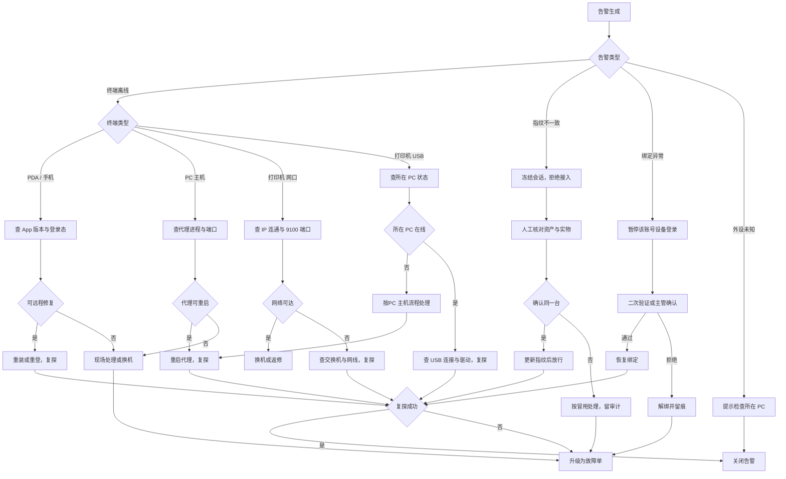
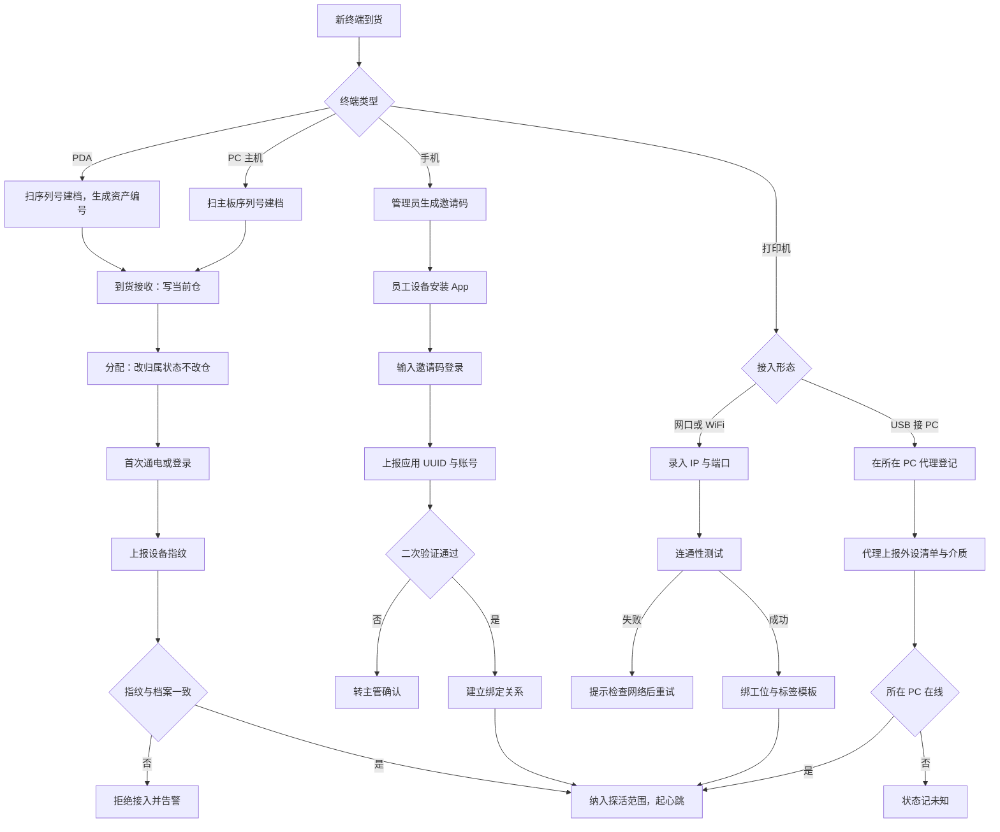
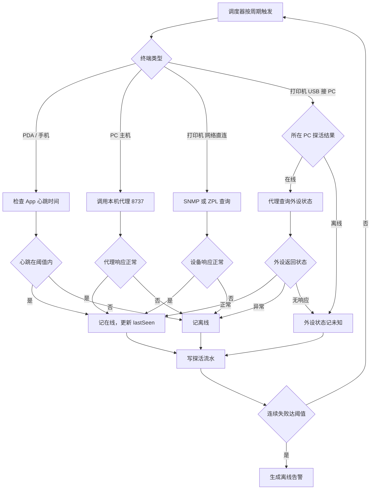
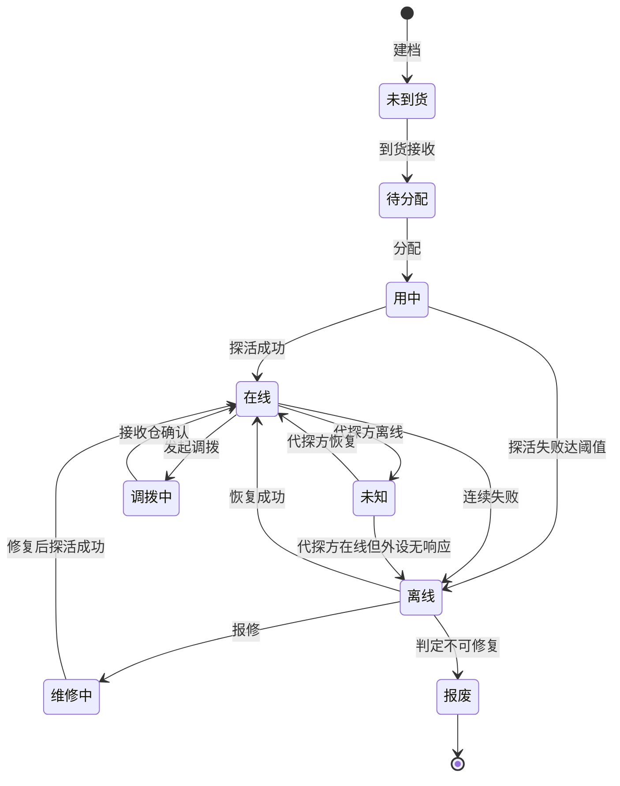

# 终端接入管理与探活需求文档

| 项 | 内容 |
| --- | --- |
| 编号 | DOC-SPC-005 |
| 状态 | 草稿，待评审 |
| 更新日 | 2026-10-30 |
| 依赖于 | DOC-SPC-001（硬件管理）、DOC-MOD-001（硬件与执行单元分工） |
| 范围限定 | 仅 PDA、手机、台式电脑（PC 主机）、打印机（网络直连 / 须接PC 主机两类）。不含 AGV、摄像头、称重机、固定扫码枪 |
| 配套 | 原型改版说明 `reports/原型改版说明-终端接入管理与探活.md`、汇报方案 `reports/设备管理思路.html` |

本文只定义**接入与管理方式、探活机制、状态判定**三件事。型号档案、资产编号、调拨、维护、权限等沿用 DOC-SPC-001，不重复。凡与本文件冲突处，以本文件为准（因本文件更窄、更新）。

## 一、背景与目标

### 1.1 为什么单独立这份文档

DOC-SPC-001 覆盖七类硬件，探活只有两条需求（FR-HW-26、FR-HW-27），不足以回答实施与运维的真问题：

- 网络打印机与 USB 打印机都叫"打印机"，但探活路径完全不同，前者系统直连，后者必须经由所在 PC。
- PC 离线时，挂在它上面的外设该判什么状态，原文档只写"未知不判离线"，没说未知怎么回到在线。
- 手机（BYOD）与 PDA（公司资产）的探活主体不同：前者靠账号绑定关系，后者靠资产归属。

本文件把范围收窄到四类终端（打印机按形态分两类，共五条路径），把探活与状态判定写到底。

### 1.2 目标

| 目标 | 衡量 |
| --- | --- |
| 每台终端都能被系统独立探活，或明确标注探活由谁代理 | 五条探活路径全覆盖，无"不知道谁在探"的终端 |
| 状态判定可解释，同一现象不出现两种结论 | 在线/离线/故障三值与「未知」标记的判定条件唯一 |
| 异常能定位到责任方 | 离线告警带探活方式字段，运维按字段分流 |

### 1.3 非目标

- 不做网络拓扑发现、不做资产盘点、不做远程桌面。
- 不做 MDM（移动设备管理）、不做远程擦除。
- 不做打印内容审计（只记打印流水）。
- 不改 DOC-SPC-001 的档案、资产编号、调拨、维护模型。

## 二、角色与职责

| 角色 | 职责 | 关键权限点 |
| --- | --- | --- |
| 总仓设备管理员 | 建型号、建档、设定探活参数、查看全局探活看板 | `hw:model:*`、`hw:device:create`、`hw:probe:config` |
| 单仓设备管理员 | 到货接收、分配、绑定工位、处理本仓离线告警 | `hw:device:receive`、`hw:device:assign`、`hw:alert:handle` |
| 仓管/作业员 | 使用终端、上报故障、扫码上报设备编号 | `hw:device:report` |
| 运维 | 处理离线与故障、重启代理、查网络 | `hw:device:maintain`、`hw:probe:retry` |
| 主管 | 审批自带设备绑定、裁决异常 | `hw:binding:approve`、`hw:exception:judge` |

数据范围：总仓管理员看主体全部，单仓管理员看本仓，运维按分配的仓，主管按管辖范围。**探活结果不跨仓可见**——A 仓管理员看不到 B 仓设备的在线状态。

## 三、范围

| 终端 | 是否纳入 | 接入与管理方式 | 探活路径 |
| --- | --- | --- | --- |
| PDA | 是 | 公司资产，建档 → 到货 → 分配 → 登录绑定 | 设备自身 App 心跳 |
| 手机（BYOD） | 是 | 员工私产，邀请码 → 登录 → 绑定审批 | 设备自身 App 心跳 |
| 台式电脑（PC 主机） | 是 | 公司资产，建档 → 到货 → 绑工位 | 本机代理心跳 |
| 打印机 · 网络直连 | 是 | 建档填 IP → 连通性测试 → 绑工位 | SNMP 或 ZPL 状态查询 |
| 打印机 · 须接PC 主机 | 是 | 在所在 PC 代理上登记，不独立建档 | 所在 PC 代探 |

明确排除（沿用 DOC-SPC-001 的 out 判定）：AGV、摄像头、称重机、固定扫码枪。四者的数据来自外部服务商或宿主机，系统拿不到设备自身状态，管不了。

## 四、管理规则

### 4.1 管理规则

| 编号 | 规则 | 优先级 |
| --- | --- | --- |
| R-01 | 每台纳入管理的终端必须有唯一设备编号，作为系统主键 | P0 |
| R-02 | PDA 与PC 主机必须建档；手机不建档，只记绑定关系 | P0 |
| R-03 | USB 打印机不独立建档，作为所在 PC 的挂载外设登记 | P0 |
| R-04 | 网络打印机必须独立建档，且必须有 IP 与端口 | P0 |
| R-05 | 一台终端同一时刻只属一个仓。在途、未到货时当前仓为空 | P0 |
| R-06 | 终端必须绑定到工位或人。PDA/手机绑人，PC/打印机绑工位 | P1 |
| R-07 | 未纳入探活范围的终端，状态列显示"未接入管理"，不得显示在线 | P1 |

### 4.2 探活参数

| 参数 | 默认值 | 可配置 | 说明 |
| --- | --- | --- | --- |
| 心跳周期 | 60 秒 | 按终端类型 | PDA/手机 60s，PC 代理 60s |
| 离线阈值 | 3 个周期（180s） | 是 | 连续 3 次无成功探活判离线 |
| 直探超时 | 5 秒 | 是 | 网络打印机 SNMP 查询超时 |
| 重试次数 | 1 次 | 是 | 超时后立即重试一次，仍失败才计数 |
| 告警去重窗口 | 30 分钟 | 是 | 同对象同类型告警 30 分钟内不重复生成 |

## 五、探活策略

### 5.1 五条探活路径

| 终端 | 探活方式 | 目标 | 成功判据 | 失败处理 |
| --- | --- | --- | --- | --- |
| PDA | App 心跳 | 长连接报文 | 收到心跳且在阈值内 | 连续 3 次无心跳判离线 |
| 手机 | App 心跳 | 同上，附账号与 UUID | 心跳有效且绑定关系有效 | 同上；绑定失效单独告警 |
| PC 主机 | 代理心跳 | `http://127.0.0.1:8737` | 代理返回版本与挂载外设清单 | 3 次无响应判离线 |
| 打印机（网络） | SNMP / ZPL | `tcp://IP:9100` | SNMP 有响应，或 ZPL 状态查询返回正常 | 超时重试 1 次，仍失败判离线 |
| 打印机（USB） | PC 代探 | 所在 PC 代理 | 代理在线且返回该外设状态 | 所在 PC 离线 → 未知；PC 在线但外设无响应 → 离线 |

### 5.2 状态判定

状态取三值：在线、离线、故障。另有一个独立标记「未知」，不占状态位。

依据 DOC-SPC-001 的 FR-HW-27：「状态三值：在线、离线、故障。PC 离线时外设为未知」。

| 状态 | 判定条件 | 适用终端 |
| --- | --- | --- |
| 在线 | 最近一次探活成功，且时间在离线阈值内 | 全部 |
| 离线 | 连续失败达阈值 | 全部（USB 打印机除外，除非所在 PC 在线） |
| 故障 | 探活通但设备自报故障，或处于维护中 | 全部 |
| 未知（标记，非状态位） | 探活结果不可得 | 仅 USB 打印机，且仅当所在 PC 离线时 |

**判定的三条硬规则：**

1. **未知不等于离线。** 未知表示"没人能替它说话"，设备可能正常工作。不得触发离线告警，只记状态。
2. **USB 打印机的状态由 PC 派生。** PC 在线时按代理返回结果判；PC 离线时一律判未知，不判离线。
3. **在途终端不判定。** 调拨中、未到货的终端不做探活，状态不参与统计。

### 5.3 探活流水

每次探活写一条流水，字段：对象类型、对象编号、探活方式、发起时间、耗时、结果、失败原因。流水保留 90 天，按对象与时间可查。

## 六、异常处理

### 6.1 告警类型

| 告警 | 触发条件 | 级别 | 处理方 |
| --- | --- | --- | --- |
| 终端离线 | 离线状态持续超过阈值 | 中 | 单仓设备管理员 |
| 所在 PC 离线 | PC 主机离线 | 高 | 运维 |
| 外设未知 | USB 打印机因 PC 离线转未知超过 30 分钟 | 低 | 单仓设备管理员 |
| 指纹不一致 | 上报指纹与档案不符 | 高 | 总仓设备管理员 |
| 绑定异常 | 手机绑定失效或频繁换机 | 中 | 主管 |

### 6.2 处置原则

- **先定位责任方，再动作。** 离线告警带探活方式字段，运维按字段分流：PDA 查 App，PC 查代理，网络打印机查网络，USB 打印机先查 PC。
- **USB 打印机不做独立处置。** 它的问题 99% 来自所在 PC，对打印机本身做任何操作都无效。
- **重试优先于人工。** 探活超时先自动重试 1 次，成功则关闭本次告警，只记流水、不生成告警。
- **未知不催办。** 外设未知只提示，不升级为故障单。

### 6.3 异常处置流程图

## 七、流程图

### 7.1 设备接入与登记

### 7.2 探活检测

### 7.3 状态变更

要点：未知只能由"代探方离线"进入；调拨中不参与探活判定，接收后按最新一次探活重置。

### 7.4 异常处置

见 6.3 节流程图，不重复。

## 八、界面与交互

| 页面 | 展示什么 | 操作 |
| --- | --- | --- |
| 设备档案（总仓管理） | 型号、厂商、默认能力、固件版本、设备数 | 建型号、看版本明细 |
| 单仓硬件（单仓配置） | 终端台账，按状态分页签；类型用设备类筛选；状态列三值 | 到货接收、分配、绑定工位、报修 |
| 终端详情抽屉 | 探活方式、最近在线、探活流水、告警记录 | 手动复探、报修、解绑 |

状态页签角标承担计数：`全部 / 在线 / 离线 / 维修 / 故障 / 待分配`。不设统计卡片。终端类型由「设备类」筛选承担，不占页签。

## 九、数据与字段

| 实体 | 新增字段 | 说明 |
| --- | --- | --- |
| 单台设备 | `probeMethod` | 探活方式，五值之一 |
| 单台设备 | `lastSeen` | 最近成功探活时间 |
| 单台设备 | `probeStatus` | 在线 / 离线 / 未知 |
| 单台设备 | `probeFailCount` | 连续失败次数，成功即清零 |
| 外设（USB 打印机） | `hostPcId` | 所在 PC 编号 |
| 探活流水 | 见 5.3 | 保留 90 天 |

## 十、验收标准

P0 八条：

1. 五条探活路径均可实际运行，探活流水可查，含探活方式字段。
2. 在线、离线、故障三值与「未知」标记的判定条件唯一，同一现象不出现两种结论。
3. USB 打印机在所在 PC 离线时为未知，且不生成离线告警。
4. 所在 PC 恢复后，其挂载外设状态在 3 个心跳周期内随之恢复。
5. 探活超时自动重试一次，重试成功只记流水、不生成告警。
6. 连续失败达阈值才生成告警，30 分钟内同对象同类型不重复生成。
7. 在途（调拨中）与未到货终端不参与探活统计。
8. 离线告警带探活方式字段，运维可按该字段分流处置。

P1 四条：

9. 指纹不一致时拒绝接入并冻结会话，处置后放行或按冒用留审计。
10. 手机绑定失效或频繁换机触发二次验证，主管可审批。
11. 手机不建档、不采集 IMEI，只记账号与设备 UUID。
12. 网络打印机可独立调拨，USB 打印机随所在 PC 同行，跨仓挂载被拒。

## 十一、待评审确认

| 编号 | 事项 | 建议 |
| --- | --- | --- |
| Q-01 | 手机是否单独占一个页签 | 暂不单独占。当前 6 台，量少不足以占页签，用形态筛选区分；超过 20 台再评估 |
| Q-02 | 未知状态是否需要人工确认入口 | 需要。运维可标"已确认正常"，24 小时内不再提示 |
| Q-03 | 探活周期是否按仓差异化 | 先统一 60 秒，量大后再按仓配置 |
| Q-04 | 探活流水保留期 | 90 天。与 DOC-SPC-001 的证据保留期一致 |
| Q-05 | 重试成功是否单独记一类结果 | 不引入。瞬时失败记流水，不占表格状态 |
| Q-06 | USB 打印机是否允许单独立项 | 不允许。必须在所在 PC 上登记，避免出现无主的打印机 |
