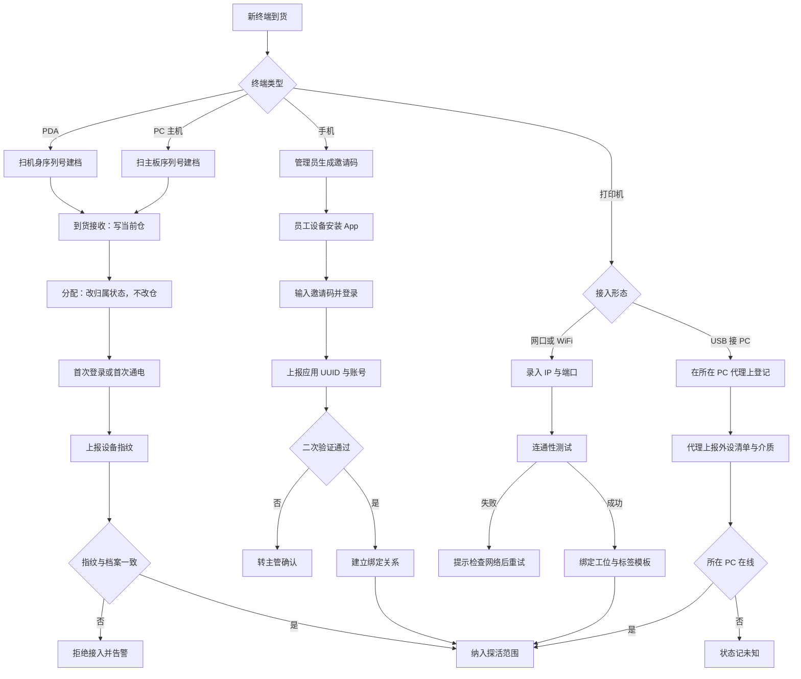
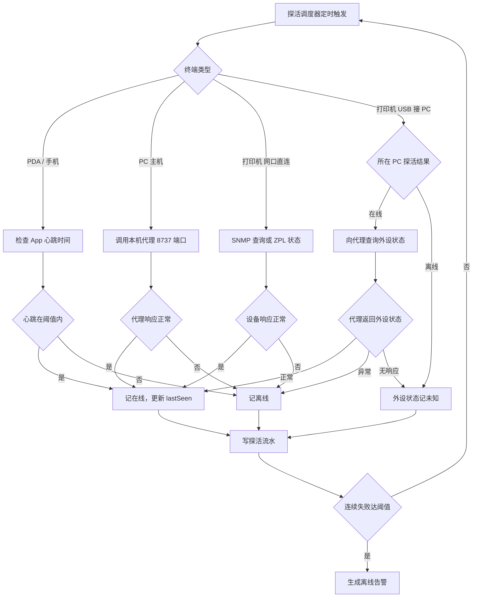
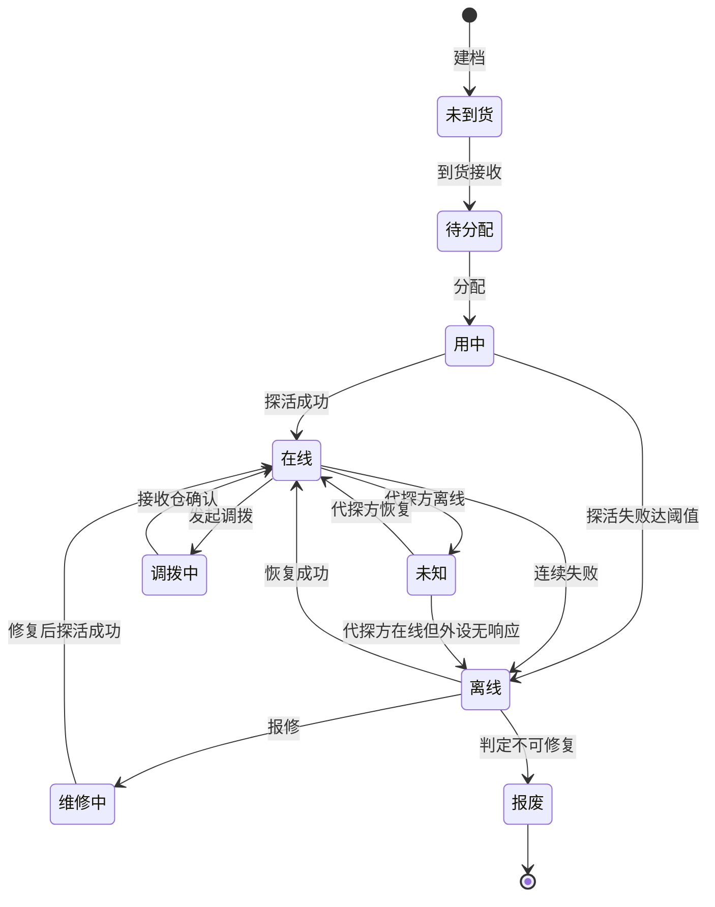
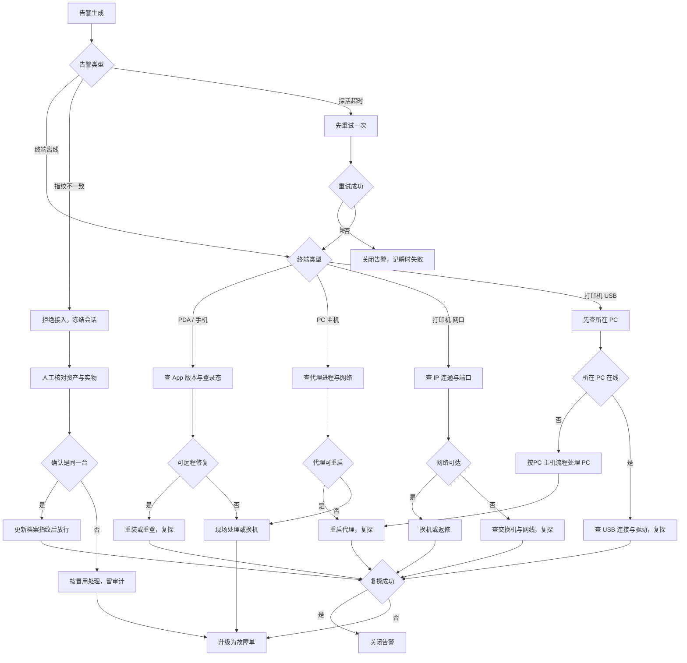

# 终端接入管理与探活 · 原型改版说明

| 项 | 内容 |
| --- | --- |
| 版本 | v1 |
| 状态 | 草稿，待评审 |
| 更新日 | 2026-10-30 |
| 对应原型 | `proto-next/dist/pc.html`（构建产物） |
| 范围 | PDA、手机、台式电脑（PC 主机）、打印机（网络直连 / 须接PC 主机两类） |

本说明只讲**原型怎么改**：各终端的管理入口在哪、状态怎么展示、操作怎么走。探活策略与业务规则以 `PRD/终端接入管理与探活PRD.md` 为准，本文件不重复。

## 一、改版要解决的问题

原型的设备页是一张平铺台账，把 130 台设备混在一起列。要管四种终端、两种打印机接入形态，平铺表有三个问题：

1. **看不出接入方式**。网络打印机与 USB 打印机在同一列里都叫"打印机"，但前者能独立探活、后者要靠 PC 代探，运维动作完全不同。
2. **看不出探活结果来自谁**。PDA 自己上报心跳；USB 打印机由 PC 代理上报；网络打印机走 SNMP。三者的"离线"含义不一样，混在一个状态列里会被误读。
3. **手机与 PDA 混在一起**。手机是员工自带的（BYOD），PDA 是公司资产，两者的接入与管理方式不同，需要的操作也不同。

改版围绕这三点收窄。

## 二、管理入口

### 2.1 两个入口，分工不同

| 入口 | 菜单路径 | 管什么 | 不管什么 |
| --- | --- | --- | --- |
| 设备档案 | 仓储库存 › 总仓管理 › 设备档案 | 型号、厂商、默认能力、固件版本。按主体共享 | 不关心某一台设备在哪个仓 |
| 单仓设备 | 仓储库存 › 单仓配置 › 设备（设备 / 工位设备 / 设备绑定三视图） | 单台设备的归属、位置、运行状态、探活结果；工位挂载；员工手机绑定关系 | 不改型号档案字段 |

设备档案页已剔除不能与系统直接交互的设备类（摄像头、称重机、固定扫码枪），只留 PDA、PC、打印机三类。

工位设备与设备绑定都收在「单仓配置 › 设备」页内，作为与设备台账并列的视图：工位是实体仓的空间概念，绑定发生在实体仓的作业人员身上，两者都只在本仓成立，总仓不摆，也不各占一个菜单项。设备页顶部的视图开关三段为「设备 / 工位设备 / 设备绑定」，行粒度不同故分视图而不合并成一张表——设备视图一行一台实物，工位视图一行一个工位，绑定视图一行一条账号与手机的关系。

### 2.2 单仓硬件页的页签结构

页签按**状态**分，不按终端类型分。理由：这个页是运维视角，来这里的目的是"哪台出问题了"，不是"我要找一台 PDA"。按状态分，离线与待处理一眼可见；按类型分，还得逐类点开看。

当前原型实际页签（与构建产物一致）：

| 页签 | 内容 |
| --- | --- |
| 全部 | 本仓在册终端，108 台 |
| 在线 | 最近一次探活成功且在阈值内 |
| 离线 | 连续失败达阈值 |
| 维修 | 已报修、维修单未关闭 |
| 故障 | 探活正常但上报故障，或指纹校验失败 |
| 待分配 | 已到货未分配，未纳入探活 |

终端类型通过「设备类」筛选承担，不再单独占页签：

```
设备类：[全部 ▾]  可选 PDA / PC / 打印机
```

**手机不单列页签。** 它在数据上是 `HW-PDA` 类、`form === '手机'` 的设备行，按设备类筛选 PDA 时会一并出现。若后续需要单独看手机，加一个「形态」筛选即可，不必占页签。

> 待改进项：见第七节 P-01。

## 三、状态展示
## 三、状态展示

### 3.1 状态取值与判定

表格状态列只显示三值，与 PRD 一致：

| 显示 | 含义 | 判定 |
| --- | --- | --- |
| 在线 | 最近一次探活成功且在阈值内 | `lastSeen` 距今 ≤ 探活周期 × 3 |
| 离线 | 超过阈值无成功探活 | 同上取反 |
| 未知 | 探活结果不可得 | 由 PC 代探的外设，PC 离线时为未知；不判离线 |

**未知是独立状态，不是离线的别名。** USB 打印机在 PC 离线时，系统拿不到它的任何信息，此时判"离线"是错的——设备可能好好的，只是没人能替它说话。原型用灰色 `未知` 标签，与红色 `离线` 区分。

### 3.2 探活方式要显示在行上

每一行设备详情里显示「探活方式」字段，取值随终端类型：

| 终端 | 探活方式 | 由谁上报 |
| --- | --- | --- |
| PDA | App 心跳 | 设备自身，`wss` 长连接 |
| 手机 | App 心跳 | 设备自身，绑定关系校验 |
| PC 主机 | PC 代理心跳 | 本机服务，`http://127.0.0.1:8737` |
| 打印机（网口直连） | SNMP / ZPL 状态查询 | 系统直连 `tcp://IP:9100` |
| 打印机（USB 接 PC） | PC 代探 | 所在 PC 的代理转发 |

这一列是本次改版新增的。没有它，运维看到"离线"不知道去哪查。

### 3.3 汇总数字放在页签上

改版去掉了页面顶部的六张统计卡片——基线模板的列表页没有这个结构。计数改由状态页签的角标承担：

```
全部(108)  在线(101)  离线(1)  未知(0)  待处理(2)
```

## 四、操作流程

### 四类终端 × 四个动作

| 动作 | PDA | 手机 | PC 主机 | 打印机（网口） | 打印机（USB） |
| --- | --- | --- | --- | --- | --- |
| 接入/登记 | 扫序列号建档 → 到货接收 → 分配 | 邀请码 → App 登录 → 绑定审批 | 扫主板序列号 → 到货接收 → 绑工位 | 填 IP → 连通性测试 → 绑工位 | 在所在 PC 上登记 → 随 PC 归属 |
| 探活 | App 心跳 | App 心跳 | 代理心跳 | SNMP 直探 | PC 代探 |
| 状态变更 | 心跳判定 | 心跳判定 | 代理心跳判定 | 直探判定 | 随 PC 状态派生 |
| 异常处置 | 重装 App / 换机 | 解绑 / 重新审批 | 重启代理 / 重置网络 | 查网络 / 换机 | 先处理 PC，再看外设 |

关键差异在最后一列：**USB 打印机的异常处置必须先看所在 PC**。它自身没有网络能力，PC 不通时对它做任何操作都无效。

## 五、流程图

### 5.1 设备接入与登记



### 5.2 探活检测



### 5.3 状态变更



说明两点：

- **未知只能由"代探方离线"进入**。不代探的终端不会出现未知。
- **调拨中不参与探活判定**。设备在途时探活结果无意义，恢复后按最新一次探活重置状态。

### 5.4 异常处置



## 六、原型改动清单

| 文件 | 改动 |
| --- | --- |
| `pc/src/menu.mjs` | 菜单项「硬件档案」改名「设备档案」 |
| `pc/src/pages/hardware-archive.mjs` | 剔除不可交互设备类；新增固件版本列与版本明细抽屉 |
| `pc/src/pages/hardware.mjs` | 统一为 ListPage；剔除摄像头/称重机/扫码枪；导出 `NOT_INTERACTIVE` 供两页共用 |
| `shared/ui/l3.mjs` | `ListPage` / `BaseTable` 支持真分页；删除统计卡片依赖 |

## 七、待确认

| 编号 | 事项 | 建议 |
| --- | --- | --- |
| P-01 | 手机是否单独占一个页签，还是仅用筛选区分 | 暂用筛选。当前数据 6 台，量少不足以占页签；超过 20 台后再评估 |
| P-02 | 状态列是否需要一个「瞬时失败」中间态 | 暂不需要。瞬时失败记在探活流水里，不占用表格状态 |
| P-03 | 打印机是否要按形态拆页签 | 不拆。形态是属性，用列区分即可 |
| P-04 | 「待处理」页签的判定条件 | 离线超过 24 小时且告警未关闭 |
