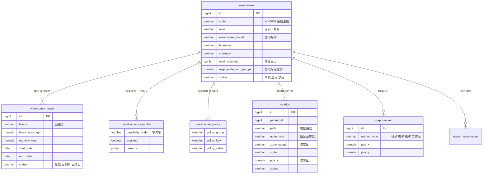

# Design

## Context

当前工作区有 `openspec/`、`docs/` 与 `code/frontend` 的两个前端骨架，后端尚未开始，没有历史数据、没有需要兼容的存量接口。这意味着主数据模型可以一次定到位，不需要为旧系统留适配层。

约束来自四个方面：

- 业务形态是单家 3PL 服务商、多货主，不做多 3PL 的 SaaS 运营层。
- 仓库有三种物理形态（平面、楼层、多栋楼），并且境内外仓并存。
- 首期只做主数据与账号，但执行端与 PDA 会在后续自建，因此模型必须按最终形态设计。
- 数据规模按单仓日均 1 万单、全系统 30 万 SKUID 规划，其中单仓有库存的约 2 万。

其余动机见 `proposal.md`，行为契约见 `specs/` 下四份规格。

## Goals / Non-Goals

**Goals:**

- 用一套空间模型同时表达三种仓型，避免后续为每种仓型复制一套作业逻辑。
- 让「同一个条码属于不同货主」成为模型支持的正常情况，而不是脏数据。
- 让数据隔离成为平台强制行为，货主账号无论配置如何都只能看到自己的数据。
- 让首期的主数据字段足以支撑后续执行端，不需要回填。

**Non-Goals:**

- 不实现库存台账、出入库单据、任务与波次。
- 不实现计费规则计算，合同只存条款与附件。
- 不实现对外开放 API 与入站系统对接；出站通知仅做邮件与企业微信群机器人。
- 不实现暗色主题与英文翻译，仅预留结构。

## Decisions

### D0. 仓库布局：代码集中于 `code/`

前端与后端统一放在 `code/` 下，前端在 `code/frontend`（自身是 pnpm workspace 根），后端在 `code/backend`（独立 Maven 工程）。仓库根只保留 `code/`、`docker/`、`docs/`、`openspec/`、`scripts/`。

**例外**：依赖服务的 `docker-compose.dev.yml` 随所属模块放置（当前为 `code/backend/docker-compose.dev.yml`），不进 `docker/`。理由：D0 的意图是「仓库根整洁」，该文件位于 `code/` 之下，意图已满足；且它装的是 PostgreSQL、Valkey、MinIO，均为后端专属依赖，随 `wms-app` 走比塞进公共 `docker/` 更内聚。

**理由**：根目录只放工程性文件，不会有人在根下误建业务文件；前后端物理隔离，各自的构建与依赖互不干扰。

**代价**：路径深一层，IDE 需分别打开两个子目录，CI 的工作目录要显式指定。

> **范围说明**：本变更实施范围为客户管理、商品中心、平台管理。
> 涉及仓库网络与空间模型的决策（D3、D4、D25、D26、D34、D35、D38）已完成设计但不在本期实施，
> 对应规格与任务见 `deferred/`。阅读时请以 `proposal.md` 的能力清单为准。

### D1. 模块化单体，首期拆四个 Maven 模块

首期建 `wms-common`、`wms-auth`、`wms-master`、`wms-app` 四个模块，单一进程部署。依赖方向锁定：`wms-common` 不依赖任何业务模块；`wms-auth` 与 `wms-master` 只依赖 `wms-common`；`wms-app` 负责装配。

`wms-inbound`、`wms-inventory`、`wms-outbound`、`wms-task` 等执行端模块等真的有代码时再建——新增一个空模块是十分钟的事，把两百个类从 `master` 搬到 `inventory` 是两天的事。

**备选**：Spring Cloud 微服务。否决原因是首期只有 32 张表和一个租户，跨域查询（如商品带品类带货主）会退化成多次远程调用；模块化单体在需要时可以把任一模块整体抽出。

### D2. 单租户，货主是数据维度而非租户

系统只服务一家 3PL，因此不引入 `operator_id` 或 `tenant_id`。货主通过业务表上的 `owner_id` 表达，不属于租户隔离层。将来若要托管给第二家 3PL，走 PostgreSQL 的 schema 隔离，不改业务表结构。

**备选**：预留 `tenant_id`。否决原因是当前明确不接受多 3PL SaaS，预留字段会让每个查询都多一个恒等条件，且容易让人误以为支持多租户。

### D3. 空间模型：一棵树 + 运输资源

园区、楼栋、楼层、库区、巷道、货架、层、库位统一为 `location` 表，用 `parent_id` 与物化路径 `path` 表达层级，用 `node_type` 区分节点类型。

**布局级别不落库**。它由树结构实时推导：有楼栋节点是多楼栋，只有楼层节点是多楼层，都没有是单层平面。不存字段的理由是仓库只有几十个，查询时算一次的成本可忽略，而冗余字段一旦存下就要在每次结构变更时同步，同步漏了比算一次贵得多。

建仓时必建唯一的楼层节点，所以单层仓也是完整层级，将来加盖只需新增楼层，老库位不受影响。

层级 MUST 完整，不跳层。平面仓的地堆区同样要建巷道、货架、层节点，允许各级只建一个默认节点。这样库位编码的五个段与树上的四级祖先严格对应，库位坐标可以从中直接派生，将来做库位矩阵地图时不需要再回填。

楼层仓与多栋楼仓的物理瓶颈单独建模为 `transport_resource`（货梯、提升机、输送线、接驳车），首期只存档案，不实现排队调度。

**库区带作业模式**。`location.operation_mode`（仅 zone 节点）取人工 / 自动化 / 人机混合，与「用途」正交——同一个拣货区，可以是人工人到货，也可以是智能库货到人。真实场景里混合仓很常见：一个仓同时有人工拣货区和智能库拣货区。

自动化与混合模式的库区必须指定关联的拣选站（用途 `PICK_STATION`），它是「货到人」的唯一交接点，不承载库存。首期只落字段与校验，派工时的区域准入匹配放到执行端。

**备选**：为每种仓型建独立表。否决原因是执行端的任务分组、盘点范围、波次拆合都要按空间节点聚合，三套表会让每个作业模块写三份逻辑。

**代价**：树形查询比固定列慢，因此依赖物化路径做子树查询，并在 `(warehouse_id, parent_id)`、`(warehouse_id, path)` 上建索引。

### D4. 不设虚拟库位，功能区做成实体库区

库位全部对应真实物理位置，不存在只存在于账上的容器。仓库里的收货区、待检区、异常区、退货区、发货暂存区都建成实体库区与实体库位，用 `location.zone_usage` 区分用途；月台是库区但不可建库位。

**理由**：这些区域本来就有货架和位置。做成虚拟库位会让账上有、地上找不到，而且容量校验、混放校验、盘点范围都要额外排除它，漏一处就出错。做成实体库位后扫码能定位、账实一致、盘点不漏。

**在途库存怎么表达**：不引入在途库位，也不引入在途仓。移动中的货物直接记账在**目标库位**上，数量标记为「在途」状态，任务表记录「从哪个库位搬到哪个库位、谁在搬、执行到哪一步」。扫码确认到达后，在途转可用；任务取消或异常时，在途数量撤销、源库位恢复。在途数量 MUST NOT 参与拣货、分配与出库。跨仓调拨同理，库存在目标仓的目标库位上，只是状态为在途。

**代价**：建仓时要为功能区建库位，工作量增加；二期需要引入库存状态机，并把任务状态与库存状态联动起来。

**备选**：虚拟库位与实体库位同表并用 `location_kind` 区分。否决原因是它把「不存在的位置」引入库存模型，后续每个查询都要记得排除。

### D5. SKUID 是货主级标识，不做跨货主归一

同一款商品在不同货主下是两条独立档案、两个 SKUID。SKUID 由「货主前缀四位 + 流水六位」生成，全局唯一、永不复用。货主在实物上贴自己的 SKUID 标签，仓库以 SKUID 而非商品条码识别归属。

**备选**：跨货主归一为一个全局商品，货主做映射。否决原因是该方案要求 3PL 预先维护全量商品库并承担归一判断，而实际业务中相同条码的货主之间不需要共享任何属性。

**代价**：同款商品在两个货主下重复维护尺寸重量；同条码不同货主的实物外观一致，只能靠标签区分，因此标签打印与扫码校验成为硬性要求。

### D6. 条码唯一性建在货主维度

唯一约束是 `(owner_id, barcode)`，不是 `(barcode)`。跨货主重复条码是合法状态。

**理由**：若全局唯一，第二个拿到同款商品的货主无法建档，业务直接卡死。

**配套**：条码查询接口必须支持返回多义结果并接受 `owner_id` 上下文，禁止「查到一条就返回」。

### D7. 包装层级链式、到箱为止

`sku_pack` 用 `level_no` 表达层级，`qty` 表示相对上一层的换算数量，层数由货主实际填写决定，最多到外箱。托盘不进入包装层级，作为装载单元在后续执行端建模。

**理由**：托盘通常混放多个 SKU，无法挂在单个商品上；托盘规格由 3PL 决定，不是商品属性。

**备选**：固定四字段（单品/内箱/外箱/托）。否决原因是会留下大量空列，且加第五层要改表。

### D8. 组套与拆套归增值服务，商品档案不含 BOM

商品档案不设 `is_bundle`，也没有物料清单。套装加工走「加工工单」：组件领料出库、加工、成品入库，成品是独立 SKU、独立 SKUID。

**理由**：套装是仓内加工服务，不是商品属性；放进商品档案会让库存模型被迫支持拆算。

### D9. 编码全部系统生成，配别名与外部码

客户、仓库、库区、库位、SKUID 五类编码由系统按规则生成，生成后不可修改。每类对象另有 `alias`（可改、可重复、用于展示）与 `external_code`（用于对接）。

**理由**：全人工编码会重号与不规范；全用系统码则界面与单据不可读、无法对接货主系统。两码分离同时保住规范性与可读性。

### D10. 三维数据权限自研，货主账号强制过滤

`user_data_scope` 表存 `(user_id, scope_type, scope_id)`，`scope_type` 取仓库、货主、库区。通过 MyBatis 拦截器按注解在 SQL 上追加条件。

对外部货主账号，拦截器无条件追加 `owner_id` 条件，不读配置表。

范围配置在用户上而非角色上，因为仓库分工经常调整，绑在角色上会导致为一个人新建角色。普通用户的三个维度均须显式配置，任一维度为空即返回空集。

超级管理员是内置角色，功能权限在鉴权时动态展开为全部权限点，新增功能自动生效；数据范围以 `ALL` 标记表示，拦截器遇到 `ALL` 直接跳过维度条件。两者都走同一个鉴权入口，不在业务代码里判断超管，这样超管路径同样被测试覆盖，也不会因为新增仓库而让范围配置过期。

角色完全由管理员自建，系统只预置一个超级管理员。权限点随代码发布维护，新增权限点默认不被任何角色勾选。

**备选**：RuoYi 等脚手架的部门级数据权限。否决原因是维度不同，改造成本高于自研。

**代价**：每条查询多一个 `IN` 条件，索引需覆盖 `owner_id` 与 `zone_id`。

### D11. 认证用 Sa-Token，第二因子用 TOTP

会话与多端登录控制交给 Sa-Token，第二因子用 TOTP（`dev.samstevens.totp`），不接短信。

**理由**：TOTP 不依赖手机号与短信通道，海外仓作业员同样可用；短信有成本且跨境送达不稳定。

**备选**：Keycloak / Casdoor。否决原因是首期只有单系统，独立部署身份服务不划算。

> **2026-10-24 确认**：维持本决策。实现侧曾误引入 `spring-boot-starter-security`（`wms-auth/pom.xml`），需迁回 Sa-Token；依据见 `docs/research/auth-middleware.md`。

### D12. i18n 首期预留，界面与数据两层都留

前端接 `vue-i18n`，后端消息走 message code，首期只填中文。数据库层面字典项、品类名等带 `name_en` 字段。

**理由**：海外仓是明确规划。界面文案可以后补，但数据表加英文列要回填，成本完全不同。

### D13. 设计令牌：一套基础，两套密度

`packages/tokens` 按 primitive、semantic、density、shell 四层组织，输出 CSS 变量；密度由根节点属性切换，两端共用同一套组件。另提供 `web-antd` 适配器，把语义令牌映射为 Ant Design Vue 的 theme token，组件库样式随之生效，业务代码不直接引用原始色值。

**备选**：两端各写一套组件。否决原因是组件会分叉，修一处要改两遍。

### D14. 30 万 SKUID 不上搜索引擎

商品检索依赖 PostgreSQL 复合索引与 `pg_trgm` 三元组索引：编码与条码走唯一索引精确匹配，名称走三元组模糊匹配。列表分页用游标（`updated_at` + `id`），不依赖大偏移量。

**备选**：Elasticsearch。否决原因是 30 万行对 PostgreSQL 是小表，引入 ES 要多一套运维与数据同步链路。中文分词方案 `zhparser`、`pg_jieba` 需要装扩展，首期用 `pg_trgm` 已经能满足前缀与包含查询，不引入依赖。

**配套**：列表页不做实时 `count(*)`，总数缓存或改为「是否有下一页」。

### D15. 批量导入异步、流式、分批

导入流程为：上传落对象存储 → 异步任务 → 流式解析（EasyExcel）→ 每批 1000 行校验与写入 → 进度轮询 → 错误报告下载。单次上限 2 万行，同一对象同时只允许一个导入任务。

**理由**：同步导入会超时并撑爆内存；逐行查库校验在 2 万行下会变成 2 万次查询。

### D16. 建表规范与 PostgreSQL 约定

所有业务表带 `owner_id`、`warehouse_id`、`created_by`、`updated_by`、`created_at`、`updated_at`、`deleted_at`。软删除，编码永不复用。

```sql
-- 标识符全小写、下划线分隔。未加引号的标识符会被服务端转成小写
create table owner_contact (...);

-- 主键用 identity，不用 serial，也不用 UUID
id bigint generated always as identity primary key,

-- 唯一索引不加 deleted_at 条件：编码永不复用，
-- 软删除行必须继续占位，否则删掉之后编码会被重新分配
create unique index uk_sku_barcode on sku_barcode (owner_id, barcode);

-- 时间统一 timestamptz，存 UTC，展示时按仓库时区换算
created_at timestamptz not null default now(),

-- 扩展字段用 jsonb，不用 json
ext jsonb
```

**软删除与唯一索引**：唯一索引 MUST 覆盖全部记录，MUST NOT 加 `where deleted_at is null`。很多项目用部分唯一索引来支持「删除后可重建」，但我们的规则是编码永不复用，加了条件等于允许复用，会让历史单据指向一个已被新数据占用的编码。

**主键策略**：`bigint identity`。单库单进程，UUID 的索引体积是 bigint 的四倍，且没有对外暴露主键的需求；真要对外标识，用系统编码而不是主键。

**三条容易踩的**：

1. 字符串比较默认区分大小写。需要不敏感时显式用 `ilike` 或 `citext` 列，不要假设数据库会忽略大小写。
2. 没有 `on duplicate key update`，用 `on conflict ... do update`。
3. 默认隔离级别是 `read committed`。库存扣减一类逻辑不要照搬 `repeatable read` 下的锁假设，按当前读加显式行锁设计。

流水表、任务表、单据表在后续变更中按月分区，分区键为 `warehouse_id + created_at`，语法用 `partition by range`。首期虽无此类表，但规范先行，避免后续改分区要重建表。

### D17. 未完成配置的账号走引导页，不进空壳

登录成功后由后端判定并返回 `needOnboarding` 与原因（未分配角色 / 数据范围未配置），前端据此跳转独立的引导页，不渲染布局与菜单。剩余时长按会话登录时间计算而非页面加载时间，避免刷新续命；默认 20 秒，存入 `sys_config`。

**理由**：新账号登录看到空壳会被当成故障，反馈成本远高于一个引导页。同时「未配置即无权」的语义要求系统能主动暴露配置遗漏，引导页就是那个暴露点。

**代价**：登录链路多一个判定分支；引导页需要独立的免鉴权接口，只允许调用登出。

### D18. 权限模型参考 RuoYi

权限点统一存在 `sys_menu`，用 `menu_type` 区分目录（M）、菜单（C）、按钮（F），每条记录带 `perms` 标识，命名规范为 `模块:实体:动作`，例如 `system:user:add`。角色通过 `sys_role_menu` 关联权限点，用户通过 `sys_user_role` 关联角色。前端路由由后端返回的菜单树动态注册，按钮级权限用指令比对本地权限集合。

**不沿用** RuoYi 的部门数据权限。它的五种范围枚举（全部、自定、本部门、本部门及以下、仅本人）建立在 `sys_dept` 部门树上，与我们的「仓库 + 货主 + 库区」三维不匹配；而且它的范围绑在角色上，我们绑在用户上。保留 `@DataScope` 的注解风格，维度换成三个。

**理由**：菜单即权限点、`perms` 字符串、注解校验这套已被大量项目验证，团队熟悉度高、上手快；数据权限部分与业务形态强相关，照搬会引入一棵用不上的部门树。

### D19. 货主账号登录名由系统生成，不用手机号

货主主账号登录名等于货主系统编码，子账号为「货主编码 - 两位序号」。手机号退化为联系方式，不参与认证。

**理由**：手机号会变（换号、号码被运营商回收），一旦作为登录名，改号就等于迁移账号，历史日志也会错乱；而且手机号属于个人信息，出现在登录框与日志里等于持续暴露。系统分配登录名后，改手机号不影响登录，账号生命周期与联系方式解耦。

**代价**：货主记不住登录名，需要 3PL 在建档时把账号信息一并交付；子账号序号不回收，停用后新开子账号的编号会往后走。

### D20. 税号独立成表，不放在货主主档

`owner_tax_registration` 按「国家 + 州省 + 税号类型」一条记录，一个货主可以有多条。

**理由**：美国卖家在多个州有销售税登记（economic nexus），欧盟卖家可能同时有 VAT 与 EORI。把税号做成主档上的单字段，第二批州注册时就装不下，只能改建表并回填。税号类型也必须与记账国家绑定，中国是统一社会信用代码，美国是 EIN 与州销售税号，欧盟是 VAT，一个字段表达不了。

**地址处理**：国家与州省走字典，城市与详细地址自由输入。国家字典存 ISO 3166-1 alpha-2，州省字典带 `ext.country` 关联国家，美国预置 50 州加华盛顿特区，中国预置 34 个省级行政区。城市不做三级联动——首期地址只用于档案，不做派送分区，等做尾程计费时再引入完整的行政区划表。

### D21. 货主终止不级联，改为业务入口拦截

终止时只改货主状态，不自动停用商品、不改库区归属、不动合作关系。终止前展示影响清单（在册商品数、专属库区数），由人工决定怎么清理。

**理由**：级联写操作是一次大批量、难回滚的变更，一旦点错，几千个商品状态被改，恢复要靠日志回放。而「货主状态」本身就是业务入口的总开关——所有建单入口只要校验货主状态，未清理的残留数据自然用不了。

**代价**：系统里会出现「已终止货主仍有在售商品」的观感问题，需要靠影响清单和列表筛选提示，而不是靠数据自洽。

### D22. 通知走企业应用，不走群机器人

合同到期提醒通过企业微信自建应用发给负责客服个人，而不是发到群机器人。

**理由**：群机器人无法定向，发到群里谁看谁不看不可控；而「负责客服」是明确的责任人，提醒必须落到人。企业应用需要 corpId、agentId、secret 与通讯录读取权限，还要在管理后台配置可信 IP，但这是一次性配置，之后只是维护 access_token。

**代价**：上线前必须由 3PL 的 IT 配合完成应用创建与可见范围配置；内部员工需要在用户档案上补充企业微信 userid，否则推不出去。

**降级**：任一渠道未配置时只发站内提示，并在 `sys_notify_log` 记录渠道未启用，不阻断业务。

### D23. 货主端只放开联系人编辑，其余档案只读

货主端「我的档案」展示基本信息、合作仓库与合同下载，仅联系人允许增删改。

**理由**：联系方式最容易变，货主自己维护才是最新的；而结算主体、税号、合作仓库涉及商务与合规，改动必须经 3PL。放开前者的收益远大于风险，放开后者的风险远大于收益。

**审计要求**：联系人是子表，变更时保存变更前后的完整集合快照而不是差异，否则被删除的联系人查不回来。日志必须记录来源端，3PL 才能分清这条变更是货主自己改的还是内部改的。

### D24. 技术选型受许可约束，用 PostgreSQL 与 Valkey

零商业授权预算，GPL、AGPL、SSPL 一律不得引入。MySQL 为 GPL，Redis 7.4 起转为 AGPL，两者都踩线，因此改用 PostgreSQL（PostgreSQL License）与 Valkey（BSD）。前端组件库选 Ant Design Vue 4（MIT），设计令牌通过 `web-antd` 适配器喂给 `ConfigProvider` 的 theme token。

**代价**：SQL 方言、声明式分区语法、JSONB 与全文检索方案都与 MySQL 不同。检索改用 `pg_trgm` 三元组索引，中文分词扩展（`zhparser`、`pg_jieba`）首期不引入，避免额外编译与运维成本。

### D25. 货架模板作为库位生成的主路径

`rack_template` 定义标准货架规格（层数、每层位数、库位尺寸、承载上限）。建仓时选模板加巷道号、起始货架号、数量，一次生成整片库位，生成时把尺寸与承载上限快照到库位。

**理由**：3PL 的仓是自己规划的，货架规格本来就统一；一个仓上万库位靠 Excel 逐个录入既慢又容易错。模板把录入变成填四个数字，同时保证同一区域库位尺寸一致，库位矩阵地图渲染时不需要逐个算宽高。生成即建齐巷道、货架、层节点，避免人工先建树再导库位。

**代价**：模板是全局规格库，不绑仓库；生成后改模板不影响存量库位，需要调整只能改单个库位或重新生成。

**补充路径**：库位批量导入保留，用于规格不统一或需沿用既有编码的场景，导入时上级节点必须已存在。

### 仓库档案结构

仓库档案不是一张表，而是「一个可独立核算、独立授权、独立作业的场地」在系统里的投影，按变化频率拆成六块：



| 表 | 管什么 | 变化频率 |
| --- | --- | --- |
| `warehouse` | 身份、地址、时区、图纸、状态 | 极低 |
| `warehouse_lease` | 租金、租期、出租方 | 一年一次 |
| `warehouse_capability` | 能做什么 | 半年一次 |
| `warehouse_policy` | 怎么干 | 随时 |
| `location` | 空间结构 | 建仓集中，之后零星 |
| `map_marker` | 柱子、电梯、工作台 | 建仓一次 |
| `owner_warehouse` | 哪些货主在此合作 | 随客户增减 |

变化越快的表，字段越少、越要能加行而不是加列。

### D26. 混放策略四维度、只收紧不放宽

混放拆成四个独立维度：多货主、同条码跨货主、多 SKU、多批次。库区保存配置，库位可保存同名配置作为收紧项，生效值一律按 `库区 AND (库位 ?? true)` 计算。

**理由**：四个维度的违规代价都指向串货与错发，属于安全规则而非效率规则。允许库位放宽会造成「某处的配置与直觉相反」，而违规后果不可逆。统一成一个 AND 公式后，规则只有一条，配置错误率最低。

**代价**：需要不同策略的库位必须划入独立库区，库区数量会增加。这是有意的——库区本身就是配置分组。

**默认值**：多货主、多 SKU、多批次允许；同条码跨货主禁止。默认关闭一个高风险能力，比默认打开再教人关闭更安全。

**性能**：条码集合比对的触发条件是「允许多货主 且 禁止同条码跨货主 且 库位已有货」。货架格通常禁止多 SKU，此时只需比对 SKU，整个条码比对可跳过；真正跑集合比对的只有地堆区大库位，量级有限。

### D27. 尺寸重量单一口径：主档存单品，层级存箱规

商品主档只存单品的尺寸、重量、体积；包装层级只存内箱与外箱的箱规，单品层不再重复录入。

**理由**：「这个商品多大」必须只有一个答案。两处都存时，计费读一处、库位容量校验读另一处，早晚会读到不同版本，而且不会有任何报错。单一口径让问题在录入时暴露，而不是在结算时。

**代价**：包装层级的单品层没有自己的尺寸字段，查询时要 join 主档。这个代价可接受——单品尺寸本来就读得多、写得少。

### D28. 品牌归货主，品类归 3PL

品牌为货主级主数据，唯一性限定在货主内，允许不同货主存在同名品牌；品类为 3PL 统一维护的树形结构，承载的必填项模板对所有货主一致。

**理由**：品牌是货主的商业资产，3PL 无权也不该统一治理；品类是行业属性，模板如果按货主放开，同一品类会出现多套要求，审核标准随之分裂。

**代价**：3PL 做跨货主分析时，同一品牌会以多个 ID 出现，需要按名称归并。不做跨货主品牌合并号。

### D29. 关键字段改动走待审版本，双版本并存

已通过的商品修改条码、包装层级、尺寸重量、品类或合规属性时，改动写入待审版本，业务继续读取上一版已通过数据；审核通过后覆盖生效版，驳回则丢弃。同一 SKU 同一时刻最多一个待审版本。

**理由**：如果改动直接卡住商品，改一个重量就会让这个 SKU 停止出库，运营不可接受；如果改动立刻生效，审核就变成走过场。双版本让「审核有效」与「业务不中断」同时成立。

**代价**：商品表要拆出生效版与待审版两张，所有读取路径必须明确读哪一张，读错的后果是用了未审数据。这条通过统一的数据访问层强制，与 D4 的库位查询同一套做法。

### D30. 审核状态与启停状态拆成两个字段

`sku.audit_status` 取草稿/待审核/已通过/已驳回，`sku.enabled` 取启用/停用，两者独立。启用要求审核已通过，但停用不回退审核状态，恢复启用也不重新审核。

**理由**：一个商品可以同时是「审核通过」和「已停用」，这是正常状态，不是中间态。合并成一个枚举后，停用再启用必须回答「回到哪个状态」，答「回已通过」就丢失了审核历史，答「回草稿」就等于要求重新审核，两个答案都是错的。

**代价**：查询「可用商品」要看两个字段，不是一个。这个条件封装在数据访问层，业务代码不重复拼。

### D31. SKUID 标签极简，40×20 mm

标签只放 SKUID 条码、SKUID 明文与货主简称。商品名称、规格、商品条码不上标签，需要时在系统里查。

**理由**：SKUID 是 10 位数字，Code128C 编码后约 90 个模块，40 mm 宽时每模块 0.33 mm，正好是 300 dpi 打印机的下限。把商品名称塞进去，高度和宽度都会突破这个约束，实际做出来就是 60×40 mm —— 贴在商品上会遮挡原包装信息，货主不愿意用。

**代价**：仓库作业员在货架前看不到商品名称，只能靠 SKUID 反查。这在 PDA 扫码场景下成立，但在「人眼找货」场景下不成立，所以货架标签是另一套设计，不受此约束。

### D32. 商品条码是作业第一入口，SKUID 标签是补充

收货、上架、拣货一律优先扫商品自带的厂商条码。有单据上下文时按「货主 + 条码」唯一定位，未命中直接报错；无单据上下文时按条码检索，多命中才列候选。SKUID 标签只在商品无条码、条码不可读或需要跨货主区分时使用。

**理由**：货到仓时，箱子上唯一的码就是厂商条码。如果要求先贴标再作业，等于把「贴标」变成收货的前置步骤，每箱都多一个动作，而这个动作在多数情况下是多余的——同货主内条码已经唯一，足以定位 SKU。

**代价**：存在两套标识，作业逻辑要处理「扫到的是哪个码」。这条通过统一的条码解析入口收敛，业务代码不各自判断。另外，同货主内条码唯一成为硬约束，货主若有同条码多 SKU 的情况，建档时就会被拒。

**拦截返库是无上下文的常态，不是边界情况**。退回的货混放，面单可能已毁，作业员手上只剩商品条码，跨货主多命中必然发生。这里靠两条设计撑住：一是同货主内条码唯一，保证每个候选行都是确定的「货主 + SKU」，不会出现同一货主两个候选的歧义；二是候选按最近出库时间倒序，让最可能的那条排在最前。

候选排序依赖出库历史，首期没有出库作业，所以「最近出库时间」在首期 DEFERRED，二期随出库历史表一并落地。首期建条码解析入口时预留该字段位置，避免二期改接口。

选错货主等于串货，因此每次选择都要记操作人、时间与候选数量——不是为了防止误操作，是为了事后能查清是哪一步选错的。

**DEFERRED**：候选选定时是否再弹一次确认（防手滑），留到聊出库场景时一并确定，本变更只定「显示完整候选 + 选择留痕」，不定交互细节。

### D33. 三张「有表无需求」的表，三种处理

`sys_org`、`sys_notify_log`、`sys_config` 之前在表清单里已有，但没有对应需求。逐一收口：

- **`sys_org` 做两级**：公司 + 部门，内部员工必须归属部门。3PL 的总部与仓是两回事，仓已经有独立档案与数据权限，部门解决的是「同一仓内不同职能」的人员归属。不做三级是因为三级以上需要权限继承规则，而首期的人数是几十人。
- **`sys_notify_log` 只发不收**：提醒通过企业微信与邮件发出，系统内只落发送日志，不做站内信列表。做站内信要连带未读已读、消息中心页面、清理策略，成本远大于收益，而提醒的真实触达靠的是企业微信。
- **`sys_config` 建表不做界面**：参数由运维改数据。参数总量少、变更频率低，做一个管理页要连带权限点、审计、校验，不划算。代价是改参数需要 DBA 介入，可接受。

**共同判断**：一张表如果首期没有完整的需求支撑，要么补需求，要么不留。留着不用的表会在实施时被当成「应该能用」而反复询问。

### D34. 平面图首期不做，方案整体进演进

首期不实现仓库平面图，`warehouse` 表**不加** `map_*` 列。完整方案记录在此，二期照此实现。

**为什么不做**：完整版约两周，收益是「让管理层看见仓库布局」。首期四个模块是主数据基座，没有库存也没有作业，布局图看的是空仓，展示价值有限。

**为什么不留空列**：加可空列的成本在二期只是一条 `ALTER TABLE`，而首期建了没人填，实施时会反复问「这个图怎么传」。空列比没有更贵。字段定义留在这里，不留进表。

**二期需要的东西**：

- `warehouse` 增 `map_image_url`、`map_width`、`map_height`、`map_scale_mm_per_px`、`map_calibration`（jsonb，存两点与真实长度）、`map_area_sqm`
- 上传后**必须完成两点标定**才能保存，不接受图纸自带的打印比例
- 标定后自动反算面积，与档案中的建筑面积交叉校验，偏差超过 30% 提示
- 库区在图上以矩形表达，位置用像素坐标存；柱子、电梯、楼梯、工作台用独立标记表，不进空间树
- 布局图只做示意，货架按库区矩形均分渲染，不做像素级精确

### D35. 货架的层降为字段，空间树逐层懒加载

空间节点类型收敛为七种：园区、楼栋、楼层、库区、巷道、货架、库位。货架的层不再建节点，改为库位上的 `level_no` 字段，从 01 起算。库位编码仍为五段，层段取自该字段。

前端按逐层懒加载，每次只请求某节点的直接子节点，返回中带 `has_children` 标记。

**理由**：一个 1.5 万库位的仓，层节点约 8000 个，是除库位外最大的层级，但它只表达「这是第几层」，不承载任何独立属性。降为字段后少 8000 行，批量生成的撤销也少一层要清理。巷道只有约 50 个，保留为节点更直观，且将来限速、单向这类属性有地方挂。

**代价**：库位的层号不再由祖先保证，可能出现「同一货架下第 3 层有 4 个位、第 4 层只有 2 个位」这种不齐的情况。这是允许的——货架格位本来就可能不齐，强行要求整齐反而要造假。

**为什么保留楼层**：楼层是建筑事实，参与地址与动线，且区段编码要靠它；货架的层是仓储事实，只影响定位。两个「层」不是一回事，代码命名上必须区分（`floor_no` 与 `level_no`）。

### D36. 权限矩阵按角色正向列举，数据范围改角色默认加用户覆盖

权限矩阵落在 `permission-matrix.md`：八个角色 × 约 60 个权限点。每个角色只列它拥有的权限点，没列的一律没有。矩阵是**推荐配置**，系统只预置超级管理员，落地时按表建角色。

数据范围从「只配在用户上」改为「角色给默认值、用户可覆盖、生效值优先取用户」。

**理由**：60 条需求约 150 个权限点，8 个角色就是 1200 格。按「谁能做这个功能」逐格确认要问 150 次，按「这个角色能干什么」只需 8 次——后者符合人对自身职责的认知方式。正向列举把总量从 1200 格压到约 120 条。

**数据范围为什么要改**：原方案要求每个新账号都手动配三维度，未配即无权。这在安全上成立，但操作上每个新员工都要配一次，而多数人用的是同一套范围。改成角色带保守默认值后，新账号开箱可用，特殊人员再单独收紧。

**代价**：角色默认值一旦设得宽，所有人都会跟着宽。所以默认值必须保守——客服默认「自己负责的货主」，不默认「全部货主」。

### D37. 首期页面从 35 砍到 19

页面清单落在 `ui-structure.md`。判据：首期不做库存与作业，凡「运行期才用得上」的页面后置。

后置的 16 个页面里，工作台、组织管理、字典管理、编码规则、库位导入、运输资源、日志、货主端我的档案、子账号、品牌管理都能用「预置值 + 默认行为」先顶上，不阻塞主链路。

**货主详情用五个页签加一个抽屉**：基本信息、联系人、税号、合作仓与合同、账号，操作日志走右上角抽屉。

**理由**：合作仓与合同必须放一起——合同必须关联仓库，两者是同一个问题的两面。审计记录不进页签，因为没人靠翻页签查操作，它属于「出问题时才看」，抽屉随用随开比常驻一页更省。

**货主新建只有四个字段**：名称、类型、结算主体、备注。其余全在详情页补。这与分阶段校验一致——建档宽松，进合作前收严，而不是一上来逼人填二十个框。

### D38. 空间树不做树上多选，批量操作走右栏表格

树上不提供多选，批量停用与删除在右栏的子节点表格里勾选执行。

**理由**：树是懒加载的，没展开的节点算不算「被选中」是一个没法回答的问题。勾了楼层却没展开下面的库区，删除时到底删不删？任何答案都会让一部分人意外。列表里勾选没有这个歧义——看得见的就是全部。

**代价**：跨多个父节点的批量操作要来回切换父节点。首期建仓阶段的操作本来就按库区组织，这个代价可以接受。

### D39. 条码单一来源，包装层级只标层号

规格原本要求包装层级每层记录条码，同时又要求条码管理支持「一个 SKU 多个条码 + 主条码」。这两条会造出两份条码数据。

落地时改为：条码只存 `sku_barcode`，用 `pack_level` 标记它属于哪一层；`sku_pack` 不存条码。

**理由**：同一个码如果既能从条码表查到、又能从包装层级查到，两处不一致时没有任何机制能发现。而且「一个 SKU 同一层有多个条码」（不同供应商贴不同的码）在包装层级的单行结构里根本放不下。

**代价**：查询某层有哪些条码要 join 一次。这个代价远小于两份数据打架。

### D40. 对象存储做一层抽象，首期用本地文件系统

`minio/minio` 已从 Docker Hub 下架，`quay.io/minio/minio` 需要登录，`bitnami/minio` 已迁移，三个来源都取不到。这不是网络问题，是分发策略变了。

落地：定义 `ObjectStorage` 接口（`put` / `get` / `url` / `delete`），本地实现写文件系统，生产实现接 S3。`docker-compose.dev.yml` 不再包含对象存储服务，开发环境依赖只剩 PostgreSQL 与 Valkey。

**理由**：对象存储只在商品图片（5.12）与批量导入（5.13）落地时才用得上，这两条都还没开工，此刻定架构成本最低；等写到 5.12 再改就要动业务代码。抽象层还让开发环境彻底不依赖容器，不至于为一个首期用不到的组件卡住骨架验收。

**代价**：多一层接口，且本地文件系统实现不能用于生产，切换 S3 时必须保证 `url` 语义一致（相对路径还是签名 URL 要在接口层定死）。

**备选**：换 S3 兼容容器（`localstack`、`seaweedfs`）。否决原因是开发机仍要多背一个服务，而首期根本用不到它。

### 数据模型概览

24 张表，分三组（仓库网络、组织架构、合同相关的表随范围缩减移出，见 `deferred/`）：

| 分组 | 表 |
| --- | --- |
| 平台（12） | `sys_user`、`sys_password_reset_token`、`sys_role`、`sys_role_menu`、`sys_user_role`、`sys_data_scope_owner`、`sys_menu`、`sys_dict`、`sys_dict_item`、`sys_code_rule`、`sys_config`、`sys_audit_log` |
| 客户（4） | `owner`、`owner_contact`、`owner_assignee`、`owner_tax_registration` |
| 商品（8） | `category`、`brand`、`sku`、`sku_pending`、`sku_barcode`、`sku_pack`、`sku_import_task`、`label_print_record` |

关键约束：

```text
sku             unique (sku_id), unique (owner_id, owner_sku_code)
sku_pending     unique (sku_id)   -- 同一 SKU 最多一个待审版本
sku_barcode     unique (owner_id, barcode), index (barcode)
location        unique (warehouse_id, code), index (warehouse_id, path)
owner           unique (external_code) where not null
sys_user        unique (login_name), unique (mobile)
```

`warehouse_policy` 首期建表不落数据，供后续执行端接运营策略。

## Risks / Trade-offs

| 风险 | 缓解 |
| --- | --- |
| 同条码不同货主的实物外观一致，靠人工识别必然串货 | 强制贴 SKUID 标签；扫码以 SKUID 为主键；条码查询返回多义而非取首条 |
| 功能区库位与存储区库位混在一起，上架时可能落到收货区或异常区 | 上架候选库位按 `zone_usage = STORAGE` 过滤，功能库区只能通过移库进入 |
| 库区级数据权限给每条查询加 `IN` 条件，数据量上来后变慢 | 索引覆盖 `owner_id`、`zone_id`；对高频接口做结果缓存 |
| 首期无执行端，主数据字段若考虑不周，二期回填成本极高 | 首期字段按最终形态一次建全（容量占用、批次效期标记、序列号标记、分区键）；在规格中列明后续演进依赖 |
| 30 万 SKU 的列表总数统计拖慢首屏 | 总数缓存 5 分钟或改为游标分页，不做实时 `count(*)` |
| 两端共用组件库后版本漂移 | `code/frontend` 为单一 pnpm workspace，`apps/*` 与 `packages/*` 同一版本树 |
| SKUID 前缀耗尽或并发重号 | 前缀在客户建档时校验全局唯一；流水用 Valkey 号段批量取号，数据库唯一索引兜底 |

## Migration Plan

新建项目，无数据迁移。落地顺序：

1. 建立 monorepo 与后端工程骨架、数据库迁移脚本（Flyway）。
2. 交付平台层（认证、权限、字典、编码规则、审计）。
3. 交付客户管理与仓库网络，含空间树与库位导入。
4. 交付商品中心，含导入、审核与标签打印。
5. 交付货主端三个模块并完成两端联调。

回滚策略：各阶段以数据库迁移版本为界，出现阻断问题时回退到上一版本并回滚对应 Flyway 脚本；首期无存量数据，回滚不涉及数据修复。

## 后续演进

以下能力不在本变更范围，但属于既定规划。模型与字段需要为其留出位置，避免届时推翻。

### 库位地图（库区可视化）

在库区维度展示库位矩阵，用颜色区分空置、占用、锁定、异常与作业中；点击库位打开详情抽屉，展示编码、启用状态、绑定任务、容器编码与可执行操作。分期为：静态地图加详情抽屉 → 实时状态叠加与任务轨迹。

模型前置条件（本变更未落地，届时需补）：

| 数据 | 字段 | 说明 |
| --- | --- | --- |
| 库位坐标 | `row_no`、`col_no`、`level_no` | 行列层索引，不依赖编码字符串解析 |
| 画布位置 | `pos_x`、`pos_y`、`bin_width`、`bin_height` | 由货架规格推算，可离线批量生成 |
| 货架规格 | `grid_rows`、`grid_cols`、`grid_levels` | 挂在货架节点上 |
| 朝向与深度 | `orientation`、`depth_index` | 双深位需区分内外层 |

- 适用仓型：货架仓、楼层仓、多栋楼仓；地堆平面仓不启用。启用开关走 `warehouse_capability`，不改主表。
- 渲染方案：Canvas 2D 加视口裁剪与分层绘制，单库区 5000 库位的量级。
- **坐标来源**：因为层级完整、编码五段与树上的四级祖先严格对应，库位的行、列、层可以直接从祖先节点派生，不需要额外存字段，也就不存在二期回填的问题。只有渲染用的画布宽高需要在生成地图时按库位尺寸计算。

### 自动化设备接入（WCS / RCS）

原则：WMS 不直接驱动 AGV，只对接厂商的 WCS/RCS。分层为 WMS →（可选 WES）→ WCS/RCS → 设备。WMS 只回答搬什么、从哪到哪、多急；路径与交通管制由 WCS 负责。

数据主权需逐域确认，每类数据只能有一个事实来源：

| 数据域 | 建议归属 |
| --- | --- |
| 仓库、库区、楼层结构 | WMS |
| 库位物理坐标与货架格位 | WCS 提供，WMS 存同步副本 |
| 库位逻辑属性（容量、混放、温区、可存可拣） | WMS |
| 库位状态（空、占用、锁定、异常） | 对接前定死；倾向设备侧感知、WMS 订阅 |
| 库存数量 | WMS |
| 业务任务（入库、出库、补货） | WMS |
| 设备任务与路径 | WCS |
| 容器与托盘 | 对接前明确 |

三种边界模式：WMS 主、WCS 主、按域切分。人机混行的仓通常取第三种。

模型前置条件：

- 任务表增加 `assignee_type`（HUMAN / DEVICE）与 `assignee_id`，使人与设备共用同一任务池。该字段必须在执行端的任务模块首次建模时加入。
- 引入容器或托盘实体作为搬运对象。
- 库位 `external_code` 承担与 WCS 库位码的映射，系统码保持不变。
- 设备心跳与离线检测，设备掉线时任务可回退人工。
- 搬运任务 `move_task` 与业务任务分离。
- 按厂商实现设备适配器接口，业务层不感知厂商差异。

决策时机：执行端设计开始之前。触发条件为取得 WCS 接口文档并完成一次技术对接，而不是在方案阶段拍板。

对接会待核实：库位编码是否强制厂商格式、库位状态以谁为准、上架选位由谁决定、任务下发粒度、异常回调机制、是否支持人机混运、授权与实施费用。

### 保税仓

保税业务确定要做，落地时间未定。首期不预留字段——一个永远为 false 的布尔没有验证价值，届时补字段加回填只是一条 SQL 的成本。

届时的补充内容：

- 仓库档案增加「是否保税」标记
- 保税区与非保税区必须物理隔离，库区与库位不得混用
- 出入库需生成核注清单并推送海关系统；账册在金关系统或单一窗口侧维护，WMS 只负责报送与核销
- 涉及备案序号、手册号等业务字段，属于独立集成域，不在主数据内

### 实物资产与容器

分两个域，不合成一张表，因为管理逻辑不同：

| 域 | 表 | 覆盖 | 状态 | 特点 |
| --- | --- | --- | --- | --- |
| 资产 | `asset` + `asset_type` | 货架、月台、充电桩、PDA、打印机、电子秤、叉车、AGV | 在用 / 闲置 / 维修 / 报废 | 静态或被占用，不绑库存 |
| 容器 | `container` | 托盘、笼车、料箱、周转箱 | 空闲 / **占用** / 停用 / 维修 | 流转，绑定库存与库位 |

「占用」这个状态只有容器有——装着货的时候不能挪作他用。资产没有这个状态，所以不能合表。

与空间模型的分工：`location` 的 rack 节点表示「这里有一排货架、几层几位」，属于空间结构；`asset` 表示「这排货架 2023 年采购、编号 R-001、保修到 2026」，属于实物台账，两者一对一。货架模板是规格，空间节点是位置，资产是实物，三件事不能混。

AGV 同时出现在资产表与执行单元会话里，但语义不同：资产表回答「这台车值多少、保修到何时」，会话表回答「这台车此刻能不能接活」。

首期不建这两张表：首期不做 PDA 与作业，资产与容器信息对四个模块没有增益。二期引入时需要：

- 按 `location` 中 `node_type = 'rack'` 的节点批量补建资产记录
- 货架模板生成器增加「同时创建资产」的选项
- 资产必须先于库位存在（货架装好但库位未规划是常态），因此 `location_id` 可空
- 容器需要绑定当前库存与库位，是执行端的前置依赖

### 存储单元与分格容器

库存不能直接挂在库位上。库位是固定位置，而实际占位的是一个会移动的东西——托盘、料箱、整箱货、散货。这个中间层叫**存储单元**，它使四层结构成立：

```text
库位 location          货架上的一个格口
  └─ 存储单元 storage_unit   实际占位的托盘 / 料箱 / 整箱 / 散货
       └─ 格 cell            容器内部分区，不分格的容器只有一个默认格
            └─ 库存 inventory  SKU + 批次 + 数量
```

**格子绝不能做成库位的子节点。** 空间是固定的，容器是移动的：把格子建成 `location` 会让容器一移动、格子坐标全部失效，还会让 1 万个料箱 × 8 格产生 8 万个伪库位码，并让容量语义（这一格能放多少 vs 这个库位能放多少）彻底混乱。

不分格的容器也建立 `cell_no = 1` 的默认格，使上架、拣货、盘点只走一套代码，无需「有无格子」的分支。

容量三层逐级校验：容器总量 → 格容量 → 当前库存。上架校验的是「这一格还剩多少」，不是「这个库位还剩多少」。

编码上采用**整箱一码**：扫箱码后由屏幕提示格口号与数量，不为每个格子贴标签。这与外箱小标签的约束一致，也省掉成倍的贴标工时。

### 混放异常处理

混放异常分四类，处理难度差别很大：

| 类型 | 产生时机 | 处理方式 |
| --- | --- | --- |
| 上架拦截 | 上架校验不通过 | 直接拒绝，最简单 |
| **存量违规** | 配置变更后才违规 | 允许变更 + 标记 + 整改 |
| 状态变化引发 | 货主终止、库区改专属 | 变更时提示影响清单 |
| 账实不符 | 盘点发现实际混放 | 靠盘点，不靠系统 |

**存量违规是核心场景**：库区原本共享，改成专属后库里仍有其他货主的货。三种处理——阻止变更、允许但不管、允许并标记整改。选第三种：阻止变更会让用户无法推进业务，而不管会让违规数据无声存在。做法是变更前展示影响清单（几个库位、多少件、哪些货主），变更时二次确认，变更后生成 OPEN 状态的违规记录，移库完成后自动 RESOLVED。

**库位的实际货主是推导值，不是字段**：由当前库存的 `owner_id` 集合决定——空集为无货主、单值为绑定、多值则按配置判定正常或违规。这与库区的 `owner_id` 语义不同：前者是「这个位置现在放着谁的货」，后者是「这个区专门服务谁」。因此库位表不需要 `owner_id` 字段，否则会与推导值冲突，还要额外处理「货搬空后是否清空」。

**不设通用强制上架通道。** 混放违规的后果是串货，代价远高于「放不进去」。确需例外时走临时授权：指定库位、指定货主、限定 48 小时、仓主管签字，到期提醒移除、超期升级告警。

```text
mix_violation
├─ warehouse_id, location_id, inventory_id
├─ rule_code        MIX_OWNER / MIX_BARCODE / MIX_SKU / MIX_BATCH
├─ trigger_type     CONFIG_CHANGE / INBOUND_FORCE / OWNER_STATUS
├─ detected_at, detected_by
├─ status           OPEN / RESOLVED / WAIVED
└─ resolution       MOVE_OUT / CONFIG_ROLLBACK / WAIVE
```

`trigger_type` 区分来源，决定整改方向：配置变更导致的可以回滚配置解决，强制上架的需追溯审批人，货主状态变化导致的（终止后货物仍在专属区）需移库。

首期无库存，此类异常不会真正发生，因此不建 `mix_violation` 表。首期只有一种变种需处理：库区设了专属货主、该货主随后终止，形成「专属给已终止货主」的孤儿库区——已在货主终止的影响清单中覆盖。

### 设备分类与接入形态

设备分三层，分界点是「有没有会话」和「谁发起」：

| 层 | 有会话 | 承接任务 | 谁发起 | 例子 |
| --- | --- | --- | --- | --- |
| **执行单元** | 有 | 是 | 人登录或车被唤醒 | 人 + PDA、AGV |
| **执行终端** | 无 | 否，被调用 | 业务单据调用 | 打印机、输送线、封箱机 |
| **采集设备** | 无 | 否，主动上报 | 设备自己 | 电子秤、DWS、摄像头 |

接入形态决定数据可信度：

| 形态 | 含义 | 例子 | 数据性质 |
| --- | --- | --- | --- |
| 直连 | 自建客户端装在设备上 | PDA | 事实 |
| 桥接 | 通过厂商系统对接 | AGV（RCS）、视频（服务商） | 镜像，需过期兜底 |
| 无接入 | 无通信能力 | 货架、月台、充电桩 | 人工维护 |

桥接类必须带 `integration_mode` 与 `last_sync_at`，超时标记为 `stale` 而非直接判离线。`integration_mode` 必须可变——将来若自建 WCS 或自建视频平台，对接方会变。

各类设备的关键点：

- **打印机**：静默打印是硬需求，浏览器 `window.print()` 每张弹框无法用于高频作业，需本地打印服务。模板比台账重要，必须有尺寸、字段布局、条码类型与版本号。蓝牙打印机绑定到终端资产而非人（换班不重配）。云打印场景打印机不属于我们，台账需记 `ownership = PROVIDED`。
- **电子秤**：绑定工位，读数落单据行，用于计费重量段与发货校验。
- **DWS 三维测量**：绑定工位，产出长宽高重与条码，用于体积重计费、库位容量校验、装箱推荐。若二期只上一台采集设备，优先选 DWS。
- **摄像头**：不自建存储，只维护录像索引（业务号、工位、服务商设备号、时间段），回放地址按需换取不落库。台账需记服务商承诺的 `retention_days`，超出范围时直接提示已过期。

**外采能力清单**：视频监控、AGV 搬运、电子面单、短信。共同模式是「能力外采、编排自建」——我们不拥有这些能力，但拥有任务编排与数据归属。判断某个能力该自建还是外采的标准是：是否构成客户可感知的核心差异。扫码交互必须自建，视频存储永远做不过专业云厂商。

**优先接入的四类**：PDA、电子秤、DWS 三维测量仪、打印机。其余设备（RFID、播种墙 PTL、车载终端、室内定位、温湿度传感、电子墨水屏）优先级靠后，但会带来新的数据形态，见下节。

**RFID** 改变的是数据颗粒度：从逐个扫描变为整批读取（一托 60 箱约 200 毫秒），收货流程由「逐箱核对」变为「整批读取后比对差异」。接口需支持批量提交与防重读。

**播种墙与 PTL 电子标签** 引入「格口」概念，格口与订单绑定，一次拣货拆成 N 个投放动作，需下发点亮指令并接收按下确认，属于执行终端桥接。

**车载终端（叉车平板）** 带来托盘级任务，与件级任务的校验方式不同：扫托盘与库位，而非扫 SKU 逐件累计。

**温湿度传感** 是冷链仓的合规要求，属时序数据，需按库区聚合、按时间段查询、超限告警留痕。

**室内定位（UWB/BLE）** 数据量级与业务数据不同，暂不纳入。

### 包装与标识耗材

耗材是独立于商品与容器的第三类物品，**不得进入 SKUID 体系**——纸箱不是货主商品，混入会污染编码与条码唯一性。

| 维度 | 商品 | 容器 | 耗材 |
| --- | --- | --- | --- |
| 归属 | 货主 | 3PL | 3PL 统采或货主自备 |
| 使用 | 持续存放 | 循环周转 | 一次性消耗 |
| 追踪粒度 | 每件唯一码 | 每个容器唯一码 | 只记数量，不记个体 |
| 计费 | 仓储费 | 免费用或押金 | 按用量计入货主账单 |

```text
supply_item           物料：category（纸箱/OPP袋/标签纸/碳带/胶带/填充物）、spec、unit、owner_scope（SHARED/OWNER）
supply_stock          库存：warehouse_id、qty_on_hand、qty_reserved、safety_stock、location_id
supply_transaction    流水：qty、type（IN/OUT/ADJUST）、operator_id、biz_ref、owner_id
```

四个必答问题：有什么、还剩多少、谁领的、算谁的。

与四类优先设备的连动：

- 打印耗材与打印机：标签纸或碳带断货是「打出来是空白」的最主要原因，比设备故障更常见
- 包装耗材与 DWS：有实际尺寸才能推荐箱型
- 打包耗材与计费：纸箱、OPP 袋按个计费，属增值收入
- 耗材库存与库位：耗材也占空间，必须有存放库位，否则账实不符

耗材与打印机应同属第一批接入范围——没有耗材，打印机等于没有。单仓日均万单的场景下，标签纸断货两小时即停摆。

**待讨论：货主自备的无条码耗材**

货主自备耗材（`owner_scope = OWNER`）的典型到货形态是大批量、整包整箱、单件无条码。这会击穿现有设计的基底——库位、商品、托盘、容器全都有码，扫码校验是防错的全部手段，无条码物料进来后这条链就断了。

四个待解问题，留到拣货环节专门讨论，此处只记录不决策：

1. 收货核量：按「包数 × 每包数量」记，还是称重换算
2. 库存单位：件 / 包 / 卷 / 米 多单位并存的处理
3. 拣货校验：无码物料如何确认没拿错
4. 是否真的「与商品一起拣」：若耗材在打包台就近取用、不进入拣货路径，则只属打包消耗，问题范围小得多；若确需随订单拣出，则要单独设计任务类型

第 4 条决定前三条的解法方向，讨论时应先定它。

### 收货重新装箱

**默认路径是原箱直存，换箱是分支。** 纸箱完整、箱内单一 SKU、尺寸适配库位时，不做任何拆装直接上架——作业动作最少，工序时效最有保障。

判断分支：

```text
到货
├─ 纸箱完整 + 单一 SKU + 适配库位 → 原箱直存（默认）
└─ 任一条不满足
   ├─ 混装多 SKU       → 拆箱，按 SKU 分开
   ├─ 箱体破损 / 超规   → 换箱
   ├─ 上架形态不匹配     → 换容器（纸箱进不了料箱货架）
   └─ 需贴新标          → 换标不换箱（最轻，货不动）
```

动作数决定成本：原箱直存 2 步，换标不换箱 3 步，换箱 6 步且要占工位。万单级仓库的收货口本就是堵点，因此换箱在流程上必须是**可选工序**，收货单带「是否需换箱」标记，默认否。

换箱时本质不是「换包装」，而是「把商品装进容器」：新包装的标识就是容器码，不需要额外的包装转换概念。原箱号保留在收货行上，形成 `新箱 → 原箱 → 运单` 的追溯链。

原箱直存时是否按箱管理，取决于箱上有没有唯一码：有箱唛条码则每箱一条容器记录可逐箱追踪，只有印刷箱唛无条码则只能按数量管理，箱数仅作参考。两种粒度需在同一系统内共存。

三个连带问题：

1. **计数口径改变**：收货按外箱数、上架按新单元数，中间需要「装箱结果」收尾，否则收货量、上架量、库存量三者对不上。
2. **二次打印**：新容器需要打容器标签（容器码 + 内容摘要），又是一次打印作业，与打印机和耗材相连。
3. **属于增值服务**：按箱或按件收费，作业记录需能进入计费。

数据落点：`container_item`（container_id、sku_id、batch_no、qty、source_line_id），`source_line_id` 指向收货行以保留追溯。

对首期无影响，但确认一条已定的边界：**箱规是仓库的属性而不是商品的属性**。商品包装只定义到外箱层（长宽高、装箱数），能否直接上架由仓库货架规格决定，这也是包装层级到箱为止的原因。

### 箱码与箱标

整箱可能原样发给终端客户，因此外箱标签必须小，不能遮挡品牌信息。这条约束反向决定了编码长度与硬件选型。

| 标签尺寸 | Code128 可容纳 | 扫码成功率 | 观感 |
| --- | --- | --- | --- |
| 40×20 mm | 约 12 位 | 高 | 一般 |
| 30×15 mm | 约 9 位 | 中 | 可以 |
| 25×10 mm | 约 7 位 | 低 | 最好 |

**箱码建议 10 位 = 2 位仓号 + 8 位流水**，每仓 1 亿容量、支持 100 个仓。8 位纯数字（1 亿）只能覆盖单仓场景——按单仓日产 1 万箱估算，10 个仓时年消耗 3650 万，两年半即耗尽，而编码不允许复用。

仓号指**创建仓**而非当前所在仓：箱码标识身份，不标识位置。调拨后箱码不变，否则历史记录全部对不上。

编码长度与标签尺寸必须一起定：10 位数字用 Code128C 约 88 modules，0.25 mm 模宽下约 32 mm（含静区），30×15 mm 标签略紧，40×20 mm 余量充足。要压到 25 mm 宽就得砍流水位到 6 位，每仓仅 100 万，三个月即耗尽——此路不通。

打印机分辨率要求 300 dpi 起步，203 dpi 打 30 mm 以下标签会发虚。

贴码范围可以省量：整箱直出给客户必须贴；整箱入库后续整箱出可只靠周转箱容器码；散货入库不需要箱码，贴 SKUID 即可。若只有整箱直出贴码，实际量约为总箱量的三到五成。

粘贴位置优先封口处——既做标识又兼做防拆痕迹；其次侧面下沿、顶部角落，避免箱面正中。

**对外可见性**：整箱直出时客户会扫这个码。建议箱码本身只含流水号、不含业务信息，扫码后跳转公开查询页，仅显示所属订单与发货时间，不暴露 SKU、货主、库位。对外查询页属二期。

小标签是有代价的：打印机更贵、贴标更费时、贴歪贴皱概率更高、扫码失败率高于大标签。这是一项用成本换品牌观感的交换，是否值得取决于货主的商品定位。

### 人机混合仓的派工与跨区订单

字段与校验已在首期落地（见 D3 的作业模式）。执行端阶段需要补三件事：

1. **区域准入匹配**：执行单元能力增加 `access` 维度（可进入的作业模式），派工时校验「区域作业模式 ∈ 执行单元 access」，不满足直接排除。这条不只是效率——自动化区有围栏与光栅，把人工任务派进去会触发设备急停，是安全问题。
2. **上架候选过滤**：人工任务的候选库位不得包含自动化模式库区下的库位。
3. **跨区订单处理**：同一订单的商品可能分布在人工区与智能库两处。三种可选路径——拆成子任务后复核台合并、按区拆波次、上架时尽量引导同单同区。第三种无法保证，因为库存分布由历史决定。需在任务模型上预留「跨区合并」的位置，否则二期要改任务主表。

盘点方式也需按区域区分：人工区扫码盘，自动化区靠设备自检或停机人工盘。

### 仓内搬运的人机混合

仓内搬运（收货区到存储区、存储区到拣货区、拣货区到打包区）既有人工（手推车、地牛）也有 AGV，两者混合是常态。

与拣货的关键差别：**拣货任务的执行者基本被区域限定，搬运任务的执行者不预设**——同一个搬运需求，派给人或派给车都成立。因此任务表不能带 `executor_type` 之类的预设字段，只能描述可执行性，由调度匹配。

三种形态：人做全程、车做全程、人车接力。接力最常见也最难，它要求任务可拆段、段间有真实交接点、状态联动、每段责任可追溯：

```text
T1 人：月台 → 缓存位
T2 AGV：缓存位 → 存储库位
```

一条业务指令生成多条执行任务，T1 完成后才启动 T2，T1 异常则 T2 不启动。这也是「不设虚拟库位」的一个后续收益——交接点必须是真实存在的物理位置，否则接力没有落点。

任务需带可执行性描述 `carry_profile`（unit、weight_kg、volume、from_node、to_node、requires），执行单元需有对应的搬运能力（载重、载具、可通行区域），匹配规则是「任务载重 ≤ 执行单元载重」且终点可达。

**AGV 不是运输资源。** `transport_resource` 是固定设施（货梯、提升机、输送线、接驳车），位置与起终点固定，二期做排队；AGV 是移动的执行单元，由任务分配而非排队调度。两者是使用关系——AGV 要乘货梯，但不同类。

### 执行单元

执行单元不是「人」也不是「设备」，而是人登录终端后形成的工作会话；AGV 则由调度系统唤醒形成同类会话。详见 `docs/research/execution-unit-modeling.md`。

对首期的硬要求只有一条：**二期建任务表时，外键必须是 `assigned_executor_id`，指向会话，不是员工 ID 也不是设备 ID。** 写成员工 ID，接 AGV 时整个派工模块要重写；写成设备 ID，交接班无法处理。

配套约束：

- 一个人同一时刻只能有一个活跃会话，一台终端同一时刻只能有一个活跃会话
- 任务不强制绑定会话，`assigned_executor_id` 可空即「在池里」，交接班结束会话后任务自动回池
- 会话能力是「人的技能 ∩ 终端支持能力」的交集
- 会话表与资产表分开：资产回答东西的所有权与寿命，会话回答此刻能否接活

**接入形态决定可信度**：PDA 走自建 APP 直连，会话是事实；AGV 走厂商 RCS/WCS 桥接，会话是镜像，必须带 `integration_mode` 与 `last_sync_at`，超时未同步标记为 stale 而非直接判离线。`integration_mode` 必须可变，将来自建 WCS 时对接方会从厂商 RCS 换成自有 WCS，写死会导致台账重建。

资产台账的接入信息也随之分形态：直连记 APP 版本与系统版本，桥接记厂商、型号、RCS 地址与协议版本。

首期不建会话表与任务表，因为没有现场登录与任务派发行为。

### 其他既定方向

单仓执行端与 PDA、库存台账、出入库作业、任务与波次、计费结算、订单路由、海外仓头程与清关。各自以独立变更引入，互不合并。

## Open Questions

- 强制启用第二因子的角色清单是否需要在首批上线后调整（当前为管理员与财务）。
- 标签模板的最终尺寸与是否需要在首批上线前增加自定义模板设计器。
- 后续执行端接入时，`warehouse_policy` 的键值集合需要与运营共同确认。
